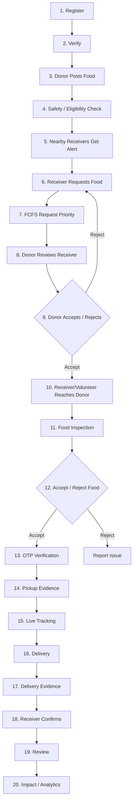
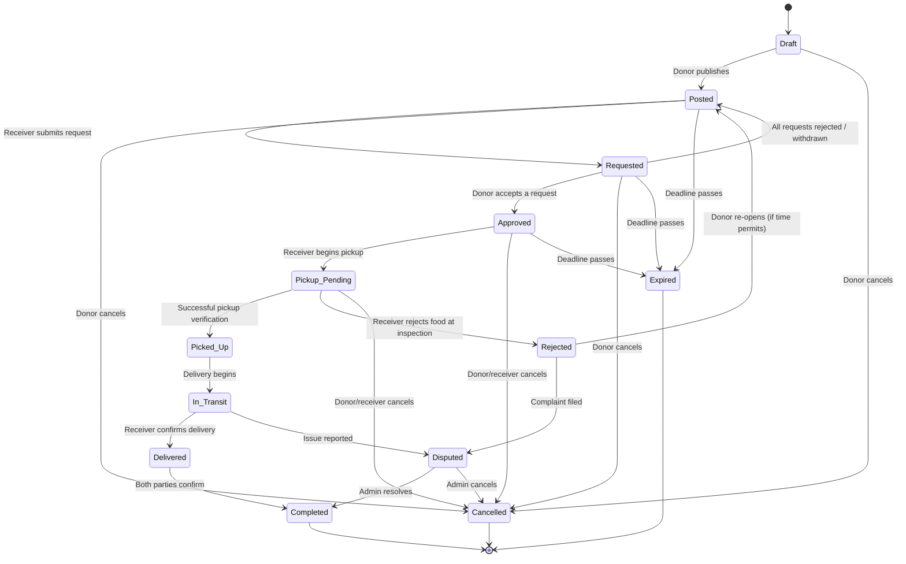
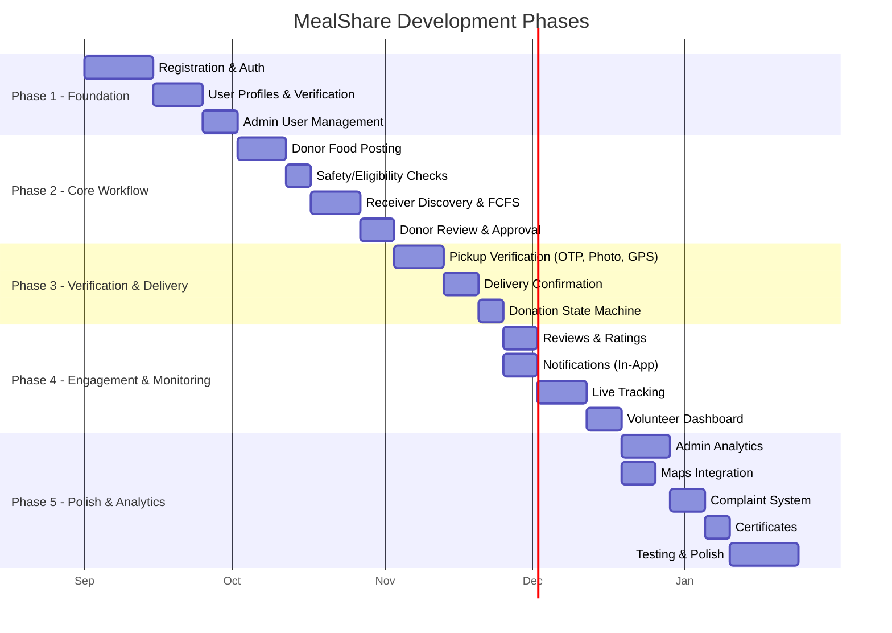

# MealShare — Product Requirements Document v1.0

| Field               | Value                                                    |
|---------------------|----------------------------------------------------------|
| **Document Title**  | MealShare PRD v1.0                                       |
| **Version**         | 1.0                                                      |
| **Date**            | 2026-08-29                                               |
| **Author**          | Product & Architecture Team                              |
| **Status**          | Draft — Pending Stakeholder Approval                     |
| **Project Type**    | MCA Capstone Project                                     |
| **Classification**  | Internal / Academic                                      |

---

## Table of Contents

1. [Product Vision & Overview](#1-product-vision--overview)
2. [Users & Actors](#2-users--actors)
3. [Core Donation Workflow](#3-core-donation-workflow)
4. [Feature Requirements](#4-feature-requirements)
   - 4.1 [Registration & Onboarding](#41-registration--onboarding)
   - 4.2 [Donor Flow — Food Posting](#42-donor-flow--food-posting)
   - 4.3 [Receiver Discovery & FCFS](#43-receiver-discovery--fcfs)
   - 4.4 [Donor Review & Approval](#44-donor-review--approval)
   - 4.5 [Food Safety Model](#45-food-safety-model)
   - 4.6 [Pickup Verification](#46-pickup-verification)
   - 4.7 [Live Tracking](#47-live-tracking)
   - 4.8 [Delivery Confirmation](#48-delivery-confirmation)
   - 4.9 [Reviews & Reputation](#49-reviews--reputation)
   - 4.10 [Volunteer Functionality](#410-volunteer-functionality)
   - 4.11 [Notifications](#411-notifications)
   - 4.12 [Admin Functionality](#412-admin-functionality)
   - 4.13 [AI / ML — Demand Prediction](#413-ai--ml--demand-prediction)
   - 4.14 [Smart Matching](#414-smart-matching)
   - 4.15 [Route / Delivery Optimization](#415-route--delivery-optimization)
5. [Business & Platform Rules](#5-business--platform-rules)
6. [Donation Lifecycle State Machine](#6-donation-lifecycle-state-machine)
7. [Non-Functional Requirements](#7-non-functional-requirements)
8. [Success Metrics](#8-success-metrics)
9. [MVP vs. Future Scope](#9-mvp-vs-future-scope)
10. [Final End-to-End Workflow](#10-final-end-to-end-workflow)
11. [Open Decisions Before SRS](#11-open-decisions-before-srs)
12. [Recommended Next Steps](#12-recommended-next-steps)

---

## 1. Product Vision & Overview

### 1.1 Vision Statement

> *Don't waste food when someone can benefit from it.*

MealShare is a surplus-food redistribution platform that connects people and organizations with usable surplus food to people and organizations that need it. It provides a structured, transparent, and trust-driven workflow that enables safe, verified, and accountable food donation — from posting through pickup, delivery, and confirmation.

### 1.2 Problem Statement

Significant quantities of edible food are discarded daily by individuals (after gatherings, parties, events), hotels, restaurants, caterers, hostels, and event organizers. Simultaneously, NGOs, shelters, old-age homes, and underserved communities face persistent food insecurity. There is no widely adopted, structured platform that:

- Enables donors to post surplus food quickly and with appropriate safety information.
- Alerts eligible nearby receivers in real time.
- Provides a transparent, verifiable pickup-and-delivery workflow.
- Builds trust through verification, reputation, evidence, and accountability.

### 1.3 Product Scope

MealShare addresses the full lifecycle of a surplus-food donation:

| Phase           | Coverage                                                       |
|-----------------|----------------------------------------------------------------|
| Discovery       | Donor posts food → nearby receivers are alerted                |
| Matching        | FCFS priority with donor-approval authority                    |
| Verification    | Pickup OTP, food inspection, evidence capture                  |
| Delivery        | Live tracking, delivery evidence, receiver confirmation        |
| Accountability  | Reviews, reputation, complaints, admin investigation           |
| Insights        | Operational analytics and (future) demand prediction           |

### 1.4 Target Users

- **Donors**: Individuals, hotels, restaurants, caterers, hostels, event organizers.
- **Receivers**: NGOs, shelters, old-age homes, communities, and individual volunteers who know people/families in need.
- **Admins**: Platform operators responsible for verification, monitoring, and enforcement.

### 1.5 Out of Scope

The following are explicitly **not** in scope for this PRD unless stated otherwise:

- Monetary transactions or payment processing.
- Laboratory food testing or certified food-safety inspection services.
- Continuous background surveillance of users.
- Meal-kit or grocery delivery services.
- Social networking or general messaging features beyond donation coordination.

---

## 2. Users & Actors

### 2.1 Role Definitions

MealShare has **four primary roles**. A single platform account maps to exactly one primary role.

> [!IMPORTANT]
> **Open Decision OD-01**: Whether a single user account can hold multiple roles (e.g., an individual acting as both Donor and Volunteer) must be finalized before SRS. See [Section 11](#11-open-decisions-before-srs).

---

#### 2.1.1 Donor

| Attribute        | Detail                                                              |
|------------------|---------------------------------------------------------------------|
| **ID**           | `ROLE-DONOR`                                                        |
| **Description**  | A person or organization that has usable surplus food and wishes to donate it. |
| **Examples**     | Individual/person, hotel, restaurant, caterer, hostel, event organizer. |
| **Use Case**     | An individual has a party at home. 20 people attended. 10–15 people's worth of usable food remains. The individual posts the surplus food on MealShare. |

**Profile Information:**

- Name / Organization name
- Contact information
- Address / Location
- Type (Individual / Organization)
- Organization details (if applicable): registration number, photos, documents
- Verification status
- Donation history
- Ratings & reputation
- Accepted Food Donation Policy status

---

#### 2.1.2 Receiver — Organization

| Attribute        | Detail                                                              |
|------------------|---------------------------------------------------------------------|
| **ID**           | `ROLE-RECV-ORG`                                                     |
| **Description**  | An organization that receives donated food for distribution to beneficiaries. |
| **Examples**     | NGO, shelter, old-age home, community kitchen, other eligible organizations. |

**Profile Information:**

- Organization name
- Type / Category
- Registration / license information
- Contact information
- Address / Service area
- Supporting photos and documents (so donors can have confidence the organization is genuine)
- Verification status
- Request & delivery history
- Ratings & reputation
- Number of beneficiaries served (self-reported)

---

#### 2.1.3 Receiver — Volunteer

| Attribute        | Detail                                                              |
|------------------|---------------------------------------------------------------------|
| **ID**           | `ROLE-RECV-VOL`                                                     |
| **Description**  | An individual who knows people or families in need and can request and collect food for them. |

**Profile Information:**

- Name
- Profession / "Who I am"
- About (self-description)
- Service area
- Relevant verification information
- Delivery / request history
- Ratings
- Completed donation / delivery count
- Certificates (milestone-based, configurable)

---

#### 2.1.4 Admin

| Attribute        | Detail                                                              |
|------------------|---------------------------------------------------------------------|
| **ID**           | `ROLE-ADMIN`                                                        |
| **Description**  | Platform administrator responsible for oversight, verification, and enforcement. |

**Capabilities:**

- User verification & management
- Platform monitoring
- Complaint & report handling
- Suspicious-account investigation
- Donation monitoring
- Analytics & reporting
- Account restrictions & suspensions

---

### 2.2 Role Summary Matrix

| Capability                     | Donor | Recv-Org | Recv-Vol | Admin |
|--------------------------------|:-----:|:--------:|:--------:|:-----:|
| Post surplus food              | ✅    |          |          |       |
| Request donation               |       | ✅       | ✅       |       |
| Inspect & accept/reject food   |       | ✅       | ✅       |       |
| Pickup food                    |       | ✅       | ✅       |       |
| Deliver to beneficiaries       |       | ✅       | ✅       |       |
| Review counterparty            | ✅    | ✅       | ✅       |       |
| View/manage users              |       |          |          | ✅    |
| Verify organizations           |       |          |          | ✅    |
| Investigate complaints         |       |          |          | ✅    |
| View analytics                 |       |          |          | ✅    |
| Restrict/suspend accounts      |       |          |          | ✅    |

---

## 3. Core Donation Workflow

The approved end-to-end workflow is the **source of truth** for all feature design.



> [!IMPORTANT]
> **FCFS determines the priority/order of incoming requests but does NOT automatically force the donor to accept any receiver.** The donor retains final approval authority after reviewing the receiver's profile.

---

## 4. Feature Requirements

### 4.1 Registration & Onboarding

| Field         | Value                       |
|---------------|-----------------------------|
| **Req ID**    | `FR-REG-001`                |
| **Purpose**   | Allow users to create accounts and establish their role on the platform. |
| **Users**     | All roles                   |

#### Description

New users register on MealShare by providing identity information and selecting their role. The platform collects role-specific profile data and routes the account through a verification workflow before the user can participate in donations.

#### Expected Behavior

1. User selects role: Donor, Receiver (Organization), Receiver (Volunteer).
2. User provides required profile information per role (see [Section 2.1](#21-role-definitions)).
3. System validates input and creates an account in `Pending Verification` status.
4. Admin reviews and verifies the account (or automated checks are applied — see open decision OD-02).
5. Upon verification, account status transitions to `Verified`.
6. Donor accounts must accept the **MealShare Food Donation Policy** before posting.

#### Business Rules

| Rule ID       | Rule                                                                  |
|---------------|-----------------------------------------------------------------------|
| `BR-REG-01`   | All fields marked as mandatory for a role must be provided before account creation. |
| `BR-REG-02`   | Organization receivers must upload supporting photos/documents.        |
| `BR-REG-03`   | Accounts in `Pending Verification` status cannot post food or request donations. |
| `BR-REG-04`   | Admin accounts are created through a separate administrative process (not self-registration). |
| `BR-REG-05`   | Donor must accept the Food Donation Policy before the first posting (tracked with timestamp). |

#### Edge Cases

- User attempts to register with an email/phone already associated with an existing account.
- User uploads invalid or unreadable documents.
- User abandons registration midway (partial profile).
- Admin rejects verification — user is notified with reason and can resubmit.

#### Acceptance Criteria

- [ ] User can register with role selection and role-specific fields.
- [ ] System prevents duplicate registrations on the same identifier.
- [ ] Organization receiver accounts include document/photo upload.
- [ ] Unverified accounts are blocked from posting or requesting.
- [ ] Donor is prompted to accept Food Donation Policy before first post.
- [ ] Admin can view pending verification requests.

---

### 4.2 Donor Flow — Food Posting

| Field         | Value                       |
|---------------|-----------------------------|
| **Req ID**    | `FR-DON-001`                |
| **Purpose**   | Enable donors to post information about surplus food available for donation. |
| **Users**     | Donor                       |

#### Description

A verified donor creates a food donation listing by providing structured information about the surplus food. The listing passes through a basic safety/eligibility check before being published and made visible to nearby receivers.

#### Donation Information Fields

| Field                   | Required | Notes                                          |
|-------------------------|:--------:|-------------------------------------------------|
| Food type               | Yes      | Category or free-text description               |
| Quantity / servings     | Yes      | Estimated number of people the food can serve   |
| Preparation date/time   | Yes      | When the food was prepared                      |
| Storage condition       | Yes      | E.g., refrigerated, room temperature, frozen    |
| Consumption deadline    | Yes      | Donor's stated deadline for safe consumption    |
| Vegetarian / Non-veg    | Yes      | Dietary classification                          |
| Known allergens         | Conditional | Required if known; "None known" option available |
| Pickup location         | Yes      | Address or map pin                              |
| Food photograph         | Yes      | At least one photo captured through the app     |
| Additional notes        | No       | Any other relevant information                  |

#### Expected Behavior

1. Donor navigates to "Post Food" screen.
2. Donor fills in all required fields.
3. Donor captures or uploads a food photograph.
4. Donor reviews the listing.
5. System runs a **basic software eligibility check** (see [Section 4.5](#45-food-safety-model)).
6. If the check passes, the donation status transitions to `Posted`.
7. If the check fails, the donor is notified with the reason and can edit and resubmit.
8. Nearby eligible receivers are alerted (see [Section 4.3](#43-receiver-discovery--fcfs)).

#### Business Rules

| Rule ID       | Rule                                                                  |
|---------------|-----------------------------------------------------------------------|
| `BR-DON-01`   | Only verified donors who have accepted the Food Donation Policy can post. |
| `BR-DON-02`   | Consumption deadline must be in the future at the time of posting.     |
| `BR-DON-03`   | At least one food photograph is mandatory.                             |
| `BR-DON-04`   | Donation can be saved as `Draft` before publishing.                    |
| `BR-DON-05`   | Donor can edit the listing while status is `Draft` or `Posted` (before any request is accepted). |
| `BR-DON-06`   | Donor can cancel the listing at any time before pickup is completed.   |
| `BR-DON-07`   | Listings where the consumption deadline has passed automatically transition to `Expired`. |

#### Edge Cases

- Donor posts food with a consumption deadline less than a configurable minimum threshold in the future — system warns but may allow (see open decision OD-03).
- Donor loses internet connectivity mid-post — system should save draft locally.
- No eligible receivers are found nearby — donation remains `Posted` until expiry or cancellation.
- Donor attempts to post multiple donations simultaneously — allowed.

#### Acceptance Criteria

- [ ] Donor can create a food listing with all required fields.
- [ ] Photo capture/upload is functional.
- [ ] Basic eligibility check runs before publishing.
- [ ] Listing transitions through correct states (Draft → Posted → Expired).
- [ ] Donor can edit or cancel a posted listing.
- [ ] Listings auto-expire when consumption deadline passes.

---

### 4.3 Receiver Discovery & FCFS

| Field         | Value                       |
|---------------|-----------------------------|
| **Req ID**    | `FR-DISC-001`               |
| **Purpose**   | Alert nearby eligible receivers about available donations and manage request ordering. |
| **Users**     | Receiver (Organization), Receiver (Volunteer) |

#### Description

When a donor publishes a food listing, the platform identifies eligible receivers within a configurable geographic radius and sends them a notification. Receivers can view the donation details and submit a request. Requests are timestamped and ordered by **First-Come, First-Served (FCFS)** priority.

#### Expected Behavior

1. Donation transitions to `Posted`.
2. System identifies eligible receivers based on:
   - Geographic proximity (within configurable radius)
   - Verification status (must be verified)
   - Account status (must be active, not suspended)
3. Eligible receivers receive a notification with summary information.
4. Receiver views the full donation listing.
5. Receiver submits a request.
6. System timestamps the request and adds it to the FCFS-ordered queue.
7. Donor is notified of the incoming request.

#### Business Rules

| Rule ID        | Rule                                                                  |
|----------------|-----------------------------------------------------------------------|
| `BR-DISC-01`   | Only verified, active receivers within the configured radius receive alerts. |
| `BR-DISC-02`   | Requests are strictly ordered by submission timestamp (FCFS).          |
| `BR-DISC-03`   | FCFS determines request **priority/order** — it does NOT auto-accept any receiver. |
| `BR-DISC-04`   | A receiver can submit at most one request per donation listing.        |
| `BR-DISC-05`   | A receiver can withdraw their request before the donor makes a decision. |
| `BR-DISC-06`   | If the donation is cancelled or expired, all pending requests are automatically voided. |
| `BR-DISC-07`   | The configurable radius is a platform setting managed by Admin.        |

#### Edge Cases

- No receivers are within range — donation stays `Posted`, no alerts sent.
- Multiple requests arrive within the same second — timestamp precision should be sufficient (milliseconds recommended).
- Receiver submits a request after the consumption deadline has passed — system rejects the request.
- Donor cancels donation while requests are pending — all requesters are notified.

#### Acceptance Criteria

- [ ] Nearby eligible receivers receive notifications when a donation is posted.
- [ ] Receiver can view full donation details.
- [ ] Receiver can submit a request.
- [ ] Requests are ordered by timestamp (FCFS).
- [ ] Only one request per receiver per donation.
- [ ] Receiver can withdraw a pending request.
- [ ] Pending requests are voided on cancellation/expiry.

---

### 4.4 Donor Review & Approval

| Field         | Value                       |
|---------------|-----------------------------|
| **Req ID**    | `FR-APPR-001`               |
| **Purpose**   | Allow the donor to review receiver profiles and approve or reject requests. |
| **Users**     | Donor                       |

#### Description

After one or more receivers have requested a donation, the donor reviews the FCFS-ordered queue. For each requester, the donor can examine the receiver's profile information, verification status, activity history, and ratings. The donor then decides to **accept** or **reject** each request.

#### Information Visible to Donor

- Receiver name and type (Organization / Volunteer)
- Verification status
- Supporting photos/documents (for organizations)
- Previous donation/delivery history
- Ratings and reputation score
- Completed donation/delivery count
- Complaint history (summary)
- Request timestamp (FCFS position)

#### Expected Behavior

1. Donor opens the request queue for a specific donation.
2. Requests are displayed in FCFS order.
3. Donor selects a request to view the receiver's full profile.
4. Donor chooses **Accept** or **Reject**.
5. If **Accept**: Donation status transitions to `Approved`. Accepted receiver is notified. Remaining pending requests are either voided or waitlisted (see open decision OD-04).
6. If **Reject**: The specific request is marked as rejected. The receiver is notified. The donation remains available for other requests (if any exist or new ones arrive).

#### Business Rules

| Rule ID        | Rule                                                                  |
|----------------|-----------------------------------------------------------------------|
| `BR-APPR-01`   | Donor has full authority to accept or reject any request regardless of FCFS position. |
| `BR-APPR-02`   | FCFS determines the **display order** for donor review, not automatic acceptance. |
| `BR-APPR-03`   | Only one request can be accepted per donation at a time.               |
| `BR-APPR-04`   | If the accepted receiver fails to complete pickup within a configurable window, the donor may re-open the donation to remaining/new requests. |
| `BR-APPR-05`   | Donor can provide a reason when rejecting (optional but encouraged).   |

#### Edge Cases

- Donor does not respond to any request before the consumption deadline — donation expires, all requests voided.
- Donor accepts a request, but the receiver becomes unresponsive — donation can be re-opened.
- All requests are rejected — donation returns to `Posted` state if time permits.

#### Acceptance Criteria

- [ ] Donor sees requests in FCFS order.
- [ ] Donor can view full receiver profile from the request queue.
- [ ] Donor can accept or reject each request individually.
- [ ] Accepted receiver is notified immediately.
- [ ] Rejected receiver is notified.
- [ ] Only one active acceptance per donation.
- [ ] Donation can be re-opened if pickup is not completed within the configured window.

---

### 4.5 Food Safety Model

| Field         | Value                       |
|---------------|-----------------------------|
| **Req ID**    | `FR-SAFE-001`               |
| **Purpose**   | Establish a layered risk-control model for food safety without claiming guaranteed safety. |
| **Users**     | All roles                   |

#### Critical Disclaimer

> [!CAUTION]
> **MealShare does NOT guarantee that donated food is safe.** MealShare provides a layered risk-control model that combines donor declarations, mandatory information, receiver inspection, and accountability mechanisms. MealShare is **not** a laboratory food-testing platform.

#### Layered Safety Model

The following layers collectively manage food-safety risk:

| Layer | Control                              | Type              | Description                                                  |
|:-----:|--------------------------------------|-------------------|--------------------------------------------------------------|
| 1     | Food Donation Policy                 | Policy            | Donor agrees to policy terms before posting.                 |
| 2     | Mandatory food information           | Software          | Required fields ensure structured data is captured.          |
| 3     | Basic eligibility/safety rules       | Software          | Automated checks (e.g., consumption deadline in the future). |
| 4     | Receiver visibility of information   | Transparency      | Receiver sees all food information before requesting.        |
| 5     | Receiver inspection at pickup        | Human inspection   | Receiver physically inspects food before accepting.          |
| 6     | Accept/reject option at pickup       | Human decision     | Receiver can refuse food they deem unsuitable.               |
| 7     | OTP verification                     | Software          | Confirms identity and intentional handover.                  |
| 8     | Food/pickup evidence                 | Software + Human  | Photographs captured through the app.                        |
| 9     | GPS + timestamp                      | Software          | Location and time recorded automatically.                    |
| 10    | Complaint/reporting mechanism        | Software + Admin  | Any party can report food-safety concerns.                   |
| 11    | Donor reputation/history             | Software          | Track record informs receiver decisions.                     |
| 12    | Admin investigation                  | Admin + Human     | Admin can investigate complaints and take action.            |

#### Explicit Distinctions

| Category                         | What It Means in MealShare                                 |
|----------------------------------|------------------------------------------------------------|
| **Software eligibility checks**  | Automated validations: required fields present, consumption deadline valid, basic category rules. |
| **Human inspection**             | Receiver physically examines food at pickup. This is the receiver's judgment, not a certified inspection. |
| **Scientific/laboratory testing**| NOT provided by MealShare. If added in the future, it would be a separate, explicitly scoped feature. |

#### Donor Declaration

The donor must declare:
- The information provided is truthful.
- The food is, to the best of the donor's knowledge, suitable for donation.
- The food has been handled and stored as described.

This declaration is recorded with a timestamp.

#### Receiver Inspection at Pickup

At the point of pickup, the receiver/volunteer:
1. Physically inspects the food.
2. Verifies that it matches the listed description (type, quantity, condition).
3. Makes an independent judgment on suitability.

If the receiver believes the food is **unsuitable**:
- **Reject** the donation.
- **Report** the issue through the platform.
- **Record** the reason for rejection.

#### Business Rules

| Rule ID        | Rule                                                                  |
|----------------|-----------------------------------------------------------------------|
| `BR-SAFE-01`   | MealShare does not claim to guarantee food safety. All platform communications must reflect this. |
| `BR-SAFE-02`   | The platform does NOT enforce a universal time-based food safety rule (e.g., "2–3 hours"). Food safety depends on food type, handling, storage, and applicable regulations. |
| `BR-SAFE-03`   | The consumption deadline is set by the donor and is a required field. |
| `BR-SAFE-04`   | The receiver always has the right to reject food at the point of inspection. |
| `BR-SAFE-05`   | Food-safety complaints trigger admin investigation.                    |
| `BR-SAFE-06`   | Repeated food-safety complaints against a donor may result in restriction or suspension (see [Section 4.9](#49-reviews--reputation)). |

> [!WARNING]
> **Open Decision OD-05**: The specific source and scope of food-safety rules to be implemented as software checks must be finalized with legal/compliance review before SRS. See [Section 11](#11-open-decisions-before-srs).

#### Acceptance Criteria

- [ ] Donor must accept the Food Donation Policy (with timestamp) before posting.
- [ ] All mandatory food information fields are enforced.
- [ ] Basic software eligibility checks run before publishing.
- [ ] Receiver can view all food information before requesting.
- [ ] Receiver can reject food at pickup with a recorded reason.
- [ ] Complaint mechanism is available for food-safety concerns.
- [ ] Admin can investigate food-safety complaints.
- [ ] No platform UI or communication claims MealShare guarantees food safety.

---

### 4.6 Pickup Verification

| Field         | Value                       |
|---------------|-----------------------------|
| **Req ID**    | `FR-PICK-001`               |
| **Purpose**   | Verify and record the food handover at the donor's location.         |
| **Users**     | Donor, Receiver (Organization / Volunteer)                           |

#### Description

When the accepted receiver or volunteer arrives at the donor's location, a structured pickup verification process is executed. This ensures both parties confirm the handover and that evidence is captured for accountability.

#### Expected Behavior (Step-by-Step)

1. **Arrive**: Receiver/volunteer arrives at the donor's pickup location.
2. **Inspect Food**: Receiver physically inspects the food.
3. **Accept or Reject**:
   - **Accept**: Proceed to OTP verification.
   - **Reject**: Receiver reports the issue, records the reason. Donation status transitions to `Disputed` or returns to `Posted` (see open decision OD-06).
4. **OTP Verification**: Donor provides a platform-generated OTP to the receiver. Receiver enters the OTP in the app. System validates the OTP.
5. **Capture Evidence**: Receiver captures a food/pickup photograph **through the MealShare app** (not from gallery — to ensure authenticity).
6. **Record GPS**: System automatically records the GPS coordinates of the pickup.
7. **Record Timestamp**: System automatically records the pickup timestamp.
8. **Mark Pickup Completed**: Donation status transitions to `Picked Up`.

#### Business Rules

| Rule ID        | Rule                                                                  |
|----------------|-----------------------------------------------------------------------|
| `BR-PICK-01`   | OTP is generated by the platform and shared with the donor (via the app). |
| `BR-PICK-02`   | OTP has a configurable expiry time.                                    |
| `BR-PICK-03`   | Photos must be captured through the app camera (not uploaded from gallery). |
| `BR-PICK-04`   | GPS location is recorded automatically at the time of pickup confirmation. |
| `BR-PICK-05`   | Pickup must be completed before live tracking begins.                  |
| `BR-PICK-06`   | If the receiver rejects food at inspection, the rejection is logged with reason and evidence. |

#### Edge Cases

- OTP expires before the receiver enters it — system can regenerate OTP.
- Receiver's device has no GPS signal — system should warn and log the issue; pickup can proceed with a manual location note (see open decision OD-07).
- Receiver's camera is malfunctioning — pickup should not proceed without photo evidence unless an exception process is defined.
- Donor is not available when the receiver arrives — donation status can be updated to indicate a failed pickup attempt.

#### Acceptance Criteria

- [ ] OTP is generated and displayed to the donor.
- [ ] Receiver can enter and validate OTP.
- [ ] Photo capture through app camera is enforced.
- [ ] GPS coordinates are recorded on pickup confirmation.
- [ ] Timestamp is recorded on pickup confirmation.
- [ ] Receiver can reject food with reason.
- [ ] Donation transitions to `Picked Up` on successful verification.

---

### 4.7 Live Tracking

| Field         | Value                       |
|---------------|-----------------------------|
| **Req ID**    | `FR-TRACK-001`              |
| **Purpose**   | Enable the donor to track the donation during active delivery.       |
| **Users**     | Donor, Receiver (Organization / Volunteer)                           |

#### Description

After a successful pickup, the platform enables live location tracking so the donor can monitor the donation's journey. Tracking is active **only** during the delivery phase and stops when delivery is completed.

#### Expected Behavior

1. Pickup is confirmed (status = `Picked Up`).
2. Donation status transitions to `In Transit`.
3. Receiver/volunteer's location is shared with the donor in real time (or near-real-time).
4. Donor can view the delivery progress on a map.
5. When the receiver confirms delivery, tracking stops.
6. Donation status transitions to `Delivered`.

#### Business Rules

| Rule ID         | Rule                                                                 |
|-----------------|----------------------------------------------------------------------|
| `BR-TRACK-01`   | Live tracking is activated **only** after successful pickup confirmation. |
| `BR-TRACK-02`   | Tracking is active **only** during the `In Transit` state.           |
| `BR-TRACK-03`   | Tracking stops automatically when delivery is confirmed or donation is cancelled/disputed. |
| `BR-TRACK-04`   | The platform does NOT perform continuous background tracking of volunteers outside active deliveries. |
| `BR-TRACK-05`   | Location sharing requires the receiver/volunteer's explicit consent (granted at role acceptance or per-delivery). |

#### Edge Cases

- Receiver's device loses connectivity — last known location is displayed; donor is informed of the connectivity gap.
- Receiver disables location services mid-delivery — system notifies the donor and logs the event.
- Delivery takes an unexpectedly long time — configurable alert threshold for the donor.

> [!NOTE]
> **Open Decision OD-08**: The exact tracking implementation (e.g., WebSocket, periodic polling, third-party SDK) and update frequency must be finalized during architecture design.

#### Acceptance Criteria

- [ ] Live tracking activates only after pickup confirmation.
- [ ] Donor can view receiver/volunteer location on a map during `In Transit`.
- [ ] Tracking stops on delivery confirmation.
- [ ] No background tracking outside of active deliveries.
- [ ] Connectivity loss is handled gracefully.

---

### 4.8 Delivery Confirmation

| Field         | Value                       |
|---------------|-----------------------------|
| **Req ID**    | `FR-DELV-001`               |
| **Purpose**   | Record and confirm the delivery of food to the final destination/beneficiaries. |
| **Users**     | Receiver (Organization / Volunteer)                                  |

#### Description

When the receiver/volunteer reaches the destination and distributes the food, the delivery is formally recorded through the platform. Evidence is captured, quantity is confirmed, and the donation lifecycle moves to completion.

#### Expected Behavior

1. Receiver/volunteer arrives at the delivery destination.
2. Food is distributed to beneficiaries.
3. Receiver uploads **delivery evidence** (photo through the app).
4. Receiver confirms the **quantity received/distributed**.
5. Receiver marks the donation as **Completed**.
6. Donation status transitions to `Completed`.
7. Both parties are notified of successful completion.

#### Example

> A volunteer collects 20 meals from a donor and delivers them to a group of families in need. The volunteer captures a delivery photo, confirms "20 meals delivered," and marks the donation as completed.

#### Business Rules

| Rule ID        | Rule                                                                  |
|----------------|-----------------------------------------------------------------------|
| `BR-DELV-01`   | Delivery evidence (photo) is mandatory for completion.                 |
| `BR-DELV-02`   | Quantity confirmation is required.                                     |
| `BR-DELV-03`   | Only the accepted receiver/volunteer can mark the donation as completed. |
| `BR-DELV-04`   | Delivery confirmation triggers the review phase.                       |
| `BR-DELV-05`   | If the actual quantity delivered differs significantly from the posted quantity, the system should flag this for potential review. |

#### Edge Cases

- Receiver delivers only a partial quantity (e.g., some food was unsuitable upon closer inspection) — partial delivery should be recordable.
- Receiver's camera is unavailable — see edge case handling in pickup verification.
- Delivery destination differs from receiver's registered address — acceptable, as volunteers deliver to beneficiaries elsewhere.

#### Acceptance Criteria

- [ ] Receiver can upload delivery photo through the app.
- [ ] Receiver can confirm quantity delivered.
- [ ] Receiver can mark donation as completed.
- [ ] Donation transitions to `Completed` status.
- [ ] Both donor and receiver are notified of completion.
- [ ] Partial delivery is recordable with explanation.

---

### 4.9 Reviews & Reputation

| Field         | Value                       |
|---------------|-----------------------------|
| **Req ID**    | `FR-REV-001`                |
| **Purpose**   | Build trust and accountability through mutual reviews and a reputation system. |
| **Users**     | Donor, Receiver (Organization / Volunteer)                           |

#### Description

After a donation is completed, both parties can review each other. Reviews, combined with activity history and complaint records, form a reputation profile that informs future interactions.

#### Review Mechanism

- **Donor reviews Receiver**: Rating + optional comment.
- **Receiver reviews Donor**: Rating + optional comment.
- **Either party can report issues** at any time during or after the process.

#### Reputation Components

| Component             | Description                                              |
|-----------------------|----------------------------------------------------------|
| Successful donations  | Count of completed donations                             |
| Ratings               | Average rating from counterparties                       |
| Complaints            | Number and severity of complaints                        |
| Completion rate       | Percentage of accepted donations that reached completion |
| Verified status       | Whether the account is admin-verified                    |

#### Escalation Path

Repeated or serious complaints may trigger the following actions (in escalating order):

1. **Warning** — Notified to the user.
2. **Additional verification** — Admin requests further documentation.
3. **Restriction** — Reduced platform privileges (e.g., cannot post new donations).
4. **Suspension** — Account temporarily or permanently suspended.
5. **Admin investigation** — Detailed review of evidence, history, and complaints.

#### Business Rules

| Rule ID       | Rule                                                                  |
|---------------|-----------------------------------------------------------------------|
| `BR-REV-01`   | Reviews can only be submitted after a donation reaches `Completed` or `Disputed` status. |
| `BR-REV-02`   | Each party can submit only one review per donation.                    |
| `BR-REV-03`   | Reviews are visible on the user's public profile.                      |
| `BR-REV-04`   | Reported issues are routed to Admin for investigation.                 |
| `BR-REV-05`   | Escalation thresholds (number of complaints before action) are configurable by Admin. |
| `BR-REV-06`   | Users can respond to reviews left about them (rebuttal).               |

#### Acceptance Criteria

- [ ] Donor and receiver can submit ratings and optional comments after completion.
- [ ] Reputation score is calculated and displayed on profiles.
- [ ] Issues can be reported at any stage.
- [ ] Admin receives reports for investigation.
- [ ] Escalation actions (warning → suspension) are functional.
- [ ] Reviews are displayed on public profiles.

---

### 4.10 Volunteer Functionality

| Field         | Value                       |
|---------------|-----------------------------|
| **Req ID**    | `FR-VOL-001`                |
| **Purpose**   | Provide volunteers with a dedicated dashboard and recognition system. |
| **Users**     | Receiver — Volunteer                                                 |

#### Volunteer Dashboard

The volunteer dashboard should display:

| Dashboard Item           | Description                                          |
|--------------------------|------------------------------------------------------|
| Completed pickups        | Total number of successful food pickups              |
| Completed deliveries     | Total number of successful deliveries                |
| Meals delivered          | Cumulative count of meals delivered                  |
| Successful donations     | Count of fully completed donation cycles             |
| Ratings                  | Average rating and rating history                    |
| Impact statistics        | Summary of contribution (meals, people served, etc.) |
| Certificates             | Downloadable milestone certificates                  |
| Milestones               | Progress toward next milestone                       |

#### Certificate Functionality

Certificates recognize milestones such as a configurable number of successful completed deliveries.

> [!NOTE]
> **Certificate thresholds are configurable by Admin.** Do not hardcode specific numbers (e.g., "50 deliveries"). The system should allow Admin to define milestone levels and their corresponding certificate templates.

#### Business Rules

| Rule ID       | Rule                                                                  |
|---------------|-----------------------------------------------------------------------|
| `BR-VOL-01`   | Dashboard metrics update in real time (or near-real-time) after each completed delivery. |
| `BR-VOL-02`   | Certificates are generated automatically when a configurable milestone is reached. |
| `BR-VOL-03`   | Certificates include: volunteer name, milestone, date, and a unique certificate ID. |
| `BR-VOL-04`   | Milestone thresholds are managed by Admin.                             |
| `BR-VOL-05`   | Certificates are downloadable (PDF or image format).                   |

#### Acceptance Criteria

- [ ] Volunteer dashboard displays all specified metrics.
- [ ] Metrics are accurate and updated after each activity.
- [ ] Certificates are auto-generated at configurable milestones.
- [ ] Certificates are downloadable.
- [ ] Admin can configure milestone thresholds.

---

### 4.11 Notifications

| Field         | Value                       |
|---------------|-----------------------------|
| **Req ID**    | `FR-NOTIF-001`              |
| **Purpose**   | Deliver timely, event-driven notifications to all users.             |
| **Users**     | All roles                   |

#### Description

Notifications are triggered by platform events and delivered to the relevant user(s). All notifications are **event-driven** — they are sent in response to specific state transitions or actions, not on a polling or scheduled basis.

#### Notification Matrix

##### Donor Notifications

| Event                        | Trigger                                    |
|------------------------------|--------------------------------------------|
| New request received         | A receiver requests the donor's donation   |
| Request accepted/rejected    | Donor's own action confirmation            |
| Pickup started               | Receiver begins navigation to donor        |
| Donation picked up           | Pickup verification completed              |
| Donation in transit          | Live tracking begins                       |
| Donation delivered           | Delivery confirmed                         |
| Complaint/review received    | Counterparty submits review or report      |

##### Receiver (Organization) Notifications

| Event                        | Trigger                                    |
|------------------------------|--------------------------------------------|
| Nearby donation available    | New donation posted within radius           |
| Request status update        | Request state changes                      |
| Donor approval               | Donor accepts/rejects the request          |
| Pickup reminder              | Configurable reminder before pickup window |
| Delivery updates             | Status transitions during delivery         |

##### Volunteer Notifications

| Event                        | Trigger                                    |
|------------------------------|--------------------------------------------|
| Nearby/eligible opportunity  | New donation posted within service area    |
| Request approval             | Donor accepts/rejects the request          |
| Pickup information           | Approved donation details and location     |
| Delivery reminder            | Configurable reminder                      |

##### Admin Notifications

| Event                        | Trigger                                    |
|------------------------------|--------------------------------------------|
| New verification request     | User registers and submits for verification|
| Complaint received           | Any user files a report/complaint          |
| Suspicious activity flagged  | System or user flags suspicious behavior   |

#### Business Rules

| Rule ID        | Rule                                                                 |
|----------------|----------------------------------------------------------------------|
| `BR-NOTIF-01`  | All notifications are event-driven.                                  |
| `BR-NOTIF-02`  | Users can configure notification preferences (e.g., enable/disable specific notification types). |
| `BR-NOTIF-03`  | Critical notifications (e.g., OTP, pickup confirmation) cannot be disabled. |
| `BR-NOTIF-04`  | Notifications are delivered via in-app notifications. Push notifications and email/SMS are future enhancements (see open decision OD-09). |

#### Acceptance Criteria

- [ ] Notifications are sent for all events listed above.
- [ ] Notifications are event-driven, not polled.
- [ ] Users receive in-app notifications.
- [ ] Notification preferences are configurable (non-critical notifications).
- [ ] Critical notifications are always delivered.

---

### 4.12 Admin Functionality

| Field         | Value                       |
|---------------|-----------------------------|
| **Req ID**    | `FR-ADMIN-001`              |
| **Purpose**   | Provide comprehensive platform management tools for administrators.  |
| **Users**     | Admin                       |

#### 4.12.1 User Management

| Feature                    | Description                                               |
|----------------------------|-----------------------------------------------------------|
| View users                 | List and search all registered users by role, status, etc.|
| Verify organizations       | Review submitted documents and approve/reject verification|
| Review profiles            | View detailed user profiles and activity history          |
| Restrict/suspend accounts  | Apply warnings, restrictions, or suspensions              |

#### 4.12.2 Donation Management

| Feature                    | Description                                               |
|----------------------------|-----------------------------------------------------------|
| View donations             | List and search all donations by status, date, location   |
| Monitor active donations   | Real-time view of in-progress donations                   |
| Monitor expired/cancelled  | Review donations that expired or were cancelled           |
| Investigate suspicious     | Flag and review donations with anomalies                  |

#### 4.12.3 Food Safety / Complaints

| Feature                    | Description                                               |
|----------------------------|-----------------------------------------------------------|
| View reports               | List all filed complaints and reports                     |
| Investigate complaints     | Review evidence, history, and donor declarations          |
| Review donation history    | Access full audit trail of a specific donation            |
| Review evidence            | View pickup/delivery photos, GPS data, timestamps         |
| Review donor declarations  | Access the donor's Food Donation Policy acceptance and food information |
| Take platform action       | Issue warnings, restrict accounts, escalate issues        |

#### 4.12.4 Analytics Dashboard

| Metric                     | Description                                               |
|----------------------------|-----------------------------------------------------------|
| Total donations            | Count of all donations (by status, by period)             |
| Meals redistributed        | Total meals successfully delivered                        |
| Successful deliveries      | Count of completed donation cycles                        |
| Expired donations          | Donations that expired without completion                 |
| Active users               | Users who have been active in a configurable period       |
| Volunteer activity         | Volunteer-specific metrics (pickups, deliveries, ratings) |
| Complaint statistics       | Complaint count, categories, resolution rate              |
| Geographic trends          | Donation/request density by location                      |

#### Business Rules

| Rule ID        | Rule                                                                 |
|----------------|----------------------------------------------------------------------|
| `BR-ADMIN-01`  | Admin actions are logged with timestamp, action type, and admin ID.  |
| `BR-ADMIN-02`  | Account restrictions/suspensions require a documented reason.        |
| `BR-ADMIN-03`  | Users are notified when admin action is taken on their account.      |
| `BR-ADMIN-04`  | Analytics data is updated periodically (near-real-time or daily refresh — configurable). |

#### Acceptance Criteria

- [ ] Admin can list, search, and filter users by role and status.
- [ ] Admin can review and approve/reject verification requests.
- [ ] Admin can restrict or suspend accounts with a recorded reason.
- [ ] Admin can view all donations with filtering and search.
- [ ] Admin can view and investigate complaints with evidence.
- [ ] Analytics dashboard displays all specified metrics.
- [ ] All admin actions are audit-logged.

---

### 4.13 AI / ML — Demand Prediction

| Field         | Value                       |
|---------------|-----------------------------|
| **Req ID**    | `FR-ML-001`                 |
| **Purpose**   | Predict future donation demand to improve platform efficiency.       |
| **Users**     | Admin (primary consumer of insights)                                 |
| **Scope**     | **Future / Advanced** — Not required for MVP.                        |

> [!IMPORTANT]
> AI/ML is an **advanced component**, not the foundation of the platform. The core platform must function fully with rule-based logic. ML is an enhancement layer.

#### Potential Inputs

- Historical donation data (type, quantity, location, time)
- Historical request data (location, time, receiver type)
- Geographic data
- Time-of-day and day-of-week patterns
- Seasonal / event patterns

#### Potential Outputs

- Predicted demand by location and time
- Potential demand hotspots
- Time/location pattern visualization

#### Distinction

| Question                      | Answered By                                    |
|-------------------------------|------------------------------------------------|
| "What happened / what is happening?" | Operational analytics (Admin dashboard) |
| "What may happen next?"       | ML demand prediction                           |

#### Business Rules

| Rule ID       | Rule                                                                  |
|---------------|-----------------------------------------------------------------------|
| `BR-ML-01`    | ML is not required for basic donor-receiver matching.                  |
| `BR-ML-02`    | Rule-based and location-based matching work without ML.                |
| `BR-ML-03`    | ML predictions are presented as informational insights, not automatic decisions. |
| `BR-ML-04`    | ML model performance should be measurable (accuracy, precision, recall). |

> [!WARNING]
> **Open Decision OD-10**: ML dataset availability and minimum data volume required for meaningful predictions must be assessed before implementing this feature.

---

### 4.14 Smart Matching

| Field         | Value                       |
|---------------|-----------------------------|
| **Req ID**    | `FR-MATCH-001`              |
| **Purpose**   | Improve the relevance of donation alerts sent to receivers.          |
| **Users**     | System (transparent to Donors and Receivers)                         |

#### Description

Smart matching determines which receivers receive alerts for a given donation. The basic implementation is **rule-based** and considers observable factors.

#### Matching Factors

| Factor                  | Description                                          |
|-------------------------|------------------------------------------------------|
| Geographic distance     | Proximity between donation location and receiver's service area |
| Food quantity           | Match quantity to receiver's capacity/need            |
| Receiver requirement    | Alignment with receiver's stated needs (e.g., veg/non-veg) |
| Receiver capacity       | Organization size, volunteer history                 |
| Availability            | Receiver's current active status                     |
| Pickup deadline         | Time remaining before expiry                         |

#### Classification

| Approach                    | Implementation                                       |
|-----------------------------|------------------------------------------------------|
| **Rule-based matching**     | Configurable weighted factors, threshold-based filtering. This is **not** AI. |
| **ML-based matching**       | Model trained on historical data to predict best matches. This is AI/ML. Only applicable in future scope with sufficient data. |

> [!CAUTION]
> Do NOT label a simple weighted-score system as "AI." If a scoring system is implemented, it must be clearly classified as **rule-based smart matching**.

#### Business Rules

| Rule ID         | Rule                                                                 |
|-----------------|----------------------------------------------------------------------|
| `BR-MATCH-01`   | Basic matching uses rule-based logic (distance, quantity, availability). |
| `BR-MATCH-02`   | All verified, eligible receivers within the configured radius receive alerts in MVP. |
| `BR-MATCH-03`   | Advanced scoring/ranking is a future enhancement.                    |
| `BR-MATCH-04`   | Matching logic must be documented and auditable.                     |

#### Acceptance Criteria

- [ ] Nearby receivers are identified based on geographic distance.
- [ ] Only verified, active receivers receive alerts.
- [ ] Matching logic is rule-based in MVP.
- [ ] Documentation clearly distinguishes rule-based from ML-based matching.

---

### 4.15 Route / Delivery Optimization

| Field         | Value                       |
|---------------|-----------------------------|
| **Req ID**    | `FR-ROUTE-001`              |
| **Purpose**   | Optimize pickup and delivery routes for efficiency.                  |
| **Users**     | Receiver (Organization / Volunteer)                                  |
| **Scope**     | **Future / Advanced** — Not required for MVP.                        |

#### Potential Capabilities

| Capability             | Description                                          | Tool/Library       |
|------------------------|------------------------------------------------------|--------------------|
| Route optimization     | Optimal route for multi-stop pickups/deliveries      | Google OR-Tools    |
| Allocation optimization| Assign donations to receivers to minimize total distance | Google OR-Tools |
| Delivery planning      | Schedule and sequence deliveries                     | Google OR-Tools    |
| Maps/navigation        | Display routes on a map, turn-by-turn navigation     | Maps API           |
| Route calculation      | Calculate distance and ETA between two points        | Maps/Directions API|

#### Explicit Distinction

| Term                | What It Means                                          |
|---------------------|--------------------------------------------------------|
| Maps/navigation     | Displaying a route on a map or providing directions.   |
| Route calculation   | Computing distance, time, or path between points.     |
| Optimization        | Finding the best solution among many possibilities (e.g., shortest total route for multiple stops). |

> [!NOTE]
> Maps/navigation and basic route calculation are MVP candidates. Optimization (OR-Tools) is future scope.

---

## 5. Business & Platform Rules

This section consolidates all business rules referenced throughout the PRD into a single registry.

### 5.1 Registration Rules

| Rule ID       | Rule                                                                  |
|---------------|-----------------------------------------------------------------------|
| `BR-REG-01`   | All mandatory fields for a role must be provided.                      |
| `BR-REG-02`   | Organization receivers must upload supporting documents/photos.        |
| `BR-REG-03`   | Unverified accounts cannot post or request.                            |
| `BR-REG-04`   | Admin accounts are not self-registered.                                |
| `BR-REG-05`   | Donor must accept Food Donation Policy before first post.              |

### 5.2 Donation Posting Rules

| Rule ID       | Rule                                                                  |
|---------------|-----------------------------------------------------------------------|
| `BR-DON-01`   | Only verified, policy-accepted donors can post.                        |
| `BR-DON-02`   | Consumption deadline must be in the future.                            |
| `BR-DON-03`   | At least one photo is mandatory.                                       |
| `BR-DON-04`   | Drafts are saveable.                                                   |
| `BR-DON-05`   | Edits allowed in Draft/Posted state (pre-acceptance).                  |
| `BR-DON-06`   | Donor can cancel before pickup completion.                             |
| `BR-DON-07`   | Auto-expire on deadline expiry.                                        |

### 5.3 FCFS & Approval Rules

| Rule ID        | Rule                                                                 |
|----------------|----------------------------------------------------------------------|
| `BR-DISC-01`   | Only verified, active receivers within radius get alerts.             |
| `BR-DISC-02`   | FCFS ordering by timestamp.                                           |
| `BR-DISC-03`   | FCFS does NOT auto-accept.                                            |
| `BR-DISC-04`   | One request per receiver per donation.                                |
| `BR-DISC-05`   | Requests withdrawable before donor decision.                         |
| `BR-DISC-06`   | Pending requests voided on cancellation/expiry.                      |
| `BR-APPR-01`   | Donor has final authority to accept/reject.                          |
| `BR-APPR-02`   | FCFS determines display order, not acceptance.                       |
| `BR-APPR-03`   | One accepted request per donation at a time.                         |
| `BR-APPR-04`   | Configurable pickup window before re-opening.                        |

### 5.4 Pickup Rules

| Rule ID        | Rule                                                                 |
|----------------|----------------------------------------------------------------------|
| `BR-PICK-01`   | OTP generated by platform, shared with donor.                        |
| `BR-PICK-02`   | OTP has configurable expiry.                                         |
| `BR-PICK-03`   | Photos captured through app camera only.                             |
| `BR-PICK-04`   | GPS auto-recorded at pickup.                                         |
| `BR-PICK-05`   | Pickup must complete before tracking starts.                         |
| `BR-PICK-06`   | Rejection logged with reason and evidence.                           |

### 5.5 Tracking Rules

| Rule ID         | Rule                                                                |
|-----------------|---------------------------------------------------------------------|
| `BR-TRACK-01`   | Tracking starts only after pickup confirmation.                     |
| `BR-TRACK-02`   | Active only during `In Transit`.                                    |
| `BR-TRACK-03`   | Stops on delivery confirmation/cancellation/dispute.                |
| `BR-TRACK-04`   | No continuous background tracking outside deliveries.               |
| `BR-TRACK-05`   | Location sharing requires receiver/volunteer consent.               |

### 5.6 Delivery Rules

| Rule ID        | Rule                                                                 |
|----------------|----------------------------------------------------------------------|
| `BR-DELV-01`   | Delivery evidence (photo) mandatory.                                 |
| `BR-DELV-02`   | Quantity confirmation required.                                      |
| `BR-DELV-03`   | Only accepted receiver/volunteer can complete.                       |
| `BR-DELV-04`   | Completion triggers review phase.                                    |
| `BR-DELV-05`   | Significant quantity discrepancy flagged.                             |

### 5.7 Review & Reputation Rules

| Rule ID       | Rule                                                                  |
|---------------|-----------------------------------------------------------------------|
| `BR-REV-01`   | Reviews only after Completed/Disputed status.                          |
| `BR-REV-02`   | One review per party per donation.                                     |
| `BR-REV-03`   | Reviews visible on public profiles.                                    |
| `BR-REV-04`   | Reports routed to Admin.                                               |
| `BR-REV-05`   | Escalation thresholds configurable.                                    |
| `BR-REV-06`   | Users can respond to reviews (rebuttal).                               |

### 5.8 Safety Rules

| Rule ID        | Rule                                                                 |
|----------------|----------------------------------------------------------------------|
| `BR-SAFE-01`   | Platform does not guarantee food safety.                              |
| `BR-SAFE-02`   | No universal time-based safety rule enforced.                        |
| `BR-SAFE-03`   | Consumption deadline is donor-set and required.                      |
| `BR-SAFE-04`   | Receiver always has the right to reject at inspection.               |
| `BR-SAFE-05`   | Food-safety complaints trigger admin investigation.                  |
| `BR-SAFE-06`   | Repeated safety complaints → restriction/suspension.                 |

### 5.9 Admin Rules

| Rule ID        | Rule                                                                 |
|----------------|----------------------------------------------------------------------|
| `BR-ADMIN-01`  | Admin actions are audit-logged.                                      |
| `BR-ADMIN-02`  | Restrictions/suspensions require documented reason.                  |
| `BR-ADMIN-03`  | Users notified of admin actions.                                     |
| `BR-ADMIN-04`  | Analytics refresh rate is configurable.                               |

---

## 6. Donation Lifecycle State Machine

### 6.1 States

| State            | Description                                                        |
|------------------|--------------------------------------------------------------------|
| `Draft`          | Donor has started a listing but not yet published it.              |
| `Posted`         | Listing is live and visible to eligible receivers.                 |
| `Requested`      | At least one receiver has submitted a request.                     |
| `Approved`       | Donor has accepted a receiver's request.                           |
| `Pickup Pending` | Receiver is en route to the donor for pickup.                      |
| `Picked Up`      | Food has been collected and verified (OTP, photo, GPS).            |
| `In Transit`     | Food is being transported to the delivery destination.             |
| `Delivered`      | Receiver has confirmed delivery with evidence.                     |
| `Completed`      | Both parties have confirmed; review phase is open.                 |
| `Rejected`       | Donation was rejected at inspection by the receiver.               |
| `Cancelled`      | Donor or system cancelled the donation.                            |
| `Expired`        | Consumption deadline passed without completion.                    |
| `Disputed`       | A complaint has been filed; under admin review.                    |

### 6.2 State Transition Diagram



> [!NOTE]
> Exact transition rules and guard conditions will be detailed in the SRS. Some transitions (e.g., `Delivered → Completed`) may be automatic or require explicit user action — this is an open decision (OD-11).

---

## 7. Non-Functional Requirements

### 7.1 Security

| Req ID         | Requirement                                                          |
|----------------|----------------------------------------------------------------------|
| `NFR-SEC-01`   | All data in transit must be encrypted (TLS 1.2+).                    |
| `NFR-SEC-02`   | Sensitive data at rest (PII, location history) must be encrypted.    |
| `NFR-SEC-03`   | Authentication must use industry-standard mechanisms (e.g., OAuth 2.0, JWT). |
| `NFR-SEC-04`   | Role-based access control (RBAC) must enforce permissions per role.  |
| `NFR-SEC-05`   | OTP generation must use cryptographically secure random values.      |
| `NFR-SEC-06`   | API endpoints must be rate-limited to prevent abuse.                 |
| `NFR-SEC-07`   | File uploads (photos, documents) must be scanned for malware/validated for type. |

### 7.2 Privacy

| Req ID         | Requirement                                                          |
|----------------|----------------------------------------------------------------------|
| `NFR-PRIV-01`  | User location is shared only during active deliveries (donor viewing receiver in transit). |
| `NFR-PRIV-02`  | Personal contact information is not shared between parties until a request is accepted. |
| `NFR-PRIV-03`  | Users can request deletion of their account and associated personal data. |
| `NFR-PRIV-04`  | Location history retention period must be defined and configurable.  |

### 7.3 Reliability

| Req ID         | Requirement                                                          |
|----------------|----------------------------------------------------------------------|
| `NFR-REL-01`   | The system should target 99.5% uptime during active hours.           |
| `NFR-REL-02`   | Notification delivery should be reliable with retry mechanisms.      |
| `NFR-REL-03`   | OTP generation and validation must be available with high reliability. |
| `NFR-REL-04`   | Data loss must not occur due to single-component failure (replication/backup). |

### 7.4 Usability

| Req ID         | Requirement                                                          |
|----------------|----------------------------------------------------------------------|
| `NFR-USE-01`   | The platform must be usable on mobile devices (responsive design or native app). |
| `NFR-USE-02`   | A new donor should be able to post food in under 5 minutes.          |
| `NFR-USE-03`   | Key workflows (post, request, pickup, deliver) should be completable in ≤5 steps each. |
| `NFR-USE-04`   | The platform should support English. Additional languages are future scope. |

### 7.5 Performance

| Req ID         | Requirement                                                          |
|----------------|----------------------------------------------------------------------|
| `NFR-PERF-01`  | Donation listing should be visible to receivers within 30 seconds of posting. |
| `NFR-PERF-02`  | API response times should be ≤2 seconds for standard operations.     |
| `NFR-PERF-03`  | Live tracking should update at least every 15 seconds.               |
| `NFR-PERF-04`  | Map rendering and location queries should complete within 3 seconds. |

### 7.6 Scalability

| Req ID         | Requirement                                                          |
|----------------|----------------------------------------------------------------------|
| `NFR-SCAL-01`  | Architecture should support horizontal scaling for API and notification services. |
| `NFR-SCAL-02`  | The system should support at least 1,000 concurrent users for the capstone demo. |
| `NFR-SCAL-03`  | Database design should accommodate growth to 100,000+ donations without redesign. |

### 7.7 Availability

| Req ID         | Requirement                                                          |
|----------------|----------------------------------------------------------------------|
| `NFR-AVAIL-01` | The platform should be accessible 24/7 (food donations are time-sensitive). |
| `NFR-AVAIL-02` | Planned maintenance windows should be communicated in advance and kept minimal. |

### 7.8 Auditability

| Req ID         | Requirement                                                          |
|----------------|----------------------------------------------------------------------|
| `NFR-AUD-01`   | All admin actions must be logged with timestamp, action, and actor ID. |
| `NFR-AUD-02`   | Donation lifecycle state transitions must be logged.                 |
| `NFR-AUD-03`   | Pickup and delivery evidence (photos, GPS, timestamps) must be retained for a configurable period. |
| `NFR-AUD-04`   | Food Donation Policy acceptance must be logged with timestamp.       |

### 7.9 Maintainability

| Req ID         | Requirement                                                          |
|----------------|----------------------------------------------------------------------|
| `NFR-MAINT-01` | Codebase should follow established coding standards and include documentation. |
| `NFR-MAINT-02` | Configuration values (radius, thresholds, timeouts) should be externalized, not hardcoded. |
| `NFR-MAINT-03` | System should be modular to allow features to be added/modified independently. |

---

## 8. Success Metrics

The following metrics measure platform success. **Target numbers are proposed and must be validated with stakeholders before baseline setting.**

| Metric                                 | Description                                           | Proposed Target       |
|----------------------------------------|-------------------------------------------------------|-----------------------|
| Successful donation completion rate    | % of posted donations that reach `Completed`          | ≥60% (proposed)       |
| Number of meals redistributed         | Cumulative meals delivered through the platform       | Tracked, no target    |
| Average posting-to-pickup time        | Time from `Posted` to `Picked Up`                     | ≤4 hours (proposed)   |
| Average delivery time                 | Time from `Picked Up` to `Delivered`                  | ≤2 hours (proposed)   |
| Donation expiry rate                  | % of donations that reach `Expired` without completion| ≤20% (proposed)       |
| Complaint rate                        | Complaints per 100 completed donations                | ≤5% (proposed)        |
| Volunteer participation               | Active volunteers per month                           | Tracked, no target    |
| Repeat donors                         | % of donors with ≥2 completed donations               | ≥30% (proposed)       |
| Receiver satisfaction                 | Average rating given by receivers to donors           | ≥4.0/5.0 (proposed)   |

> [!NOTE]
> All proposed targets are preliminary estimates for capstone evaluation. They should be revisited after initial pilot data is available.

---

## 9. MVP vs. Future Scope

### 9.1 MVP — Core Implementation

The MVP must deliver a **complete, usable end-to-end donation workflow** realistic for an MCA capstone project.

| Priority | Feature                              | Req ID(s)        | Justification                                      |
|:--------:|--------------------------------------|------------------|----------------------------------------------------|
| P0       | Registration & role selection        | FR-REG-001       | Foundation — no platform without users              |
| P0       | Admin verification workflow          | FR-ADMIN-001     | Trust prerequisite                                  |
| P0       | Donor food posting                   | FR-DON-001       | Core supply-side functionality                      |
| P0       | Basic software eligibility check     | FR-SAFE-001      | Required for posting                                |
| P0       | Nearby receiver alerting             | FR-DISC-001      | Core demand-side functionality                      |
| P0       | FCFS request queue                   | FR-DISC-001      | Core matching logic                                 |
| P0       | Donor review & approval             | FR-APPR-001      | Core donor authority                                |
| P0       | Food inspection (accept/reject)      | FR-PICK-001      | Food safety layer                                   |
| P0       | OTP pickup verification             | FR-PICK-001      | Accountability                                      |
| P0       | Pickup evidence (photo, GPS, time)   | FR-PICK-001      | Audit trail                                         |
| P0       | Delivery confirmation               | FR-DELV-001      | Lifecycle completion                                |
| P0       | Donation lifecycle state machine     | —                | Structural integrity                                |
| P0       | Basic notifications (in-app)         | FR-NOTIF-001     | User awareness                                      |
| P0       | Basic reviews & ratings              | FR-REV-001       | Reputation foundation                               |
| P1       | Live tracking                        | FR-TRACK-001     | Transparency during delivery                        |
| P1       | Volunteer dashboard & metrics        | FR-VOL-001       | Volunteer engagement                                |
| P1       | Admin analytics dashboard            | FR-ADMIN-001     | Operational visibility                              |
| P1       | Rule-based smart matching            | FR-MATCH-001     | Improved receiver relevance                         |
| P1       | Maps integration (display & route)   | FR-ROUTE-001     | Navigation support                                  |
| P2       | Complaint & escalation system        | FR-REV-001       | Accountability at scale                             |
| P2       | Certificate generation               | FR-VOL-001       | Volunteer recognition                               |
| P2       | Donation auto-expiry                 | FR-DON-001       | Platform hygiene                                    |

**P0** = Must have for capstone demo. **P1** = Should have. **P2** = Nice to have within capstone timeline.

### 9.2 Future / Advanced Scope

These features are explicitly **out of MVP scope** but are documented for future development.

| Feature                              | Req ID(s)        | Notes                                              |
|--------------------------------------|------------------|----------------------------------------------------|
| ML demand prediction                 | FR-ML-001        | Requires historical data volume                    |
| ML-based matching                    | FR-MATCH-001     | Requires training data                             |
| Route/delivery optimization (OR-Tools)| FR-ROUTE-001    | Optimization layer on top of basic routing         |
| Push notifications (FCM/APNs)        | FR-NOTIF-001     | Enhancement over in-app notifications              |
| Email/SMS notifications              | FR-NOTIF-001     | Requires third-party integration                   |
| Multi-language support               | NFR-USE-04       | Localization effort                                |
| Gamification (leaderboards, badges)  | —                | Engagement enhancement                             |
| Recurring donation scheduling        | —                | For regular donors (e.g., daily restaurant surplus)|
| Batch/bulk donation management       | —                | For high-volume organizational donors              |
| Integration with food banks          | —                | External system integration                        |
| Mobile native apps (iOS/Android)     | —                | If MVP is web-based                                |

### 9.3 Recommended Development Priority



> [!NOTE]
> This timeline is indicative and should be refined during sprint planning. The Gantt chart assumes a single developer with sequential phases. Parallel development can compress the timeline.

---

## 10. Final End-to-End Workflow

### 10.1 Complete Happy Path

```
1.  DONOR registers → selects "Donor" role → provides profile → submits for verification.
2.  ADMIN reviews and verifies the donor account.
3.  DONOR accepts the MealShare Food Donation Policy.
4.  DONOR posts surplus food with all required information (type, quantity, prep time,
    storage, deadline, allergens, photo, location).
5.  SYSTEM runs basic eligibility check → passes → donation status = Posted.
6.  SYSTEM identifies nearby, verified, active receivers.
7.  RECEIVERS receive notification: "New donation available nearby."
8.  RECEIVER views donation details.
9.  RECEIVER submits a request → request timestamped → added to FCFS queue.
10. DONOR receives notification: "New request from [Receiver Name]."
11. DONOR opens the request queue → views receiver profile (verification, history,
    ratings, documents).
12. DONOR accepts the request → donation status = Approved → receiver notified.
13. RECEIVER navigates to the donor's location.
14. RECEIVER arrives → inspects food → food is acceptable → ACCEPTS.
15. DONOR shares OTP → RECEIVER enters OTP → system validates.
16. RECEIVER captures food/pickup photo through MealShare app.
17. SYSTEM records GPS + timestamp → donation status = Picked Up.
18. SYSTEM activates live tracking → donation status = In Transit.
19. DONOR monitors delivery on map.
20. RECEIVER arrives at destination → distributes food.
21. RECEIVER uploads delivery evidence photo.
22. RECEIVER confirms quantity received → marks donation completed.
23. Donation status = Delivered → Completed.
24. DONOR reviews receiver → RECEIVER reviews donor.
25. Metrics update → analytics updated → impact recorded.
```

### 10.2 Key Alternate Paths

| Scenario                        | Handling                                                |
|---------------------------------|---------------------------------------------------------|
| Receiver rejects food at pickup | Rejection logged with reason → donor notified → donation may re-open or go to Disputed. |
| OTP expires                     | Regenerate OTP → retry verification.                    |
| No receivers nearby             | Donation stays Posted → expires if no requests before deadline. |
| Donor rejects all requests      | Donation returns to Posted → may receive new requests or expire. |
| Receiver unresponsive after acceptance | Configurable timeout → donor can re-open donation. |
| Partial delivery                | Recorded with actual quantity → flagged if significant discrepancy. |
| Food-safety complaint           | Routed to Admin → investigation → possible action.     |

---

## 11. Open Decisions Before SRS

The following items are **unresolved and must be finalized before writing the SRS**. Each is marked with a unique ID referenced throughout this document.

| ID       | Decision                                                          | Impact Area          | Notes / Options                                                |
|----------|-------------------------------------------------------------------|----------------------|----------------------------------------------------------------|
| **OD-01** | Can a single user account hold multiple roles (e.g., Donor + Volunteer)? | User model, RBAC    | Options: (a) One account, one role. (b) One account, multiple roles with role-switching. (c) Separate accounts per role. |
| **OD-02** | What are the exact verification requirements for each user type? | Registration, Trust  | Individual donors: phone/email OTP? Organization receivers: document review by admin? Volunteers: ID proof? |
| **OD-03** | Should there be a minimum time-before-expiry threshold for posting? | Food posting         | E.g., reject posts with <30 min remaining? Or warn but allow? Configurable threshold? |
| **OD-04** | When a donor accepts one request, what happens to remaining requests? | FCFS, request queue  | Options: (a) Auto-reject all others. (b) Waitlist remaining (in FCFS order) in case accepted receiver fails. (c) Void without notification. |
| **OD-05** | What specific food-safety rules should be implemented as software checks? | Food safety          | Requires legal/compliance review. What regulations apply? What can be enforced by software vs. policy vs. human judgment? |
| **OD-06** | What happens to the donation when receiver rejects food at inspection? | Pickup, state machine | Options: (a) Return to Posted for new requests. (b) Go to Disputed. (c) Depend on whether a complaint is filed. |
| **OD-07** | How should the system handle GPS unavailability at pickup?        | Pickup verification  | Options: (a) Block pickup without GPS. (b) Allow with manual location note + flag. (c) Use Wi-Fi-based approximate location. |
| **OD-08** | What tracking technology and update frequency should be used?    | Live tracking        | WebSocket vs. polling? Update every 5s, 10s, 15s? Battery impact on volunteer devices? |
| **OD-09** | What notification channels should MVP support?                   | Notifications        | In-app only? In-app + push? Email? SMS? Depends on tech stack and budget. |
| **OD-10** | Is sufficient historical data available for ML training?         | AI/ML                | ML features should be deferred until meaningful data volume exists. What is the minimum dataset size? |
| **OD-11** | Should `Delivered → Completed` be automatic or require explicit confirmation? | State machine       | Options: (a) Auto-complete after delivery evidence. (b) Require both parties to confirm. (c) Auto-complete after configurable timeout if no dispute. |
| **OD-12** | Who can physically deliver food — only the requesting receiver, or can they delegate? | Volunteer/Org model | An organization might send a different person to pick up. How is identity verified at pickup? |
| **OD-13** | What map/routing service will be used?                           | Maps, tracking       | Google Maps Platform? OpenStreetMap + routing API? Cost and licensing implications. |
| **OD-14** | What are the exact certificate milestone criteria?               | Volunteer recognition | Should be configurable by Admin. Need initial default values. |
| **OD-15** | Is a legal/compliance review of the platform needed before launch? | Legal, food safety  | Food donation liability, data privacy regulations, platform disclaimers. |
| **OD-16** | What is the exact MVP boundary for the capstone submission?      | Scope management     | Phase 1–3 mandatory? Phase 4–5 stretch goals?                 |
| **OD-17** | Web app, mobile app, or both for MVP?                            | Platform, architecture | Responsive web app is likely most feasible for capstone. Native mobile is future scope. |

---

## 12. Recommended Next Steps

| Step | Action                                                           | Owner            |
|:----:|------------------------------------------------------------------|------------------|
| 1    | **Review and approve PRD v1.0** with stakeholders/advisor.       | Product Owner    |
| 2    | **Resolve Open Decisions (OD-01 through OD-17)** documented in Section 11. | Product Owner + Architect |
| 3    | **Conduct legal/compliance review** of food-safety disclaimer and platform liability (OD-15). | Legal / Advisor  |
| 4    | **Write the Software Requirements Specification (SRS)** based on the approved PRD and resolved open decisions. | Architect        |
| 5    | **Design system architecture** — component diagram, deployment model, technology stack selection. | Architect        |
| 6    | **Design database schema** based on the user model, donation lifecycle, and evidence storage. | Architect / Dev  |
| 7    | **Define API specification** (REST or GraphQL) for all identified features. | Architect / Dev  |
| 8    | **Create development plan** with sprint breakdown aligned to the Phase 1–5 priority model. | Dev Lead         |
| 9    | **Set up development environment** — repository, CI/CD, staging. | Dev              |
| 10   | **Begin Phase 1 development** — Registration, Profiles, Verification. | Dev              |

---

> **Document Status**: This PRD v1.0 is a **draft** pending stakeholder review and approval. It is designed to serve as the **source of truth** for the subsequent SRS, system architecture, database schema, API specification, and development plan.
>
> All open decisions (Section 11) must be resolved before the SRS is written. No implementation code should be produced until the PRD is approved and the SRS is finalized.

---

*MealShare PRD v1.0 — End of Document*
