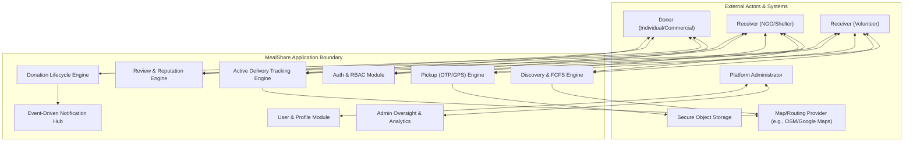
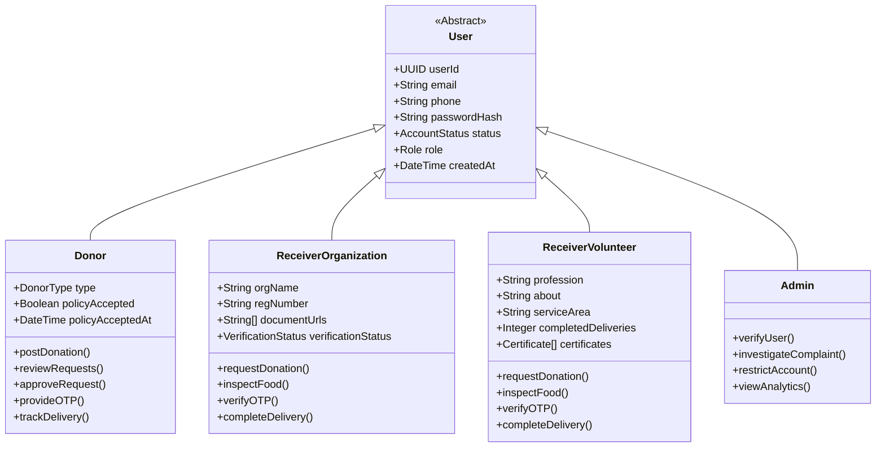
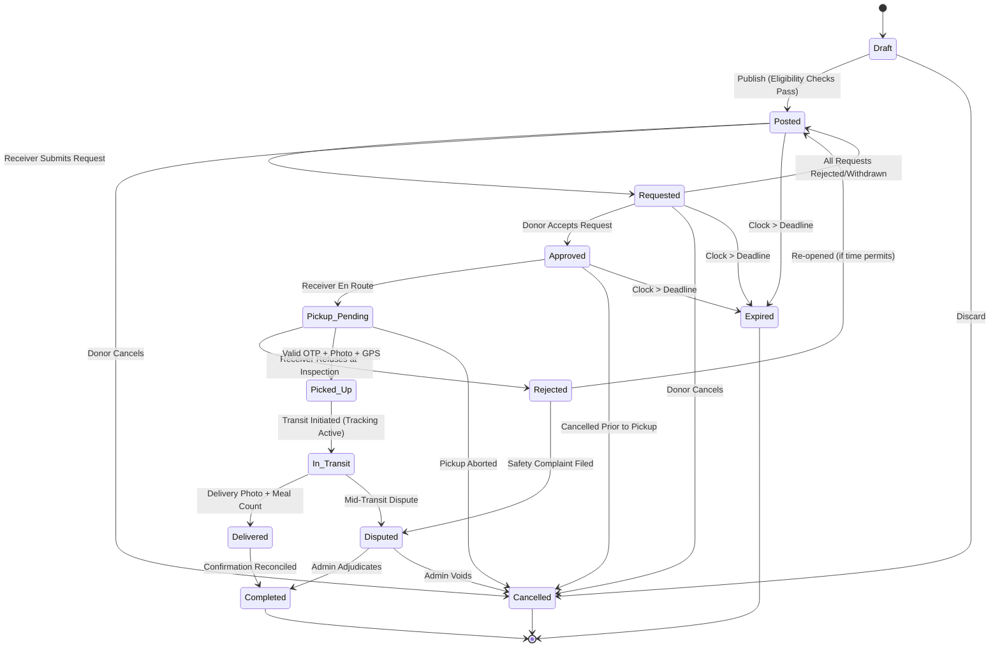
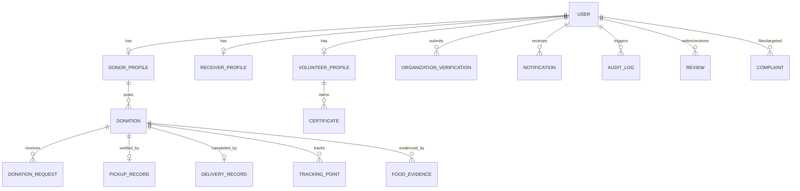

# MealShare — Software Requirements Specification (SRS) v1.0

---

## 1. Document Control

| Field                 | Value                                                              |
|-----------------------|--------------------------------------------------------------------|
| **Document Title**    | Software Requirements Specification (SRS) for MealShare            |
| **Document Version**  | 1.0                                                                |
| **Date**              | 2026-08-29                                                         |
| **Project Name**      | MealShare                                                          |
| **Project Type**      | MCA Capstone Project                                               |
| **Status**            | Baseline Draft — Pending Technical Review                          |
| **Source Document**   | `MealShare — Product Requirements Document (PRD) v1.0`             |
| **Author**            | Senior Software Architect & Requirements Engineering Team          |
| **Security / Access** | Academic / Project Team Internal                                   |

### Revision History

| Version | Date       | Author / Role                         | Description of Changes                               |
|---------|------------|---------------------------------------|-----------------------------------------------------|
| 1.0     | 2026-08-29 | Senior Software Architect / SRS Lead  | Initial complete SRS baseline generated from PRD v1.0 |

---

## 2. Introduction

### 2.1 Purpose
This Software Requirements Specification (SRS) defines the complete functional, behavioral, logical data, interface, and non-functional requirements for the **MealShare** surplus-food redistribution platform (Release v1.0). It translates the high-level operational concepts, workflows, and risk controls defined in the `MealShare PRD v1.0` into a formal, testable specification for software engineers, database designers, quality assurance testers, and academic evaluators.

### 2.2 Scope
The MealShare software system encompasses:
- Multi-role user registration, credential management, profile setup, and administrative verification.
- Donor food post creation, mandatory safety metadata capture, and policy acceptance logging.
- Spatial-temporal receiver discovery and First-Come, First-Served (FCFS) request queue management.
- Donor-controlled receiver review and approval workflow.
- Multi-step physical pickup verification comprising visual inspection logging, mutual OTP exchange, cryptographic evidence capture (in-app photo), and automated geolocation-timestamp binding.
- Active-delivery-only live location tracking with strict boundary conditions.
- Final delivery confirmation, quantity reconciliation, and evidence submission.
- Bidirectional mutual reviews, reputation scoring, and structured issue/complaint reporting.
- Volunteer recognition metrics, milestone tracking, and configurable certificate generation.
- Administrative monitoring, organization verification, dispute investigation, account governance, and aggregate operational analytics.
- Rule-based smart matching, with hooks for future AI/ML demand forecasting and OR-Tools optimization.

**Explicitly Out of Scope:**
- Financial payment gateways, monetary donations, delivery fee processing, or tipping.
- Chemical, biological, or laboratory-grade food testing integration.
- Continuous 24/7 background location surveillance of volunteers.
- General peer-to-peer social networking or open-ended unstructured chat channels.
- Commercial meal-kit, grocery delivery, or commercial logistics operations.

### 2.3 Product Overview
MealShare operates on the foundational philosophy: *"Don't waste food when someone can benefit from it."* It serves as a coordinated digital bridge connecting food donors (individuals, restaurants, hotels, caterers, hostels, event organizers) with verified receivers (NGOs, shelters, community homes, and individual neighborhood volunteers). The platform emphasizes accountability, layered food-safety risk control, verifiable custody handovers, and transparent operational metrics.

### 2.4 Intended Audience
1. **Software Developers**: For implementing data schemas, application business logic, APIs, and client interfaces.
2. **System Architects**: For structuring backend microservices/monolith components, real-time messaging, and geospatial queries.
3. **Quality Assurance (QA) & Test Engineers**: For writing automated test suites, integration test harnesses, and user acceptance tests (UAT).
4. **Academic Project Evaluators & Advisors**: For assessing technical rigor, domain depth, architectural soundness, and project completeness against MCA capstone standards.
5. **Platform Administrators**: For understanding administrative oversight, verification workflows, and policy enforcement tools.

### 2.5 Definitions

| Term | Formal Engineering Definition |
|------|-------------------------------|
| **Surplus Food** | Edible, wholesome prepared food or raw ingredients that remain unconsumed after events, commercial operations, or household meals and are declared fit for donation by the donor. |
| **Donor** | An authenticated platform actor who publishes a surplus food listing and authorizes its transfer. |
| **Receiver (Organization)** | An authenticated, admin-verified corporate/charitable entity (NGO, shelter, old-age home) requesting food for group distribution. |
| **Receiver (Volunteer)** | An authenticated individual who identifies local needy beneficiaries, requests food, and executes pickup and delivery. |
| **First-Come, First-Served (FCFS)** | A deterministic queue ordering algorithm where incoming requests are prioritized strictly by verified submission timestamp. FCFS governs **queue position only**; it does not grant automatic claim to food. |
| **Food Donation Policy** | A legally structured terms-of-use contract where the donor explicitly warrants truthful description, appropriate handling, and good-faith fitness for consumption. |
| **Software Eligibility Check** | Automated server-side validation rules applied to a donation listing (e.g., non-past expiry, mandatory photo, valid category) prior to publication. |
| **Human Inspection** | Physical, sensory evaluation performed on-site by the receiver prior to custody acceptance. |
| **Handover OTP** | A cryptographically generated, time-limited numerical token provided to the donor and entered by the receiver to prove co-location and mutual consent during pickup. |
| **Active Delivery Tracking** | Ephemeral transmission of geolocation coordinates from the receiver's device to the donor's client, active *exclusively* between pickup completion and delivery confirmation. |

### 2.6 Acronyms

| Acronym | Expansion |
|---------|-----------|
| **API** | Application Programming Interface |
| **FCFS** | First-Come, First-Served |
| **GPS** | Global Positioning System |
| **JSON** | JavaScript Object Notation |
| **JWT** | JSON Web Token |
| **ML** | Machine Learning |
| **NFR** | Non-Functional Requirement |
| **NGO** | Non-Governmental Organization |
| **OD** | Open Decision |
| **OTP** | One-Time Password |
| **PII** | Personally Identifiable Information |
| **PRD** | Product Requirements Document |
| **RBAC** | Role-Based Access Control |
| **REST** | Representational State Transfer |
| **SRS** | Software Requirements Specification |
| **TLS** | Transport Layer Security |
| **UAT** | User Acceptance Testing |
| **UI / UX**| User Interface / User Experience |

### 2.7 References
1. `MealShare — Product Requirements Document (PRD) v1.0` (Source of Truth, 2026-08-29).
2. ISO/IEC/IEEE 29148:2018 — Systems and software engineering — Life cycle processes — Requirements engineering.
3. RFC 6749 — The OAuth 2.0 Authorization Framework.
4. RFC 7519 — JSON Web Token (JWT).
5. Open Geospatial Consortium (OGC) — Simple Feature Access Standards for spatial data representations.

### 2.8 Document Conventions
- **Requirement Identifiers**: Every requirement is tagged with a globally unique alphanumeric ID (e.g., `FR-AUTH-001`, `NFR-SEC-01`, `BR-DON-01`, `AT-001`).
- **Priority Classifications**:
  - **P0**: Core / Mandatory for MVP (Must have for system viability and demonstration).
  - **P1**: High Priority / Essential for Complete Operational Flow (Should have).
  - **P2**: Nice-to-Have / Extended MVP Scope (Could have).
  - **Future**: Explicitly deferred beyond initial capstone MVP release.
- **Normative Language**:
  - *Shall*: Mandatory system requirement.
  - *Should*: Highly recommended capability, subject to architectural trade-offs.
  - *May*: Optional or discretionary system behavior.
- **Explicit Callouts**:
  - `OPEN DECISION`: Flags architectural or functional areas where the PRD mandates an open choice pending formal stakeholder/regulatory sign-off.
  - `ARCHITECTURAL RECOMMENDATION — NOT YET APPROVED`: Denotes technical proposals introduced to fulfill engineering completeness without contradicting the PRD.

---

## 3. System Overview

### 3.1 System Purpose
MealShare is an end-to-end distributed software platform engineered to orchestrate the discovery, allocation, physical custody verification, active transport monitoring, and audit logging of perishable surplus food donations.

### 3.2 System Boundaries
The MealShare boundary encompasses all client interfaces (Web/Mobile responsive clients), application server logic, database storage, geolocation calculation utilities, notification dispatchers, and administrative analytics engines. 

External dependencies (Maps tiles, Geocoding providers, SMS/Push gateways, Object Storage) interact across defined external interface boundaries.



### 3.3 Major System Components
1. **Identity & Access Management (IAM)**: Handles user registration, authentication tokens, session lifecycles, and role enforcement.
2. **Profile & Verification Subsystem**: Manages actor profiles, institutional document submissions, and administrative approval queues.
3. **Donation Lifecycle Engine**: Implements the finite state machine governing donation records from `Draft` through `Completed`/`Disputed`.
4. **Spatial Discovery & FCFS Allocation Hub**: Executes spatial radius queries and manages concurrency-safe timestamped request queues.
5. **Handover & Physical Verification Engine**: Generates and verifies cryptographic OTPs, enforces in-app camera evidence ingestion, and binds geocoordinates.
6. **Active Geolocation Tracking Hub**: Manages ephemeral, socket/polling-based location streaming during active transit.
7. **Reputation & Dispute Engine**: Computes rolling weighted ratings, processes complaint filings, and applies account sanction states.
8. **Volunteer Engagement Hub**: Tracks impact metrics and generates cryptographically verifiable milestone certificates.
9. **Event Notification Hub**: Dispatches real-time, asynchronous in-app alerts based on domain state transitions.
10. **Administrative Control Center**: Provides auditing, user intervention, complaint adjudication, and aggregate analytics.

### 3.4 Major Actors



### 3.5 External Systems and Services
- **Geocoding & Map Tile Provider**: External service for rendering maps, forward/reverse geocoding of textual addresses, and calculating road-network route distances. *(Specific provider is OPEN DECISION OD-13)*.
- **Object Storage Service**: Secure, immutable blob storage for hosting uploaded organization verification credentials, food photographs, pickup evidence, and delivery proof.
- **Clock Source**: Network Time Protocol (NTP)-synchronized server clock for timestamping requests and evidence.

### 3.6 High-Level Workflow
1. **Registration & Verification**: Users register under one role; organizations submit compliance proof; Admin verifies.
2. **Posting & Validation**: Donor inputs food details, certifies truthfulness, and accepts policy. Server applies software eligibility checks.
3. **Spatial Broadcast & FCFS Request**: System alerts eligible nearby receivers. Receivers request food; system places requests in an immutable FCFS queue.
4. **Donor Approval**: Donor inspects requester profiles in FCFS order and selectively approves one receiver.
5. **Physical Handover**: Receiver travels to pickup site, inspects food, agrees to accept, inputs Donor's OTP, snaps an in-app photo, and binds GPS.
6. **Active In-Transit Tracking**: Geolocation streaming activates exclusively for the duration of the trip to destination.
7. **Delivery & Evidence**: Receiver delivers food to beneficiaries, snaps delivery photo, inputs meal count, and completes cycle.
8. **Reputation & Audit**: Mutual reviews are filed; platform analytics and volunteer metrics update.

### 3.7 System Assumptions
- **`ASSUMP-01` (Connectivity)**: Users possess internet-connected smartphone or web devices equipped with functional HTML5 Geolocation and camera hardware during pickup/delivery.
- **`ASSUMP-02` (Good Faith)**: Donors provide truthful descriptions regarding preparation time, ingredients, and storage conditions as legally affirmed in the Food Donation Policy.
- **`ASSUMP-03` (Spatial Coverage)**: Platform viability assumes a critical density of donors and receivers operating within overlapping geographic radii.

### 3.8 System Constraints
- **`CONST-01` (No In-House Logistics)**: The platform shall not employ or contract delivery drivers; physical transportation is strictly the responsibility of the accepted receiver/volunteer.
- **`CONST-02` (Zero Financial Transactions)**: The platform shall contain no code, interfaces, or database structures for processing currency transactions or monetary fees.
- **`CONST-03` (No Certified Food Safety Testing)**: The platform shall not perform or integrate scientific laboratory food testing; safety is managed exclusively via the layered risk-control model.
- **`CONST-04` (Privacy Bound Tracking)**: Background device tracking outside the active `In Transit` window is technically and architecturally prohibited.

---

## 4. Actors and Role-Based Access Control (RBAC)

### 4.1 Detailed Actor Profiles

#### 4.1.1 Donor (`ROLE-DONOR`)
- **Purpose**: Surplus food supply-side entity seeking to safely redistribute usable food.
- **Sub-types**: Individual (household gatherings), Commercial (restaurant, hotel, caterer, hostel, event organizer).
- **Responsibilities**: Provide accurate food descriptions; maintain declared storage conditions until pickup; verify receiver credentials prior to approval; generate/share OTP upon successful physical inspection; submit mutual counterparty reviews.
- **Accessible Modules**: Auth, Profile, Food Posting, Request Queue Review, Pickup Handover (OTP display), Live Tracking (View Only), Review Submission, Complaint Filing.

#### 4.1.2 Receiver — Organization (`ROLE-RECV-ORG`)
- **Purpose**: Institutional entity dedicated to feeding sheltered or aggregated vulnerable populations.
- **Examples**: Registered NGOs, homeless shelters, orphanages, old-age homes, community welfare trusts.
- **Responsibilities**: Submit genuine legal registration documents; maintain updated service area profiles; perform sensory food inspection upon arrival; execute secure OTP validation and evidence capture; distribute food responsibly to verified beneficiaries.
- **Accessible Modules**: Auth, Organization Profile & Document Submission, Spatial Donation Discovery, FCFS Request Submission, Physical Inspection & Handover (OTP Input, Camera Capture), Active Tracking (Broadcaster), Delivery Evidence Submission, Review Submission, Complaint Filing.

#### 4.1.3 Receiver — Volunteer (`ROLE-RECV-VOL`)
- **Purpose**: Individual community actor facilitating hyper-local food rescue for unorganized families or individuals in need.
- **Responsibilities**: Maintain transparent personal profile and service scope; personally execute pickup, transportation, and direct beneficiary distribution; capture valid in-app photographic evidence; uphold food handling standards during transit.
- **Accessible Modules**: Auth, Volunteer Profile, Spatial Donation Discovery, FCFS Request Submission, Physical Inspection & Handover, Active Tracking (Broadcaster), Delivery Evidence Submission, Volunteer Impact Dashboard, Certificate Download, Review Submission, Complaint Filing.

#### 4.1.4 Administrator (`ROLE-ADMIN`)
- **Purpose**: Governance, compliance, and platform integrity authority.
- **Responsibilities**: Audit and verify institutional documentation; monitor suspicious postings or rapid request anomalies; investigate food safety and behavioral disputes; execute account restrictions or suspensions; monitor aggregate platform impact KPIs.
- **Accessible Modules**: Admin Console, User Verification Queue, Donation Audit Inspector, Dispute & Complaint Investigation Workbench, System Parameter Configuration, Aggregate Analytics Dashboard.

### 4.2 Comprehensive RBAC Permission Matrix

| System Functional Area | Donor | Receiver Org | Receiver Volunteer | Administrator |
|------------------------|:-----:|:------------:|:------------------:|:-------------:|
| **Self-Registration & Auth** | ✅ | ✅ | ✅ | ❌ *(Manual Provision)* |
| **View / Edit Own Profile** | ✅ | ✅ | ✅ | ✅ |
| **Upload Org Verification Docs** | ❌ | ✅ | ❌ | ❌ |
| **Approve / Reject Org Verification** | ❌ | ❌ | ❌ | ✅ |
| **Accept Food Donation Policy** | ✅ | ❌ | ❌ | ❌ |
| **Create / Edit / Cancel Food Post** | ✅ | ❌ | ❌ | ❌ |
| **View Nearby Food Postings** | ❌ | ✅ | ✅ | ✅ *(Global View)* |
| **Submit / Withdraw FCFS Request** | ❌ | ✅ | ✅ | ❌ |
| **View Requester Profiles on Post** | ✅ | ❌ | ❌ | ✅ |
| **Approve / Reject Specific Request** | ✅ | ❌ | ❌ | ❌ |
| **Perform On-Site Inspection** | ❌ | ✅ | ✅ | ❌ |
| **View Handover OTP** | ✅ | ❌ | ❌ | ❌ |
| **Validate Handover OTP** | ❌ | ✅ | ✅ | ❌ |
| **Capture & Upload Pickup Evidence** | ❌ | ✅ | ✅ | ❌ |
| **Broadcast Live Geolocation** | ❌ | ✅ *(In Transit)* | ✅ *(In Transit)* | ❌ |
| **View Live In-Transit Map** | ✅ *(Own Post)* | ❌ | ❌ | ✅ *(Audit View)* |
| **Submit Delivery Confirmation & Proof** | ❌ | ✅ | ✅ | ❌ |
| **Submit Mutual Review / Rating** | ✅ | ✅ | ✅ | ❌ |
| **Submit Issue / Safety Complaint** | ✅ | ✅ | ✅ | ❌ |
| **Investigate / Adjudicate Complaints** | ❌ | ❌ | ❌ | ✅ |
| **View Volunteer Impact & Certificates** | ❌ | ❌ | ✅ | ✅ |
| **Configure System Thresholds** | ❌ | ❌ | ❌ | ✅ |
| **Access System-Wide Analytics** | ❌ | ❌ | ❌ | ✅ |
| **Issue Warnings / Suspend Accounts** | ❌ | ❌ | ❌ | ✅ |

---

## 5. System Functional Requirements Schema

All functional requirements in Sections 6 through 21 adhere to the following strict specification template:
- **Requirement ID & Name**: Unique traceable identifier.
- **Description & Actors**: Plain engineering description and authorized actors.
- **Preconditions & Trigger**: System state required prior to execution and the initiating event.
- **Main Flow**: Step-by-step normative system behavior.
- **Alternative & Exception Flows**: Branching paths and failure modes.
- **Business Rules & Input/Output**: Specific constraints, payload expectations, and state mutations.
- **Dependencies, Priority & MVP Scope**: Architectural links, priority (`P0`/`P1`/`P2`), and release baseline.
- **Acceptance Criteria**: Verifiable test assertions.

---

## 6. Authentication & Registration Requirements

### `FR-AUTH-001`: User Registration and Role Selection
- **Description**: The system shall allow prospective users to create an account by submitting identity credentials and selecting exactly one platform role (`Donor`, `Receiver Organization`, `Receiver Volunteer`).
- **Actors**: Prospective User (Unauthenticated).
- **Preconditions**: None.
- **Trigger**: User submits the registration form.
- **Main Flow**:
  1. User supplies email address, mobile phone number, secure password, full name/entity name, and selects their desired role.
  2. System validates syntactic correctness of email and phone formats.
  3. System validates password complexity according to `NFR-SEC-03`.
  4. System verifies that neither email nor phone number already exists in the database.
  5. System creates a `User` entity with `AccountStatus = Pending_Verification` (for Organization Receivers) or `Pending_Policy` / `Active` based on role verification rules.
  6. System issues an authentication confirmation or verification dispatch.
- **Alternative Flow**:
  - *Registration with Organization*: System prompts immediately for organization type, registration number, and document uploads (`FR-PROF-002`).
- **Exception Flow**:
  - *Duplicate Identifier*: If email or phone already exists, system rejects registration with an explicit error message (`ERR-AUTH-001`) without revealing password state.
- **Business Rules**: `BR-REG-01`, `BR-REG-02`, `BR-REG-03`, `BR-REG-04`.
- **Input Data**: `name`, `email`, `phone`, `password`, `role`.
- **Output Data**: `userId`, `accountStatus`, `sessionToken` / `jwtToken`.
- **Postconditions**: User record created in database; appropriate initial account status assigned.
- **Dependencies**: Database subsystem.
- **Priority / Classification**: `P0` — Mandatory MVP Core.
- **Acceptance Criteria**:
  - [ ] System blocks registration if any mandatory field is missing.
  - [ ] System prevents duplicate accounts using the same email or phone.
  - [ ] Account status defaults to `Pending_Verification` for organizational receivers.

### `FR-AUTH-002`: User Authentication and Session Management
- **Description**: The system shall authenticate registered users using valid credentials and issue secure session tokens with role-based claim scopes.
- **Actors**: Registered User (All Roles).
- **Preconditions**: User account exists and is not in `Suspended` status.
- **Trigger**: User inputs login credentials.
- **Main Flow**:
  1. User submits identifier (email/phone) and password.
  2. System retrieves password hash and verifies authenticity using cryptographically secure hashing (e.g., Argon2/bcrypt).
  3. System verifies `AccountStatus != Suspended`.
  4. System generates a secure, signed JWT/session token containing `userId`, `role`, and token expiry.
  5. System returns token and user role metadata to client.
- **Alternative Flow**: None.
- **Exception Flow**:
  - *Invalid Credentials*: System logs failed attempt and returns generic error `ERR-AUTH-002`.
  - *Account Suspended*: If `AccountStatus == Suspended`, system rejects login and displays administrative suspension notice (`ERR-AUTH-003`).
- **Business Rules**: Failed login rate-limiting enforced (`NFR-SEC-06`).
- **Input Data**: `identifier` (email/phone), `password`.
- **Output Data**: `authToken`, `refreshToken`, `role`, `accountStatus`.
- **Postconditions**: Active user session established and logged.
- **Dependencies**: `FR-AUTH-001`.
- **Priority / Classification**: `P0` — Mandatory MVP Core.
- **Acceptance Criteria**:
  - [ ] Valid credentials yield authenticated session token.
  - [ ] Invalid credentials return generic error without distinguishing between wrong username vs wrong password.
  - [ ] Suspended users cannot authenticate.

---

## 7. User Profile & Verification Requirements

### `FR-PROF-001`: Donor Profile and Policy Agreement
- **Description**: The system shall maintain donor profile details and require mandatory timestamped acceptance of the MealShare Food Donation Policy before permitting donation postings.
- **Actors**: Donor (`ROLE-DONOR`).
- **Preconditions**: Donor authenticated.
- **Trigger**: Donor completes profile setup or attempts initial food post.
- **Main Flow**:
  1. Donor inputs profile information: Donor Name / Entity Name, Donor Type (`Individual`, `Hotel`, `Restaurant`, `Caterer`, `Hostel`, `Event Organizer`), physical address, and contact details.
  2. System presents the complete legal text of the **MealShare Food Donation Policy**.
  3. Donor explicitly checks acceptance affirmation.
  4. System records `policyAccepted = true`, `policyAcceptedTimestamp = UTC_NOW()`, and stores the policy version hash.
  5. System unlocks food posting capabilities.
- **Exception Flow**:
  - *Policy Declined*: System prevents donor from accessing the "Create Donation" interface.
- **Business Rules**: `BR-REG-05`, `BR-SAFE-01`.
- **Input Data**: `donorType`, `address`, `contactDetails`, `policyAgreementFlag`.
- **Output Data**: Updated `DonorProfile` record with audit-stamped policy state.
- **Postconditions**: Donor is authorized to post donations.
- **Dependencies**: `FR-AUTH-001`.
- **Priority / Classification**: `P0` — Mandatory MVP Core.
- **Acceptance Criteria**:
  - [ ] Unaccepted policy strictly blocks food posting.
  - [ ] Policy acceptance timestamp and version are immutably recorded.

### `FR-PROF-002`: Organization Receiver Profile & Document Verification
- **Description**: The system shall capture institutional profile data and supporting verification documentation from Organization Receivers for mandatory administrative review.
- **Actors**: Receiver Organization (`ROLE-RECV-ORG`), Administrator (`ROLE-ADMIN`).
- **Preconditions**: Organization account registered.
- **Trigger**: Organization completes profile or Administrator opens verification queue.
- **Main Flow**:
  1. Organization inputs: Legal Organization Name, Organization Type (`NGO`, `Shelter`, `Old-Age Home`, `Community Kitchen`, `Other`), Registration / Tax ID, Official Address, Operating Service Area (Geographic coordinates/radius), Contact Person Details, Self-reported Beneficiary Capacity.
  2. Organization uploads supporting verification files (Registration Certificates, Facility Photos, Tax Exemption Proof).
  3. System stores files in secure object storage and updates status to `Pending_Verification`.
  4. Administrator reviews submitted data and files in Admin Console.
  5. Administrator executes `Approve` or `Reject` with mandatory audit reason.
  6. If approved, system sets `VerificationStatus = Verified` and `AccountStatus = Active`.
- **Alternative Flow**:
  - *Admin Requests Resubmission*: Admin sets status to `Resubmission_Requested` with explanatory notes; Organization is notified to upload updated documents.
- **Business Rules**: `BR-REG-02`, `BR-REG-03`, `BR-ADMIN-01`.
- **Input Data**: `orgName`, `orgType`, `regNumber`, `documentFiles[]`, `serviceArea`.
- **Output Data**: `verificationStatus`, `adminReviewNotes`, `verifiedAt`.
- **Postconditions**: Verified organization is enabled to discover and request donations.
- **Dependencies**: `FR-AUTH-001`, File Storage Subsystem.
- **Priority / Classification**: `P0` — Mandatory MVP Core.
- **Acceptance Criteria**:
  - [ ] Unverified organizations cannot request food donations.
  - [ ] Admin approval transitions account status to verified and logs admin ID.

### `FR-PROF-003`: Volunteer Profile and Portfolio Management
- **Description**: The system shall capture and display detailed volunteer profile information, service jurisdiction, completed activity metrics, and earned certificates.
- **Actors**: Receiver Volunteer (`ROLE-RECV-VOL`).
- **Preconditions**: Volunteer authenticated.
- **Trigger**: Volunteer updates profile or completes delivery cycle.
- **Main Flow**:
  1. Volunteer inputs: Full Name, Profession / "Who I am", About / Personal Bio, Designated Service Area (Location + Radius), Contact Information.
  2. System computes and displays dynamic portfolio metrics: Total Pickups Completed, Total Deliveries Completed, Total Meals Distributed, Aggregate Rating Score, Milestone Certificate Gallery.
  3. Profile is rendered to Donors during FCFS request review.
- **Business Rules**: Public volunteer profile must conceal private residential phone numbers until request acceptance (`NFR-PRIV-02`).
- **Input Data**: `profession`, `aboutBio`, `serviceAreaGeo`.
- **Output Data**: Structured `VolunteerProfile` view model.
- **Postconditions**: Profile is updated and visible for donor evaluation.
- **Dependencies**: `FR-AUTH-001`.
- **Priority / Classification**: `P0` — Mandatory MVP Core.
- **Acceptance Criteria**:
  - [ ] Volunteer profile renders all required biographical and statistical fields.
  - [ ] Dynamic counts accurately reflect historical completed deliveries.

---

## 8. Food Donation Management Requirements

### `FR-DON-001`: Create and Publish Food Donation
- **Description**: The system shall allow a verified donor to create, validate, and publish a surplus food listing with mandatory safety and logistical metadata.
- **Actors**: Donor (`ROLE-DONOR`).
- **Preconditions**: Donor authenticated, verified, and has active `policyAccepted = true`.
- **Trigger**: Donor submits "Post Food" form.
- **Main Flow**:
  1. Donor enters mandatory food parameters:
     - Food Type / Description (Text)
     - Quantity / Servings (Estimated number of persons served, Integer > 0)
     - Preparation Date & Time (`prepDateTime <= UTC_NOW()`)
     - Storage Condition (`Refrigerated`, `Room Temperature`, `Frozen`, `Heated Container`)
     - Consumption Deadline (`consumptionDeadline > UTC_NOW()`)
     - Dietary Category (`Vegetarian`, `Non-Vegetarian`)
     - Known Allergens (Multi-select list or explicit `None Declared`)
     - Pickup Location (Address text + Lat/Long Geocoordinates)
     - Food Photograph (Captured via device camera interface)
     - Additional Handling Notes (Optional Text)
  2. Donor certifies truthfulness of information.
  3. System executes automated **Software Eligibility Checks** (`FR-SAFE-002`).
  4. Upon successful validation, system creates `Donation` entity in `Posted` state.
  5. System triggers the Spatial Broadcast and Discovery Engine (`FR-DISC-001`).
- **Alternative Flow**:
  - *Save as Draft*: Donor selects "Save Draft"; system stores listing in `Draft` state without spatial broadcasting.
- **Exception Flow**:
  - *Eligibility Validation Failure*: If `consumptionDeadline <= UTC_NOW()` or mandatory photo missing, system halts publication and highlights offending fields (`ERR-DON-001`).
- **Business Rules**: `BR-DON-01`, `BR-DON-02`, `BR-DON-03`, `BR-DON-04`, `BR-SAFE-03`.
- **Input Data**: Donation form fields as specified above.
- **Output Data**: `donationId`, `status = Posted`, `createdAt`.
- **Postconditions**: Donation is discoverable by nearby receivers.
- **Dependencies**: `FR-PROF-001`, Geocoding Service, Object Storage.
- **Priority / Classification**: `P0` — Mandatory MVP Core.
- **Acceptance Criteria**:
  - [ ] System blocks publication if any mandatory metadata field or photo is absent.
  - [ ] System rejects past or zero-duration consumption deadlines.
  - [ ] Successful post sets state to `Posted` and initiates receiver alerts.

### `FR-DON-002`: Donation Modification and Cancellation
- **Description**: The system shall permit donors to edit listing details or cancel a donation prior to physical pickup, enforcing state-dependent guard conditions.
- **Actors**: Donor (`ROLE-DONOR`).
- **Preconditions**: Donor owns the donation listing.
- **Trigger**: Donor invokes Edit or Cancel action.
- **Main Flow (Cancel)**:
  1. Donor selects "Cancel Donation" and supplies a cancellation reason.
  2. System checks that `DonationStatus IN ('Draft', 'Posted', 'Requested', 'Approved', 'Pickup_Pending')`.
  3. System transitions status to `Cancelled`.
  4. System notifies any accepted or requesting receivers of the cancellation.
  5. All active requests are voided.
- **Alternative Flow (Edit)**:
  1. Donor edits fields while `DonationStatus IN ('Draft', 'Posted')` (before any request is accepted).
  2. System re-runs eligibility checks and updates the published record.
- **Exception Flow**:
  - *Invalid State*: If donor attempts cancellation after `Picked_Up` state, system rejects action (`ERR-DON-002`).
- **Business Rules**: `BR-DON-05`, `BR-DON-06`, `BR-DISC-06`.
- **Input Data**: `donationId`, `cancelReason` (if cancelling), updated fields (if editing).
- **Output Data**: Updated `DonationStatus`.
- **Postconditions**: Donation status set to `Cancelled` or record updated.
- **Dependencies**: `FR-DON-001`.
- **Priority / Classification**: `P0` — Mandatory MVP Core.
- **Acceptance Criteria**:
  - [ ] Donors cannot edit core listing details once a request is approved.
  - [ ] Cancellation voids all pending requests and alerts affected receivers.

### `FR-DON-003`: Automated Donation Expiry Processing
- **Description**: The system shall automatically transition active donations to `Expired` status when the stated consumption deadline is reached without completed pickup.
- **Actors**: System Scheduler / Daemon.
- **Preconditions**: Donation in `Posted`, `Requested`, or `Approved` status.
- **Trigger**: System clock reaches `consumptionDeadline`.
- **Main Flow**:
  1. Scheduled job identifies all donations where `consumptionDeadline <= UTC_NOW()` and `status IN ('Draft', 'Posted', 'Requested', 'Approved')`.
  2. System transitions donation status to `Expired`.
  3. System voids all associated pending requests (`status = Voided_Expired`).
  4. System dispatches expiration notifications to donor and requesters.
- **Business Rules**: `BR-DON-07`, `BR-DISC-06`.
- **Input Data**: System time query.
- **Output Data**: Mutated `DonationStatus = Expired`.
- **Postconditions**: Donation is removed from active discovery feeds.
- **Dependencies**: Background Scheduling Service.
- **Priority / Classification**: `P2` — MVP Platform Hygiene.
- **Acceptance Criteria**:
  - [ ] Donations automatically transition to `Expired` within 60 seconds of deadline passage.
  - [ ] Expired donations are immediately hidden from receiver search feeds.

---

## 9. Food Safety Requirements

### `FR-SAFE-001`: Layered Food Safety Control Framework
- **Description**: The system shall implement and enforce a multi-tier, non-laboratory risk control architecture that embeds declarations, metadata checks, visual inspection, physical custody validation, and audit logging across the software lifecycle.
- **Actors**: All Roles, System Core.
- **Preconditions**: Platform operation.
- **Trigger**: Continuous lifecycle events.
- **System Rules & Architecture**:
  1. **Tier 1 (Policy Acceptance)**: Mandatory timestamped legal agreement prior to first post (`BR-REG-05`).
  2. **Tier 2 (Mandatory Safety Data)**: Enforced capture of prep time, storage condition, consumption deadline, allergens, and live camera photo (`BR-DON-02`, `BR-DON-03`).
  3. **Tier 3 (Automated Server Checks)**: Automated programmatic validation of deadlines and mandatory parameters (`FR-SAFE-002`).
  4. **Tier 4 (Receiver Pre-Request Visibility)**: Unrestricted display of all declared food parameters to prospective receivers prior to request submission.
  5. **Tier 5 (On-Site Human Inspection)**: Mandatory physical sensory assessment step executed by the receiver before entering the pickup OTP (`FR-PICK-001`).
  6. **Tier 6 (Autonomous Right of Refusal)**: Unconditional software option for receiver to reject food on-site with recorded reason codes (`BR-SAFE-04`).
  7. **Tier 7 (Cryptographic Handover Binding)**: OTP exchange confirming intentional custody transfer (`FR-PICK-002`).
  8. **Tier 8 (In-App Evidence Ingestion)**: Native camera photo capture of food at pickup and delivery (`BR-PICK-03`, `BR-DELV-01`).
  9. **Tier 9 (Spatial-Temporal Anchoring)**: Automated binding of device GPS and server timestamps to handover evidence (`BR-PICK-04`).
  10. **Tier 10 (Post-Event Reporting & Escalation)**: Structured complaint mechanism triggering automated administrative review (`FR-REV-003`).
  11. **Tier 11 (Reputation Weighting)**: Dynamic counterparty ratings and complaint history visible to future donors (`FR-REV-002`).
  12. **Tier 12 (Administrative Sanctions)**: Multi-stage enforcement (Warning, Restriction, Suspension) executed by Admins (`FR-ADMIN-003`).
- **Explicit System Disclaimers**:
  - *No Safety Guarantee*: The system shall render explicit, prominent disclaimers stating: *"MealShare facilitates surplus redistribution but does not conduct laboratory testing or guarantee biological food safety."* (`BR-SAFE-01`).
  - *No Arbitrary Time Rules*: The platform shall NOT enforce arbitrary blanket duration rules (e.g., universal 2-hour limits) that fail to account for food type and thermal storage methods (`BR-SAFE-02`).
- **Dependencies**: Cross-cutting engine constraint.
- **Priority / Classification**: `P0` — Core Structural Framework.
- **Acceptance Criteria**:
  - [ ] Disclaimers are displayed on all posting, requesting, and handover UI views.
  - [ ] All 12 risk control tiers are traceable to specific software operations.

### `FR-SAFE-002`: Automated Software Eligibility Checking
- **Description**: The system shall execute automated server-side sanity checks on all incoming donation payloads prior to persisting state as `Posted`.
- **Actors**: System Core.
- **Preconditions**: Donor submits donation payload.
- **Trigger**: Ingestion of `CreateDonation` API request.
- **Main Flow**:
  1. System verifies `prepDateTime <= UTC_NOW()`.
  2. System verifies `consumptionDeadline > UTC_NOW()`.
  3. System validates that `quantity >= 1`.
  4. System verifies that at least one valid image payload is attached.
  5. System validates that `storageCondition` is a recognized platform enumeration.
  6. If all assertions pass, request proceeds to persistence.
- **Exception Flow**:
  - If any check fails, system aborts creation, returns validation error schema with specific field errors.
- **Business Rules**: `BR-DON-02`, `BR-DON-03`.
- **Priority / Classification**: `P0` — Mandatory MVP Core.
- **Acceptance Criteria**:
  - [ ] Automated tests verify rejection of past deadlines, zero quantities, and missing photos.

---

## 10. Receiver Discovery & FCFS Allocation Requirements

### `FR-DISC-001`: Spatial Receiver Discovery and Broadcast
- **Description**: Upon successful publication of a donation, the system shall execute a geospatial query to identify eligible receivers within a configured radius and dispatch targeted alerts.
- **Actors**: System Discovery Engine, Receiver (`ROLE-RECV-ORG`, `ROLE-RECV-VOL`).
- **Preconditions**: Donation state transitions to `Posted`.
- **Trigger**: `DonationStatus = Posted` event.
- **Main Flow**:
  1. Discovery engine retrieves donor pickup geocoordinates (Lat/Long).
  2. Engine queries active, verified receivers whose designated service area boundary covers or intersects the pickup location within the platform radius parameter (`default = 10km`, configurable by Admin via `BR-DISC-07`).
  3. Engine filters candidate receivers:
     - Account must be `Active` and `Verified`.
     - Receiver must not be currently suspended or restricted.
  4. Engine constructs and dispatches real-time in-app discovery notifications (`FR-NOTIF-001`) to all identified candidate receivers.
  5. Donation appears in candidate receivers' discovery feeds.
- **Alternative Flow**:
  - *Zero Candidates*: If no receivers are found within radius, donation remains `Posted`; notification log records zero-candidate event.
- **Business Rules**: `BR-DISC-01`, `BR-DISC-07`.
- **Input Data**: `donationId`, `pickupLatitude`, `pickupLongitude`, `radiusKm`.
- **Output Data**: List of `receiverUserIds`, generated notification events.
- **Postconditions**: Candidate receivers alerted.
- **Dependencies**: Geolocation module, Notification Hub.
- **Priority / Classification**: `P0` — Mandatory MVP Core.
- **Acceptance Criteria**:
  - [ ] Receivers outside the geographic boundary do not receive alerts.
  - [ ] Unverified or suspended receivers are excluded from discovery.

### `FR-DISC-002`: FCFS Timestamped Request Submission
- **Description**: The system shall allow eligible receivers to submit a formal request for a posted donation, assigning a monotonic high-precision timestamp to maintain an immutable FCFS request priority queue.
- **Actors**: Receiver (`ROLE-RECV-ORG`, `ROLE-RECV-VOL`).
- **Preconditions**: Receiver is verified, active, and viewing a `Posted` or `Requested` donation.
- **Trigger**: Receiver clicks "Request Donation".
- **Main Flow**:
  1. Receiver reviews complete food metadata, dietary classifications, allergens, and pickup location.
  2. Receiver submits request payload.
  3. System records server-side high-precision timestamp (`UTC_TIMESTAMP_MILLIS`).
  4. System verifies that receiver has not already submitted an active request for this donation (`BR-DISC-04`).
  5. System creates `DonationRequest` entity with `requestStatus = Pending` and appends it to the donation's FCFS queue.
  6. If donation was in `Posted` state, system updates donation status to `Requested`.
  7. System dispatches notification to donor alerting them of a new request.
- **Alternative Flow**:
  - *Request Withdrawal*: Receiver cancels their own pending request prior to donor decision; system marks request `Withdrawn` and removes it from active queue (`BR-DISC-05`).
- **Exception Flow**:
  - *Duplicate Request*: System rejects duplicate submissions with `ERR-REQ-001`.
  - *Submission Post-Expiry*: If `consumptionDeadline` passed while submitting, system rejects request with `ERR-REQ-002`.
- **Business Rules**: `BR-DISC-02`, `BR-DISC-03`, `BR-DISC-04`, `BR-DISC-05`.
- **Input Data**: `donationId`, `receiverId`, optional `notes`.
- **Output Data**: `requestId`, `queuePosition`, `timestamp`.
- **Postconditions**: Request queued in deterministic FCFS sequence.
- **Dependencies**: `FR-DON-001`, `FR-PROF-002`/`FR-PROF-003`.
- **Priority / Classification**: `P0` — Mandatory MVP Core.
- **Acceptance Criteria**:
  - [ ] Incoming requests are strictly ordered by millisecond timestamp.
  - [ ] Receivers cannot submit multiple active requests for the same donation.

---

## 11. Donor Review & Approval Requirements

### `FR-APPR-001`: Request Queue Review and Profile Inspection
- **Description**: The system shall render the list of prospective requesters to the donor in strict FCFS chronological order and allow the donor to inspect complete counterparty reputation and verification credentials.
- **Actors**: Donor (`ROLE-DONOR`).
- **Preconditions**: Donation has one or more associated `DonationRequest` records in `Pending` state.
- **Trigger**: Donor accesses the "Manage Requests" interface for their donation.
- **Main Flow**:
  1. System queries all `Pending` requests for `donationId`, sorted by `timestamp ASC`.
  2. For each request, system renders:
     - FCFS Queue Index (#1, #2, #3...)
     - Requester Name, Role Type (`Organization` vs `Volunteer`)
     - Verification Badge
     - Historical Performance Metrics (Completed Donations/Deliveries Count, Average Rating Score)
     - Complaint History Summary
     - Request Submission Timestamp
  3. Donor can click on any requester card to view full profile (e.g., Organization registration documents or Volunteer bio/certificates).
- **Business Rules**: `BR-APPR-02`.
- **Input Data**: `donationId`.
- **Output Data**: Structured FCFS requester list.
- **Postconditions**: Donor possesses full contextual data to execute decision.
- **Dependencies**: `FR-DISC-002`, `FR-PROF-002`, `FR-PROF-003`.
- **Priority / Classification**: `P0` — Mandatory MVP Core.
- **Acceptance Criteria**:
  - [ ] Requests are displayed strictly ordered by submission time.
  - [ ] Donors can view full supporting documents and reputation statistics.

### `FR-APPR-002`: Donor Decision Execution (Accept / Reject)
- **Description**: The system shall allow the donor to exercise final approval authority by explicitly accepting or rejecting individual requests in the queue.
- **Actors**: Donor (`ROLE-DONOR`).
- **Preconditions**: Donor viewing pending request queue.
- **Trigger**: Donor clicks "Accept" or "Reject" on a specific request.
- **Main Flow (Accept)**:
  1. Donor selects "Accept" on request `R_selected`.
  2. System validates that no other request is currently in `Approved` state for this donation (`BR-APPR-03`).
  3. System updates `R_selected.status = Accepted`.
  4. System updates `Donation.status = Approved`.
  5. System assigns `Donation.acceptedReceiverId = R_selected.receiverId`.
  6. System generates a secure 6-digit Handover OTP (`FR-PICK-002`) and binds it to the donation record.
  7. System dispatches an approval notification to the accepted receiver with full pickup address details.
  8. System handles remaining pending requests according to the configured queue policy *(Reference: OPEN DECISION OD-04)*.
- **Alternative Flow (Reject)**:
  1. Donor selects "Reject" on request `R_target` (optional rejection reason input).
  2. System updates `R_target.status = Rejected`.
  3. System dispatches a polite rejection notification to `R_target.receiverId`.
  4. If other pending requests exist, donation remains in `Requested` state; if zero pending requests remain, donation returns to `Posted` state.
- **Business Rules**: `BR-APPR-01`, `BR-APPR-03`, `BR-APPR-04`, `BR-APPR-05`.
- **Input Data**: `requestId`, `decision` (`ACCEPT` | `REJECT`), `rejectionReason` (optional).
- **Output Data**: Updated `DonationStatus`, `RequestStatus`, generated OTP.
- **Postconditions**: Exactly one receiver is approved; handover authorization token generated.
- **Dependencies**: `FR-APPR-001`, Notification Hub.
- **Priority / Classification**: `P0` — Mandatory MVP Core.
- **Acceptance Criteria**:
  - [ ] Donor has absolute authority to select any requester, regardless of queue rank.
  - [ ] Exactly one receiver can be in approved state per donation at any given instant.
  - [ ] Rejection of one requester leaves remaining queue intact.

---

## 12. Pickup Verification Requirements

### `FR-PICK-001`: Physical Arrival and Visual Food Inspection
- **Description**: The system shall require the accepted receiver to perform an on-site sensory inspection of the food upon arrival and record an explicit Accept or Reject determination before proceeding to digital handover.
- **Actors**: Accepted Receiver (`ROLE-RECV-ORG`, `ROLE-RECV-VOL`).
- **Preconditions**: `Donation.status = Approved` or `Pickup_Pending`; receiver is physically present at pickup site.
- **Trigger**: Receiver opens pickup verification workflow in client.
- **Main Flow (Acceptance)**:
  1. Receiver visually inspects food condition, quantity, odor, packaging integrity, and thermal state against declared listing metadata.
  2. Receiver selects "Food Inspected — Accept Condition".
  3. System proceeds to OTP Entry and Evidence Capture screen (`FR-PICK-002`).
- **Alternative Flow (Rejection & Dispute Filing)**:
  1. Receiver inspects food and finds it spoiled, contaminated, mismatched in quantity, or otherwise unsuitable.
  2. Receiver selects "Reject Food at Inspection".
  3. System requires mandatory selection of Rejection Reason (`Spoilage/Odor`, `Unsafe Temperature`, `Mismatched Item`, `Severe Packaging Damage`, `Donor Unavailable`, `Other`).
  4. Receiver captures an in-app photographic record of the rejected food.
  5. System records `Donation.status = Rejected` (or `Disputed` if an escalation flag is set; *Reference: OPEN DECISION OD-06*).
  6. System dispatches rejection alert to Donor and logs the event for administrative oversight (`BR-SAFE-06`).
- **Business Rules**: `BR-SAFE-04`, `BR-PICK-06`.
- **Input Data**: `inspectionResult` (`ACCEPT` | `REJECT`), `rejectionReasonCode`, `rejectionPhoto` (if rejected).
- **Output Data**: Inspection audit log record.
- **Postconditions**: Workflow advances to OTP validation OR terminates with documented rejection.
- **Dependencies**: `FR-APPR-002`, Device Camera Interface.
- **Priority / Classification**: `P0` — Mandatory MVP Core.
- **Acceptance Criteria**:
  - [ ] Receiver cannot bypass the inspection confirmation prompt.
  - [ ] On-site rejections mandate reason selection and photographic proof.

### `FR-PICK-002`: OTP Validation and Geolocation-Timestamp Evidence Binding
- **Description**: The system shall verify physical custody transfer through mutual OTP exchange, mandatory in-app camera evidence ingestion, and automated capture of device geocoordinates and server timestamps.
- **Actors**: Donor (`ROLE-DONOR`), Accepted Receiver (`ROLE-RECV-ORG`, `ROLE-RECV-VOL`).
- **Preconditions**: Visual food inspection accepted (`FR-PICK-01`); Donor possesses the active Handover OTP.
- **Trigger**: Receiver submits OTP and evidence payload.
- **Main Flow**:
  1. Donor views the 6-digit Handover OTP generated in `FR-APPR-002` on their secure app screen.
  2. Donor verbally or visually shares the OTP with the receiver.
  3. Receiver inputs the 6-digit OTP into the MealShare client.
  4. Receiver activates the integrated device camera (via HTML5/native camera API) to capture a clear photograph of the packed food during handover (`BR-PICK-03`).
  5. Client captures device GPS coordinates (Latitude, Longitude, Accuracy) via Geolocation API (`BR-PICK-04`).
  6. Client transmits payload (`donationId`, `otp`, `photoBlob`, `deviceLat`, `deviceLong`) to server.
  7. Server verifies:
     - `otp` matches stored cryptographic token.
     - `otp` has not expired (`expiryWindow = 60 minutes` default, `BR-PICK-02`).
  8. Server uploads photo to secure Object Storage and generates immutable `FoodEvidence` record.
  9. Server records `pickupTimestamp = UTC_NOW()` and binds `pickupLatitude`, `pickupLongitude`.
  10. Server transitions `Donation.status = Picked_Up`.
  11. System automatically initiates Live Tracking lifecycle (`FR-TRACK-001`).
- **Exception Flow**:
  - *Invalid OTP*: System rejects input, increments failed attempt counter (`ERR-PICK-001`); after 3 failed attempts, donor must regenerate OTP.
  - *GPS Unavailable*: System logs warning and applies fallback handling *(Reference: OPEN DECISION OD-07)*.
  - *Gallery Upload Attempt*: Client blocks file system photo picking; mandates live camera hardware stream.
- **Business Rules**: `BR-PICK-01`, `BR-PICK-02`, `BR-PICK-03`, `BR-PICK-04`, `BR-PICK-05`.
- **Input Data**: `otpCode`, `liveCameraPhoto`, `gpsCoordinates`.
- **Output Data**: `pickupEvidenceId`, `DonationStatus = Picked_Up`.
- **Postconditions**: Custody formally transferred; live tracking enabled.
- **Dependencies**: `FR-PICK-001`, Camera API, Geolocation API, Object Storage.
- **Priority / Classification**: `P0` — Mandatory MVP Core.
- **Acceptance Criteria**:
  - [ ] Incorrect OTP blocks pickup completion.
  - [ ] Gallery photo selection is strictly prohibited.
  - [ ] GPS coordinates and server timestamp are permanently bound to the pickup record.

---

## 13. Live Tracking Requirements

### `FR-TRACK-001`: Active-Delivery-Only Live Location Streaming
- **Description**: The system shall stream the receiver's live geographic coordinates to the donor exclusively during active food transit, automatically terminating all location telemetry upon delivery confirmation.
- **Actors**: Receiver (`ROLE-RECV-ORG`, `ROLE-RECV-VOL`), Donor (`ROLE-DONOR`).
- **Preconditions**: `Donation.status = Picked_Up`; receiver has granted location permissions (`BR-TRACK-05`).
- **Trigger**: Server confirms `Picked_Up` state and initiates transit.
- **Main Flow**:
  1. System transitions `Donation.status = In_Transit`.
  2. Receiver's client establishes a real-time telemetry channel (WebSocket / Long Polling; *Reference: OPEN DECISION OD-08*).
  3. Receiver's client periodically samples device GPS coordinates (update frequency `15 seconds` default per `NFR-PERF-03`) and transmits updates to server.
  4. Server validates that `Donation.status == In_Transit`.
  5. Server relays updated coordinates to Donor's live map view interface.
  6. Donor views receiver's marker moving in real time along with estimated time of arrival (ETA).
- **Alternative Flow (Connectivity Interruption)**:
  - If receiver's device loses network signal, server retains and renders `lastKnownLocation` on donor's map with visual timestamp indicator (`"Last updated 3 mins ago"`).
- **Termination Flow**:
  - When receiver completes delivery (`FR-DELV-001`), server terminates tracking channel, stops telemetry ingestion, and clears active socket listeners (`BR-TRACK-03`).
- **Business Rules**: `BR-TRACK-01`, `BR-TRACK-02`, `BR-TRACK-03`, `BR-TRACK-04`, `BR-TRACK-05`, `NFR-PRIV-01`.
- **Input Data**: `donationId`, `currentLatitude`, `currentLongitude`, `heading`, `speed`, `timestamp`.
- **Output Data**: Real-time geolocation stream to donor client.
- **Postconditions**: Location sharing ceases immediately upon delivery completion.
- **Dependencies**: `FR-PICK-002`, Mapping/Routing Service.
- **Priority / Classification**: `P1` — Core Live Logistics (MVP Extension).
- **Acceptance Criteria**:
  - [ ] Location tracking is completely inaccessible prior to `Picked_Up` state.
  - [ ] Donor client renders updated receiver position within performance SLA.
  - [ ] Tracking immediately and irreversibly ceases when delivery is completed.
  - [ ] Zero background tracking occurs when no active transit is underway.

---

## 14. Delivery Confirmation Requirements

### `FR-DELV-001`: Delivery Evidence Ingestion and Lifecycle Completion
- **Description**: The system shall require the receiver to submit delivery photographic proof, reconcile delivered quantities, and mark the donation as completed upon reaching the final beneficiary destination.
- **Actors**: Receiver (`ROLE-RECV-ORG`, `ROLE-RECV-VOL`).
- **Preconditions**: `Donation.status = In_Transit`.
- **Trigger**: Receiver arrives at distribution point and completes meal handover.
- **Main Flow**:
  1. Receiver opens the "Confirm Delivery" screen.
  2. Receiver captures a live photographic record of the food distribution / handover at the destination point via the in-app camera (`BR-DELV-01`).
  3. Receiver inputs the confirmed quantity of meals/servings distributed (`BR-DELV-02`).
  4. Receiver inputs optional delivery destination notes (e.g., specific community center or family unit).
  5. System records destination GPS coordinates and server timestamp.
  6. System validates quantity:
     - If `deliveredQuantity == postedQuantity`, validation passes cleanly.
     - If `deliveredQuantity < postedQuantity`, system requires mandatory selection of discrepancy reason (`Partial Spoilage in Transit`, `Damaged Containers`, `Excess Estimate`, `Other`) (`BR-DELV-05`).
  7. System uploads delivery photo to secure Object Storage.
  8. System transitions `Donation.status = Delivered` and then `Completed` (*Reference: OPEN DECISION OD-11*).
  9. System dispatches completion notifications to Donor and Receiver.
  10. System unlocks mutual counterparty review interface (`FR-REV-001`).
- **Business Rules**: `BR-DELV-01`, `BR-DELV-02`, `BR-DELV-03`, `BR-DELV-04`, `BR-DELV-05`.
- **Input Data**: `donationId`, `deliveryPhotoBlob`, `confirmedQuantity`, `discrepancyReason`, `destGps`.
- **Output Data**: `deliveryEvidenceId`, `DonationStatus = Completed`.
- **Postconditions**: Donation lifecycle formally closed; reviews unlocked; impact metrics updated.
- **Dependencies**: `FR-TRACK-001`, Camera API, Object Storage.
- **Priority / Classification**: `P0` — Mandatory MVP Core.
- **Acceptance Criteria**:
  - [ ] Delivery cannot be completed without uploading an in-app captured photo.
  - [ ] Confirmed meal quantity is mandatory and updates volunteer/platform aggregate statistics.
  - [ ] Significant quantity deficits enforce mandatory reason recording.

---

## 15. Reviews & Reputation Requirements

### `FR-REV-001`: Bidirectional Counterparty Review Submission
- **Description**: Following donation completion, the system shall enable the donor and receiver to submit a single, mutual review consisting of a numerical rating and structured feedback.
- **Actors**: Donor (`ROLE-DONOR`), Receiver (`ROLE-RECV-ORG`, `ROLE-RECV-VOL`).
- **Preconditions**: `Donation.status IN ('Completed', 'Disputed')`.
- **Trigger**: User opens review prompt.
- **Main Flow**:
  1. User selects numerical star rating (Integer from 1 to 5).
  2. User selects structured positive/constructive feedback tags (e.g., `Punctual`, `Food As Described`, `Careful Handling`, `Professional Communication`).
  3. User inputs optional textual comments.
  4. System verifies that user has not previously reviewed this donation (`BR-REV-02`).
  5. System persists `Review` entity.
  6. System recalculates target user's rolling aggregate reputation score (`FR-REV-002`).
  7. Review appears on the target user's public profile (`BR-REV-03`).
- **Business Rules**: `BR-REV-01`, `BR-REV-02`, `BR-REV-03`, `BR-REV-06`.
- **Input Data**: `donationId`, `targetUserId`, `rating`, `feedbackTags[]`, `commentText`.
- **Output Data**: `reviewId`, updated `UserReputation`.
- **Postconditions**: Mutual feedback stored; public score updated.
- **Dependencies**: `FR-DELV-001`.
- **Priority / Classification**: `P0` — Mandatory MVP Core.
- **Acceptance Criteria**:
  - [ ] Exactly one review allowed per user per donation.
  - [ ] Rating updates target user's aggregate score within 5 seconds.

### `FR-REV-002`: Dynamic Reputation and Score Calculation
- **Description**: The system shall compute an objective, multi-factor reputation score for every platform actor based on historical completions, ratings, and complaint penalties.
- **Actors**: System Core.
- **Preconditions**: User has participated in one or more donation cycles.
- **Trigger**: Review submission or complaint adjudication.
- **Computation Logic**:
  $$\text{ReputationScore} = \left( w_1 \cdot \overline{R} \right) + \left( w_2 \cdot \frac{C_{\text{completed}}}{C_{\text{accepted}}} \right) - \left( w_3 \cdot P_{\text{complaints}} \right)$$
  *(Where weights $w_1, w_2, w_3$ are platform parameters managed by Administrator)*.
- **Outputs**:
  - Aggregate Rating (1.0 – 5.0 Stars)
  - Completion Reliability Rate (0 – 100%)
  - Total Verified Handover Count
- **Priority / Classification**: `P1` — Core Trust Engine.

### `FR-REV-003`: Formal Issue Reporting and Safety Complaint Ingestion
- **Description**: The system shall allow any participant to file a formal dispute or safety complaint at any stage of the lifecycle, routing the incident to the Administrative Investigation Queue.
- **Actors**: Any Authenticated User.
- **Preconditions**: Active or completed donation association.
- **Trigger**: User selects "Report Issue / File Complaint".
- **Main Flow**:
  1. User selects Complaint Category (`Food Safety / Odor / Spoilage`, `Severe Quantity Discrepancy`, `Unprofessional Conduct`, `Unjustified Cancellation`, `Fraudulent Documentation`, `Other`).
  2. User inputs detailed narrative and uploads supporting evidence (photos, documents).
  3. System creates `Complaint` entity with `complaintStatus = Open` and binds all donation lifecycle audit logs (OTPs, timestamps, GPS trails, photos).
  4. System alerts Admin Console (`FR-ADMIN-003`).
  5. If complaint category is `Food Safety`, system applies temporary warning flag to target account pending investigation (`BR-SAFE-05`, `BR-REV-04`).
- **Business Rules**: `BR-SAFE-05`, `BR-REV-04`, `BR-REV-05`.
- **Input Data**: `donationId`, `targetUserId`, `category`, `narrative`, `evidenceFiles[]`.
- **Output Data**: `complaintId`, `status = Open`.
- **Postconditions**: Incident queued for administrative adjudication.
- **Dependencies**: `FR-ADMIN-003`.
- **Priority / Classification**: `P1` — Mandatory Safety/Governance.
- **Acceptance Criteria**:
  - [ ] Filing a complaint bundles all historical evidence and timestamps automatically.
  - [ ] Safety complaints alert administrators immediately.

---

## 16. Volunteer Management Requirements

### `FR-VOL-001`: Volunteer Impact Dashboard and Statistics
- **Description**: The system shall provide a dedicated analytical dashboard for volunteers displaying individual contributions, deliveries, meals served, and milestones.
- **Actors**: Receiver Volunteer (`ROLE-RECV-VOL`).
- **Preconditions**: Volunteer authenticated.
- **Trigger**: Volunteer accesses Dashboard view.
- **Displayed Metrics**:
  - Total Pickups Completed (Count)
  - Total Deliveries Completed (Count)
  - Total Cumulative Meals Delivered (Sum of confirmed servings)
  - Success Completion Rate (%)
  - Average Receiver/Donor Rating
  - Active Level / Milestone Tier Progress
- **Business Rules**: `BR-VOL-01`.
- **Priority / Classification**: `P1` — Volunteer Engagement.
- **Acceptance Criteria**:
  - [ ] Dashboard metrics update in near-real-time following delivery confirmation.

### `FR-VOL-002`: Automated Milestone Certificate Generation
- **Description**: The system shall automatically generate cryptographically verifiable, downloadable digital certificates when a volunteer achieves configurable delivery milestones.
- **Actors**: Receiver Volunteer (`ROLE-RECV-VOL`), System Core.
- **Preconditions**: Volunteer completes a delivery that meets or exceeds an active milestone threshold.
- **Trigger**: Delivery completion event processing.
- **Main Flow**:
  1. System checks volunteer's total completed deliveries against configured milestone thresholds (e.g., Bronze = 10, Silver = 50, Gold = 100 deliveries; thresholds managed via `BR-VOL-04`).
  2. If a new milestone is crossed and no certificate exists for this tier:
     - System generates unique `certificateId` (UUID).
     - System dynamically renders a PDF/image certificate document containing Volunteer Name, Milestone Level, Issue Date, Digital Signature/Watermark, and Verification URL/QR Code (`BR-VOL-03`).
     - System persists `Certificate` record linked to volunteer.
     - System notifies volunteer of earned award.
  3. Volunteer views and downloads certificate from their profile gallery (`BR-VOL-05`).
- **Business Rules**: `BR-VOL-02`, `BR-VOL-03`, `BR-VOL-04`, `BR-VOL-05`.
- **Input Data**: `volunteerId`, `milestoneTier`.
- **Output Data**: `certificateId`, `pdfDocumentUrl`.
- **Postconditions**: Certificate stored and accessible for download.
- **Dependencies**: PDF rendering engine, Object Storage.
- **Priority / Classification**: `P2` — Volunteer Recognition.
- **Acceptance Criteria**:
  - [ ] Certificates generate automatically when thresholds are reached.
  - [ ] Admin can alter milestone delivery thresholds dynamically without code changes.

---

## 17. Notification System Requirements

### `FR-NOTIF-001`: Event-Driven In-App Notification Hub
- **Description**: The system shall provide an asynchronous, event-driven notification hub that dispatches context-aware alerts to specific actors in response to lifecycle state transitions.
- **Actors**: All Roles, System Core.
- **Preconditions**: Platform domain event fired.
- **Trigger**: Execution of domain service state mutations.
- **Main Flow**:
  1. Domain event published (e.g., `DonationPostedEvent`, `RequestSubmittedEvent`, `RequestApprovedEvent`, `PickupCompletedEvent`, `DeliveryCompletedEvent`, `ComplaintFiledEvent`).
  2. Notification Hub maps event to target recipients and resolves localized notification message template.
  3. Hub creates `Notification` record in database with `isRead = false`, `priority` (`High` | `Standard`), and deep-link reference.
  4. If user client is connected, Hub pushes message via active socket/SSE channel; otherwise message is retrieved on next client poll.
  5. User views notification list and clicks item to navigate directly to associated entity.
- **Notification Routing Matrix**:

| Event Type | Target Recipient | Priority | Content Summary |
|------------|------------------|:--------:|-----------------|
| `Donation_Available_Nearby` | Nearby Verified Receivers | High | "Surplus Food Available: [Qty] servings of [Type] near you." |
| `New_Request_Received` | Donor | High | "New Request from [Receiver Name] (FCFS Queue #[X])." |
| `Request_Approved` | Accepted Receiver | High | "Your request for [Food Type] was APPROVED. View pickup OTP & location." |
| `Request_Rejected` | Rejected Receiver | Standard| "Your request for [Food Type] was not accepted." |
| `Pickup_Completed` | Donor | Standard| "Donation picked up by [Receiver Name]. Live tracking is now active." |
| `Delivery_Completed` | Donor | Standard| "Donation successfully delivered to beneficiaries. Please leave a review." |
| `Complaint_Received` | Administrator | High | "New [Category] complaint filed regarding Donation #[ID]." |
| `Verification_Approved` | Receiver Organization | High | "Your organization account has been verified by Admin." |

- **Business Rules**: `BR-NOTIF-01`, `BR-NOTIF-02`, `BR-NOTIF-03`, `BR-NOTIF-04`.
- **Priority / Classification**: `P0` (In-App Core) / `Future` (SMS/External Push Gateways per OD-09).
- **Acceptance Criteria**:
  - [ ] All listed lifecycle events generate immediate database notification entities.
  - [ ] Critical transactional alerts cannot be disabled by user preferences (`BR-NOTIF-03`).

---

## 18. Administration & Governance Requirements

### `FR-ADMIN-001`: User Management and Organization Verification
- **Description**: The system shall provide administrators with comprehensive user inspection, document auditing, verification adjudication, and account governance tools.
- **Actors**: Administrator (`ROLE-ADMIN`).
- **Preconditions**: Admin authenticated.
- **Trigger**: Admin accesses User Management workbench.
- **Main Flow**:
  1. Admin searches and filters users by Role, Verification Status, Account Status, and Registration Date.
  2. Admin selects an organization in `Pending_Verification` state:
     - Admin views registration number, contact person, facility address, and service area.
     - Admin inspects uploaded PDF/image verification certificates in an integrated previewer.
  3. Admin executes decision:
     - `Approve`: Sets `VerificationStatus = Verified`, `AccountStatus = Active`.
     - `Reject`: Sets `VerificationStatus = Rejected`, enters mandatory rejection reason.
     - `Request Resubmission`: Enters specific document correction notes.
  4. System audit-logs admin ID, action, timestamp, and notes (`BR-ADMIN-01`).
- **Business Rules**: `BR-REG-03`, `BR-ADMIN-01`, `BR-ADMIN-02`, `BR-ADMIN-03`.
- **Priority / Classification**: `P0` — Mandatory MVP Core.
- **Acceptance Criteria**:
  - [ ] Admin actions produce immutable audit log entries.
  - [ ] Verification decisions update user capabilities immediately.

### `FR-ADMIN-002`: Donation Monitoring and Audit Inspector
- **Description**: The system shall provide administrators with a global monitoring console to inspect active, expired, cancelled, and suspicious donation lifecycles.
- **Actors**: Administrator (`ROLE-ADMIN`).
- **Preconditions**: Admin authenticated.
- **Capabilities**:
  - Global spatial map view of all active donations (`Posted`, `Approved`, `In_Transit`).
  - Search donations by ID, Donor, Receiver, State, Date Range, and Category.
  - Drill-down inspector rendering complete lifecycle audit trail: Creation payload, eligibility logs, FCFS request sequence, approval timestamp, Handover OTP metadata, pickup photos with GPS coordinates, live transit breadcrumb log, delivery photos, and counterparty reviews.
- **Priority / Classification**: `P1` — Platform Governance.

### `FR-ADMIN-003`: Complaint Investigation and Account Sanctions
- **Description**: The system shall provide an investigation workbench for adjudicating complaints and applying progressive disciplinary sanctions on non-compliant accounts.
- **Actors**: Administrator (`ROLE-ADMIN`).
- **Preconditions**: Admin authenticated.
- **Trigger**: Admin opens a complaint record.
- **Main Flow**:
  1. Admin inspects complaint details, narrative, attached evidence, and linked donation audit trail.
  2. Admin may request additional information from either party via administrative notices.
  3. Admin determines finding (`Substantiated`, `Unsubstantiated`, `Inconclusive`).
  4. If finding is `Substantiated`, Admin applies appropriate escalation sanction:
     - **Stage 1 (Warning)**: Dispatches formal warning notice to user.
     - **Stage 2 (Verification Re-audit)**: Revokes verified status; mandates document re-submission.
     - **Stage 3 (Posting/Requesting Restriction)**: Disables ability to create new posts or submit requests for a configured duration (e.g., 14 days).
     - **Stage 4 (Account Suspension)**: Sets `AccountStatus = Suspended`; terminates active sessions; blocks login (`FR-AUTH-002`).
  5. System records admin sanction reason and dispatches notification to affected user (`BR-ADMIN-02`, `BR-ADMIN-03`).
- **Business Rules**: `BR-SAFE-06`, `BR-REV-04`, `BR-REV-05`, `BR-ADMIN-01`, `BR-ADMIN-02`, `BR-ADMIN-03`.
- **Priority / Classification**: `P1` — Platform Governance.
- **Acceptance Criteria**:
  - [ ] Sanction execution requires mandatory recorded justification.
  - [ ] Suspended accounts are immediately blocked from API authentication.

### `FR-ADMIN-004`: Operational Analytics and Impact Reporting
- **Description**: The system shall compute and display aggregate operational metrics, redistribution efficiency KPIs, geographic heatmaps, and platform hygiene statistics.
- **Actors**: Administrator (`ROLE-ADMIN`).
- **Preconditions**: Admin authenticated.
- **Rendered Metrics**:
  - **Redistribution Totals**: Cumulative Meals Distributed, Total Donations Posted vs Completed.
  - **Efficiency KPIs**: Average Posting-to-Pickup Time, Average In-Transit Delivery Time.
  - **Hygiene & Loss Metrics**: Donation Expiry Rate (%), Cancellation Rate (%), Spoilage/Rejection Rate (%).
  - **User & Volunteer Metrics**: Active Donor Count, Active Volunteer Count, Organization Count.
  - **Geographic Density**: Spatial clustering of donation creation vs request fulfillment.
  - **Safety & Quality**: Complaint Volume by Category, Average Resolution Time.
- **Business Rules**: `BR-ADMIN-04`.
- **Priority / Classification**: `P1` — Operational Visibility.
- **Acceptance Criteria**:
  - [ ] Analytics queries execute across historical database records without degrading transaction processing performance.

---

## 19. Smart Matching Requirements

### `FR-MATCH-001`: Rule-Based Deterministic Smart Matching
- **Description**: The system shall implement a transparent, rule-based matching algorithm to score and filter the relevance of donation listings for candidate receivers based on observable constraints.
- **Actors**: System Core (Transparent to Users).
- **Preconditions**: New donation published or receiver searches feed.
- **Trigger**: Spatial discovery execution.
- **Rule-Based Matching Criteria**:
  1. **Geographic Proximity ($S_{\text{dist}}$)**: Inverse linear score based on Euclidean/road distance from pickup location to receiver service centroid.
  2. **Capacity Alignment ($S_{\text{cap}}$)**: Match between declared food servings and receiver's self-reported beneficiary capacity.
  3. **Dietary Preference ($S_{\text{diet}}$)**: Strict boolean filter or preference match (e.g., purely vegetarian organizations filtered against non-veg listings).
  4. **Urgency / Time Window ($S_{\text{time}}$)**: Weighting based on hours remaining until consumption deadline.
  5. **Reliability Index ($S_{\text{rel}}$)**: Historical completion percentage of the candidate receiver.
- **Composite Score Formula**:
  $$\text{MatchScore} = \left( k_1 \cdot S_{\text{dist}} \right) + \left( k_2 \cdot S_{\text{cap}} \right) + \left( k_3 \cdot S_{\text{time}} \right) + \left( k_4 \cdot S_{\text{rel}} \right)$$
- **Explicit Classification**: This scoring system is strictly a **Deterministic Rule-Based Matching Algorithm** and shall NOT be designated or marketed as Artificial Intelligence (`BR-MATCH-01`).
- **Business Rules**: `BR-MATCH-01`, `BR-MATCH-02`, `BR-MATCH-04`.
- **Priority / Classification**: `P1` — Enhanced Relevance (MVP Extension).
- **Acceptance Criteria**:
  - [ ] Candidate receiver feeds rank listings deterministically according to the published scoring weights.

---

## 20. AI / ML Demand Prediction (Future Scope)

### `FR-ML-001`: Surplus Food Demand and Hotspot Forecasting
- **Description**: The system shall provide an architectural interface for hosting a machine learning model to predict spatial-temporal food donation surpluses and receiver demand hotspots based on historical platform data.
- **Actors**: Administrator (Insight Consumer), External ML Training Pipeline.
- **Scope Classification**: **FUTURE SCOPE** — Explicitly deferred post-MVP. Core matching shall operate completely independently of this module (`BR-ML-01`, `BR-ML-02`).
- **Analytical Distinction**:
  - *Operational Analytics*: Reports *"What happened and what is happening now?"* (Descriptive).
  - *ML Demand Prediction*: Projects *"What surplus volume is likely to occur in Zone Z next Friday at 22:00?"* (Predictive).
- **Potential Model Inputs**:
  - Historical donation logs (Day of week, time of day, season, festival calendar).
  - Geographic zone centroids and commercial establishment density (hotels, banquet halls).
  - Historical receiver request density and time-to-claim metrics.
- **Potential Model Outputs**:
  - Predicted surplus meal counts per geographic grid cell.
  - Heatmap visualizations of predicted unfulfilled demand.
- **Prerequisites & Constraints**:
  - Minimum dataset threshold of $\ge 5,000$ completed historical donation records required prior to meaningful model training *(Reference: OPEN DECISION OD-10)*.
  - Platform shall maintain complete operational capability when ML service is offline (`BR-ML-02`).
- **Priority / Classification**: `Future` — Post-Capstone Research Enhancement.

---

## 21. Route & Delivery Optimization Requirements

### `FR-ROUTE-001`: Geospatial Mapping and Multi-Stop Delivery Optimization
- **Description**: The system shall separate basic geospatial route calculation from advanced multi-stop combinatorial optimization, specifying Google OR-Tools as the designated constraint solver for multi-order routing.
- **Actors**: Receiver (`ROLE-RECV-ORG`, `ROLE-RECV-VOL`).
- **Tiered Architectural Separation**:
  1. **Tier 1 — Basic Map Navigation (MVP Scope, P1)**:
     - Integration with mapping tile/directions API to display pickup address, delivery destination, and static turn-by-turn route previews.
     - Basic distance and estimated travel time (ETA) computation.
  2. **Tier 2 — Advanced Route Optimization (Future Scope, P2/Future)**:
     - Optimization of multi-pickup, multi-drop delivery itineraries for organizational logistics vehicles.
     - Integration with **Google OR-Tools** Vehicle Routing Problem (VRP) solver to minimize total transit distance subject to food consumption time windows.
- **Priority / Classification**: Tier 1 = `P1` (MVP Scope); Tier 2 = `Future` (Advanced Optimization).

---

## 22. Donation Lifecycle State Machine

### 22.1 Complete State Registry

| State Identifier | Formal Definition |
|------------------|-------------------|
| `Draft` | Listing created and saved locally or on server; not published; invisible to receivers. |
| `Posted` | Listing published and validated; actively discoverable by nearby eligible receivers; zero requests submitted. |
| `Requested` | One or more eligible receivers have submitted requests; queued in FCFS order; awaiting donor review. |
| `Approved` | Donor has accepted exactly one receiver request; Handover OTP generated; pickup authorization granted. |
| `Pickup_Pending` | Accepted receiver is actively travelling to the donor's pickup location. |
| `Picked_Up` | Visual inspection passed; Handover OTP validated; in-app photo and GPS captured; physical custody transferred. |
| `In_Transit` | Receiver is actively transporting food to the destination; live geolocation streaming active. |
| `Delivered` | Receiver has arrived at destination, submitted delivery photo evidence, and confirmed meal count. |
| `Completed` | Delivery verified; live tracking terminated; mutual counterparty review window opened. |
| `Rejected` | Receiver visually inspected food on-site and refused custody due to spoilage, mismatch, or safety defect. |
| `Cancelled` | Donor or System aborted the listing prior to pickup completion. |
| `Expired` | Stated consumption deadline passed without successful pickup completion. |
| `Disputed` | Formal safety or conduct complaint filed; lifecycle frozen pending administrative investigation. |

### 22.2 Comprehensive State Transition Matrix

| Current State | Triggering Event / Action | Authorized Actor | Guard Condition(s) | Next State |
|---------------|---------------------------|------------------|--------------------|------------|
| `[*] (Null)` | Create Initial Listing | Donor | `policyAccepted == true` | `Draft` |
| `Draft` | Publish Listing | Donor | `FR-SAFE-002 Checks Pass` | `Posted` |
| `Draft` | Discard Draft | Donor | None | `Cancelled` |
| `Posted` | Receiver Submits Request | Receiver | `Receiver.isVerified == true` | `Requested` |
| `Posted` | Donor Aborts Post | Donor | None | `Cancelled` |
| `Posted` | System Clock > Deadline | System Scheduler | `UTC_NOW() >= deadline` | `Expired` |
| `Requested` | Additional Request Submitted | Receiver | Request queued in FCFS | `Requested` |
| `Requested` | Donor Accepts Request | Donor | Exactly 1 request accepted | `Approved` |
| `Requested` | All Requests Withdrawn/Rejected | Receiver / Donor | Zero pending requests remain | `Posted` |
| `Requested` | Donor Aborts Post | Donor | None | `Cancelled` |
| `Requested` | System Clock > Deadline | System Scheduler | `UTC_NOW() >= deadline` | `Expired` |
| `Approved` | Receiver Commences Travel | Receiver | None | `Pickup_Pending` |
| `Approved` | Donor / Receiver Cancels | Donor / Receiver | Prior to physical pickup | `Cancelled` |
| `Approved` | System Clock > Deadline | System Scheduler | `UTC_NOW() >= deadline` | `Expired` |
| `Pickup_Pending` | Receiver Rejects at Inspection | Receiver | Mandatory reason + photo | `Rejected` |
| `Pickup_Pending` | Receiver Validates OTP + Photo | Receiver | Valid OTP + Camera Photo + GPS | `Picked_Up` |
| `Pickup_Pending` | Donor / Receiver Cancels | Donor / Receiver | Valid cancellation reason | `Cancelled` |
| `Picked_Up` | Transit Commences | System / Receiver | Live telemetry established | `In_Transit` |
| `In_Transit` | Receiver Submits Delivery Proof | Receiver | Mandatory photo + meal count | `Delivered` |
| `In_Transit` | Complaint Filed Mid-Transit | Donor / Receiver | Formal dispute submitted | `Disputed` |
| `Delivered` | System / Actor Confirmation | System Core | Reconciled evidence | `Completed` |
| `Rejected` | Donor Re-opens Post | Donor | Time remaining > threshold | `Posted` *(OD-06)* |
| `Rejected` | Formal Dispute Filed | Receiver / Donor | Complaint submitted | `Disputed` |
| `Disputed` | Admin Resolves Dispute | Administrator | Investigation finalized | `Completed` |
| `Disputed` | Admin Voids Donation | Administrator | Sanction applied | `Cancelled` |
| `Completed` | Review Phase Closes | System Core | Lifecycle End | `[*] (Terminal)` |
| `Cancelled` | None | None | Terminal State | `[*] (Terminal)` |
| `Expired` | None | None | Terminal State | `[*] (Terminal)` |



---

## 23. Logical Database Requirements

The following logical entity specifications define the data structures required by MealShare. Physical schema types (e.g., PostgreSQL DDL vs MongoDB collections) are deferred to System Architecture design.

### 23.1 Entity Relationship Diagram (Logical)



### 23.2 Logical Entity Specifications

#### 1. `User`
- **Purpose**: Base authentication and identity entity.
- **Attributes**: `userId` (PK, UUID), `email` (Unique, String), `phone` (Unique, String), `passwordHash` (String), `role` (Enum: `Donor`, `Receiver_Org`, `Receiver_Vol`, `Admin`), `accountStatus` (Enum: `Pending_Verification`, `Active`, `Restricted`, `Suspended`), `createdAt` (Timestamp), `updatedAt` (Timestamp).

#### 2. `DonorProfile`
- **Purpose**: Donor-specific profile and compliance tracking.
- **Attributes**: `donorProfileId` (PK, UUID), `userId` (FK, UUID), `donorType` (Enum: `Individual`, `Hotel`, `Restaurant`, `Caterer`, `Hostel`, `Event_Organizer`), `entityName` (String), `addressText` (String), `latitude` (Decimal), `longitude` (Decimal), `policyAccepted` (Boolean), `policyAcceptedAt` (Timestamp), `policyVersion` (String), `reputationScore` (Decimal).

#### 3. `ReceiverProfile` (Organization)
- **Purpose**: Institutional receiver profile details.
- **Attributes**: `receiverProfileId` (PK, UUID), `userId` (FK, UUID), `orgName` (String), `orgType` (Enum: `NGO`, `Shelter`, `Old_Age_Home`, `Community_Kitchen`, `Other`), `regNumber` (String), `addressText` (String), `serviceAreaGeo` (Polygon/Radius), `verificationStatus` (Enum: `Unverified`, `Pending`, `Verified`, `Rejected`), `beneficiaryCapacity` (Integer), `reputationScore` (Decimal).

#### 4. `VolunteerProfile`
- **Purpose**: Individual volunteer biography and portfolio.
- **Attributes**: `volunteerProfileId` (PK, UUID), `userId` (FK, UUID), `fullName` (String), `profession` (String), `aboutBio` (Text), `serviceAreaGeo` (Polygon/Radius), `completedDeliveriesCount` (Integer), `totalMealsDelivered` (Integer), `reputationScore` (Decimal).

#### 5. `OrganizationVerification`
- **Purpose**: Document records for admin verification.
- **Attributes**: `verificationId` (PK, UUID), `userId` (FK, UUID), `documentType` (String), `fileUrl` (String), `uploadedAt` (Timestamp), `reviewedByAdminId` (FK, UUID, Nullable), `reviewedAt` (Timestamp, Nullable), `reviewStatus` (Enum: `Pending`, `Approved`, `Rejected`), `adminNotes` (Text).

#### 6. `Donation`
- **Purpose**: Core surplus food listing entity.
- **Attributes**: `donationId` (PK, UUID), `donorUserId` (FK, UUID), `acceptedReceiverUserId` (FK, UUID, Nullable), `status` (Enum per Section 22.1), `foodType` (String), `quantityServings` (Integer), `prepDateTime` (Timestamp), `storageCondition` (Enum), `consumptionDeadline` (Timestamp), `isVegetarian` (Boolean), `allergensDeclared` (String[]), `pickupAddress` (String), `pickupLatitude` (Decimal), `pickupLongitude` (Decimal), `handoverOtpHash` (String, Nullable), `otpExpiresAt` (Timestamp, Nullable), `createdAt` (Timestamp), `updatedAt` (Timestamp).

#### 7. `DonationRequest`
- **Purpose**: FCFS-ordered request submissions.
- **Attributes**: `requestId` (PK, UUID), `donationId` (FK, UUID), `receiverUserId` (FK, UUID), `requestStatus` (Enum: `Pending`, `Accepted`, `Rejected`, `Withdrawn`, `Voided_Expired`), `submissionTimestamp` (Timestamp Millis), `notes` (Text, Nullable).

#### 8. `PickupRecord`
- **Purpose**: Custody handover and physical verification audit.
- **Attributes**: `pickupRecordId` (PK, UUID), `donationId` (FK, UUID), `verifiedReceiverUserId` (FK, UUID), `inspectionResult` (Enum: `Accepted`, `Rejected`), `rejectionReason` (String, Nullable), `otpVerifiedAt` (Timestamp), `pickupLatitude` (Decimal), `pickupLongitude` (Decimal), `photoEvidenceUrl` (String).

#### 9. `DeliveryRecord`
- **Purpose**: Final distribution confirmation and evidence.
- **Attributes**: `deliveryRecordId` (PK, UUID), `donationId` (FK, UUID), `deliveredByUserId` (FK, UUID), `confirmedQuantity` (Integer), `quantityDiscrepancyReason` (String, Nullable), `deliveryTimestamp` (Timestamp), `destinationLatitude` (Decimal), `destinationLongitude` (Decimal), `photoEvidenceUrl` (String).

#### 10. `TrackingPoint`
- **Purpose**: Ephemeral in-transit GPS breadcrumbs.
- **Attributes**: `trackingPointId` (PK, UUID), `donationId` (FK, UUID), `receiverUserId` (FK, UUID), `latitude` (Decimal), `longitude` (Decimal), `heading` (Decimal, Nullable), `speed` (Decimal, Nullable), `recordedAt` (Timestamp).

#### 11. `Review`
- **Purpose**: Mutual counterparty feedback.
- **Attributes**: `reviewId` (PK, UUID), `donationId` (FK, UUID), `reviewerUserId` (FK, UUID), `targetUserId` (FK, UUID), `rating` (Integer, 1-5), `feedbackTags` (String[]), `commentText` (Text, Nullable), `createdAt` (Timestamp).

#### 12. `Complaint`
- **Purpose**: Formal dispute and food safety reporting.
- **Attributes**: `complaintId` (PK, UUID), `donationId` (FK, UUID), `complainantUserId` (FK, UUID), `targetUserId` (FK, UUID), `category` (Enum), `narrativeText` (Text), `evidenceUrls` (String[]), `status` (Enum: `Open`, `Under_Investigation`, `Resolved`, `Dismissed`), `adminFinding` (Text, Nullable), `sanctionApplied` (String, Nullable), `createdAt` (Timestamp).

#### 13. `Certificate`
- **Purpose**: Volunteer recognition milestones.
- **Attributes**: `certificateId` (PK, UUID), `volunteerUserId` (FK, UUID), `milestoneTier` (String), `completedDeliveriesCount` (Integer), `issuedAt` (Timestamp), `certificatePdfUrl` (String), `verificationToken` (String).

#### 14. `AuditLog`
- **Purpose**: Immutable governance and security audit trail.
- **Attributes**: `logId` (PK, UUID), `actorUserId` (FK, UUID, Nullable), `actionType` (String), `entityName` (String), `entityId` (UUID), `previousStateJson` (Text, Nullable), `newStateJson` (Text, Nullable), `ipAddress` (String), `timestamp` (Timestamp).

---

## 24. Data Flow Requirements

### 24.1 High-Level Donation Lifecycle Data Flow

```mermaid
sequenceDiagram
    autonumber
    actor Donor as Donor
    participant System as MealShare Core
    participant Storage as Object Storage
    actor Receiver as Receiver (Org/Vol)
    actor Admin as Administrator

    Note over Donor,System: 1. Posting Phase
    Donor->>System: Submit Food Post Payload + Photo
    System->>Storage: Store Food Photo
    System->>System: Execute Eligibility Checks (FR-SAFE-002)
    System-->>Donor: Confirmation (Status = Posted)
    
    Note over System,Receiver: 2. Discovery & FCFS Request
    System->>Receiver: Spatial Alert (Nearby Donation)
    Receiver->>System: Submit Request (Timestamped)
    System->>System: Enqueue in FCFS Sequence
    System-->>Donor: Notify New Request
    
    Note over Donor,Receiver: 3. Review & Approval
    Donor->>System: Review Requester Profile & Approve
    System->>System: Generate Handover OTP
    System-->>Receiver: Approval Notification + Pickup Address
    
    Note over Receiver,Donor: 4. Physical Pickup Verification
    Receiver->>Donor: Arrive at Location & Inspect Food
    Receiver->>System: Confirm Physical Inspection Passed
    Donor->>Receiver: Share 6-Digit Handover OTP
    Receiver->>System: Submit OTP + Live Camera Photo + GPS
    System->>Storage: Store Pickup Evidence Photo
    System->>System: Validate OTP & Transition to Picked_Up
    
    Note over Receiver,Donor: 5. Active In-Transit Tracking
    loop Every 15 Seconds (In Transit Only)
        Receiver->>System: Transmit GPS Telemetry
        System->>Donor: Stream Live Position to Map View
    end
    
    Note over Receiver,System: 6. Delivery Confirmation
    Receiver->>System: Submit Delivery Photo + Confirmed Servings
    System->>Storage: Store Delivery Evidence Photo
    System->>System: Terminate Tracking; Transition to Completed
    System-->>Donor: Delivery Completed Notification
    
    Note over Donor,Receiver: 7. Reputation & Review
    Donor->>System: Submit Review for Receiver
    Receiver->>System: Submit Review for Donor
    System->>System: Recalculate Reputation Scores
```

---

## 25. Logical API Requirements

The following logical RESTful endpoint specifications define the core service contracts required by MealShare. Concrete serialization schemas are governed by System Architecture specifications.

### 25.1 Authentication & Profile APIs
- `POST /api/v1/auth/register`: Register new user account (`FR-AUTH-001`).
- `POST /api/v1/auth/login`: Authenticate and issue JWT tokens (`FR-AUTH-002`).
- `POST /api/v1/auth/refresh`: Refresh expired JWT access token.
- `GET  /api/v1/users/me`: Retrieve authenticated user profile and roles.
- `PUT  /api/v1/donors/policy-agreement`: Accept Food Donation Policy (`FR-PROF-001`).
- `POST /api/v1/receivers/organization/verification-docs`: Upload NGO verification files (`FR-PROF-002`).
- `GET  /api/v1/volunteers/{id}/portfolio`: Retrieve volunteer profile and impact statistics (`FR-PROF-003`).

### 25.2 Donation Lifecycle APIs
- `POST /api/v1/donations`: Create and publish food listing (`FR-DON-001`).
- `GET  /api/v1/donations/nearby`: Query available donations by spatial radius (`FR-DISC-001`).
- `GET  /api/v1/donations/{id}`: Retrieve detailed donation metadata.
- `PUT  /api/v1/donations/{id}`: Edit draft or unapproved donation (`FR-DON-002`).
- `POST /api/v1/donations/{id}/cancel`: Cancel active donation listing (`FR-DON-002`).
- `POST /api/v1/donations/{id}/requests`: Submit FCFS donation request (`FR-DISC-002`).
- `GET  /api/v1/donations/{id}/requests`: Retrieve FCFS request queue for donor (`FR-APPR-001`).
- `POST /api/v1/donations/{id}/requests/{reqId}/approve`: Approve specific receiver (`FR-APPR-002`).
- `POST /api/v1/donations/{id}/requests/{reqId}/reject`: Reject specific receiver (`FR-APPR-002`).

### 25.3 Verification, Tracking & Delivery APIs
- `POST /api/v1/donations/{id}/pickup/inspection`: Record physical food inspection outcome (`FR-PICK-001`).
- `POST /api/v1/donations/{id}/pickup/verify-otp`: Submit OTP, camera photo, and GPS for pickup (`FR-PICK-002`).
- `POST /api/v1/donations/{id}/tracking/telemetry`: Ingest active transit GPS breadcrumbs (`FR-TRACK-001`).
- `GET  /api/v1/donations/{id}/tracking/stream`: Stream live transit coordinates to donor (`FR-TRACK-001`).
- `POST /api/v1/donations/{id}/delivery/confirm`: Submit delivery evidence and confirmed meal count (`FR-DELV-001`).

### 25.4 Governance, Reviews & Admin APIs
- `POST /api/v1/reviews`: Submit mutual counterparty rating and tags (`FR-REV-001`).
- `POST /api/v1/complaints`: File formal dispute or safety complaint (`FR-REV-003`).
- `GET  /api/v1/admin/verifications`: Query pending organization verification queue (`FR-ADMIN-001`).
- `POST /api/v1/admin/verifications/{id}/adjudicate`: Approve/reject organization documents (`FR-ADMIN-001`).
- `GET  /api/v1/admin/complaints`: Query open complaint investigation queue (`FR-ADMIN-003`).
- `POST /api/v1/admin/users/{id}/sanctions`: Apply warning, restriction, or suspension (`FR-ADMIN-003`).
- `GET  /api/v1/admin/analytics/overview`: Retrieve aggregate platform KPIs (`FR-ADMIN-004`).

---

## 26. Security Requirements

| Req ID | Specification Details | Test / Verification Method | Priority |
|--------|-----------------------|----------------------------|:--------:|
| `NFR-SEC-01` | **Transport Layer Encryption**: All external and internal client-server communications shall enforce TLS 1.2 or TLS 1.3 encryption with modern cipher suites. Insecure HTTP requests shall be redirected to HTTPS. | Automated SSL/TLS Configuration Scanner (e.g., SSL Labs A-grade check). | `P0` |
| `NFR-SEC-02` | **Data at Rest Encryption**: Sensitive database attributes (passwords, tokens) and uploaded compliance documents in object storage shall be encrypted using AES-256 or cloud-managed KMS keys. | Storage Configuration & Schema Security Audit. | `P0` |
| `NFR-SEC-03` | **Password Security**: User passwords shall be hashed using salted, computationally hard key derivation algorithms (Argon2id or bcrypt with cost factor $\ge 12$). Plaintext passwords shall never be logged or stored. | Code review and database inspection of password column. | `P0` |
| `NFR-SEC-04` | **Role-Based Authorization Enforcement**: Every API endpoint shall strictly validate authenticated JWT claim scopes. Access attempts by unauthorized roles shall yield HTTP 403 Forbidden and generate an audit security log. | Automated RBAC API Security Integration Test Suite. | `P0` |
| `NFR-SEC-05` | **Cryptographic OTP Generation**: Handover OTPs shall be generated using cryptographically secure pseudorandom number generators (CSPRNG), constrained to a 6-digit numeric space with bounded 60-minute lifetime. | CSPRNG code inspection and entropy analysis. | `P0` |
| `NFR-SEC-06` | **Rate Limiting & Abuse Prevention**: Public authentication endpoints (`/login`, `/register`) shall enforce rate limiting (e.g., max 5 failed attempts per IP per minute) to prevent brute-force attacks. | Automated Load/Penetration Testing simulating credential stuffing. | `P0` |
| `NFR-SEC-07` | **File Upload Sanitization**: All uploaded media (photos, PDF certificates) shall undergo strict MIME-type validation, magic-byte inspection, file size limitation ($\le 10\text{MB}$), and filename sanitization to prevent remote code execution. | File upload security exploit test suite (e.g., uploading executable renamed as `.jpg`). | `P0` |

---

## 27. Privacy Requirements

| Req ID | Specification Details | Test / Verification Method | Priority |
|--------|-----------------------|----------------------------|:--------:|
| `NFR-PRIV-01` | **Strict Geolocation Boundary**: Volunteer and receiver geolocation telemetry shall be captured and streamed *exclusively* while a donation record is in active `In_Transit` status. Background tracking outside active transit is technically prohibited. | Mobile telemetry lifecycle audit during backgrounded app state. | `P0` |
| `NFR-PRIV-02` | **PII & Contact Shielding**: Personal phone numbers and private residential addresses shall not be disclosed to counterparty actors during the discovery or request phase. Contact details are revealed exclusively upon formal donor approval of a request. | Inspection of API JSON payloads returned during discovery vs approval phases. | `P0` |
| `NFR-PRIV-03` | **Data Retention & Account Erasure**: Users shall have the right to request account deactivation. Personally identifiable data shall be anonymized in historical records, while immutable audit trails (OTPs, delivery timestamps) are retained for legal accountability. | Account deletion integration test verifying pseudonymization of audit logs. | `P1` |

---

## 28. Non-Functional Requirements (NFRs)

### 28.1 Performance Requirements (`NFR-PERF`)

| Req ID | Requirement Statement | Metric / SLA | Measurement Method |
|--------|-----------------------|:------------:|--------------------|
| `NFR-PERF-01` | **Spatial Broadcast Latency**: Upon donation publication, eligible nearby receivers shall receive discovery notifications within standard threshold. | $\le 30 \text{ seconds}$ | End-to-end benchmark from `POST /donations` to receiver WebSocket receipt. |
| `NFR-PERF-02` | **API Response Time**: Standard transactional REST API endpoints (non-upload) shall return responses within bounded latency under nominal load. | $\le 2.0 \text{ seconds}$ (95th percentile) | APM monitoring under simulated 200 concurrent user load. |
| `NFR-PERF-03` | **Live Tracking Frequency**: During active transit, receiver location telemetry shall sample and refresh position on donor map view periodically. | $\le 15 \text{ seconds}$ interval | Real-time telemetry log analysis between GPS capture and map render. |
| `NFR-PERF-04` | **Geospatial Query Execution**: Spatial radius queries identifying candidate receivers within 10km shall execute rapidly. | $\le 3.0 \text{ seconds}$ | Database query execution plan analysis on spatial indexes. |

### 28.2 Reliability & Availability Requirements (`NFR-REL`, `NFR-AVAIL`)

| Req ID | Requirement Statement | Metric / SLA | Measurement Method |
|--------|-----------------------|:------------:|--------------------|
| `NFR-AVAIL-01`| **System Availability**: The MealShare application and database services shall maintain continuous operational uptime. | $\ge 99.5\%$ uptime (excluding planned maintenance) | Synthetic uptime monitoring probes checking `/health` endpoint. |
| `NFR-REL-01`  | **Handover Transaction Reliability**: OTP validation and pickup verification transactions shall be idempotent and resilient to momentary network drops. | Zero duplicate custody states | Chaos testing simulating client network drops during OTP verification POST. |
| `NFR-REL-02`  | **Notification Delivery Retry**: The notification dispatch hub shall implement exponential backoff retry for failed message transmissions. | 3 retry attempts over 5 minutes | Integration test simulating temporary message broker unavailability. |

### 28.3 Usability & Scalability Requirements (`NFR-USE`, `NFR-SCAL`)

| Req ID | Requirement Statement | Metric / SLA | Measurement Method |
|--------|-----------------------|:------------:|--------------------|
| `NFR-USE-01`  | **Mobile Responsiveness**: All user interfaces (Donor, Receiver, Volunteer) shall be fully responsive across mobile, tablet, and desktop viewports ($360\text{px}$ to $1920\text{px}$). | Zero horizontal overflow; touch targets $\ge 48\text{px}$ | Automated UI viewport test suite (e.g., Playwright / Lighthouse UI audit). |
| `NFR-USE-02`  | **Donation Posting Velocity**: A verified donor shall be able to complete and publish a standard surplus food listing rapidly. | $\le 5.0 \text{ minutes}$ | User usability testing with 10 sample donor participants. |
| `NFR-SCAL-01` | **Concurrency Capacity**: The system architecture shall support concurrent active users for capstone demonstration. | $\ge 1,000$ concurrent active users | Distributed load testing tool (e.g., k6 / JMeter) executing core workflows. |

### 28.4 Auditability & Maintainability Requirements (`NFR-AUD`, `NFR-MAINT`)

| Req ID | Requirement Statement | Metric / SLA | Measurement Method |
|--------|-----------------------|:------------:|--------------------|
| `NFR-AUD-01`  | **Immutable Governance Logging**: All state transitions, administrative actions, and safety declarations shall be recorded in an append-only audit log. | $100\%$ critical actions logged | Automated assertion verifying audit log entry creation for every lifecycle transition. |
| `NFR-MAINT-01`| **Externalized Configuration**: System operational parameters (radius, timeouts, OTP expiry) shall be dynamically configurable without code recompilation. | Zero hardcoded operational constants | Codebase static analysis confirming parameters sourced from configuration store. |

---

## 29. Error Handling & Edge Case Registry

| Error Code | Error Condition | System Behavior | User Message Displayed | Logging Level | Recovery Procedure |
|------------|-----------------|-----------------|------------------------|:-------------:|--------------------|
| `ERR-AUTH-001` | Duplicate email or phone during registration. | Aborts account creation; maintains transaction rollback. | "An account with this contact information already exists." | WARN | User guided to login or password recovery. |
| `ERR-DON-001` | Consumption deadline in the past or $<30\text{ min}$ in future. | Rejects post payload; highlights invalid timestamp field. | "Consumption deadline must be set to a valid future time." | INFO | Donor adjusts deadline to valid future timestamp. |
| `ERR-REQ-001` | Receiver attempts multiple requests for same donation. | Rejects second request; returns existing request status. | "You have already submitted an active request for this donation." | INFO | User views existing request status in dashboard. |
| `ERR-PICK-001` | Receiver submits incorrect Handover OTP. | Rejects verification; increments failure counter; preserves state. | "Invalid OTP entered. Please verify with the donor." | WARN | Donor re-reads OTP from app screen; receiver re-types. |
| `ERR-PICK-002` | Handover OTP expired ($>60\text{ mins}$). | Invalidates expired token; prompts donor regeneration. | "The OTP has expired. Donor must generate a new OTP." | INFO | Donor taps "Regenerate OTP"; receiver inputs new code. |
| `ERR-GPS-001` | Device GPS hardware unavailable / permission denied. | Warns user; logs GPS failure flag; captures fallback metadata *(OD-07)*. | "Location services unavailable. Please enable GPS to verify pickup." | WARN | Receiver toggles device location permissions. |
| `ERR-CAM-001` | In-app camera stream inaccessible. | Blocks completion; prevents file gallery upload bypass. | "Camera access required to capture live verification photo." | WARN | Receiver grants camera hardware permissions. |
| `ERR-NET-001` | Network connectivity dropped during active transit. | Buffers telemetry locally; renders last-known coordinate on donor map. | "Network connection lost. Reconnecting live tracking..." | INFO | Client automatically flushes buffered points upon reconnection. |
| `ERR-DELV-001` | Significant meal count deficit entered without reason. | Enforces mandatory selection of discrepancy reason code. | "Please provide an explanation for the difference in delivered quantity." | INFO | Receiver selects reason (e.g., transit spillage). |
| `ERR-ACCT-001` | Suspended or restricted user attempts restricted action. | Rejects API request with HTTP 403; logs unauthorized attempt. | "Your account is currently restricted. Contact support." | WARN | User directed to view administrative suspension notice. |

---

## 30. Audit & Logging Requirements

The platform shall maintain an immutable, structured audit log recording all security, governance, and lifecycle events.

### 30.1 Mandatory Audited Actions
1. **Authentication Events**: User registration, successful login, failed login attempts, password changes, token revocations.
2. **Profile & Verification Events**: Policy agreement acceptance (with text version hash), document uploads, admin approval/rejection of organizations.
3. **Donation Lifecycle Events**: Listing creation, eligibility validation results, listing edits, cancellations, automated expirations.
4. **Allocation & Queue Events**: FCFS request submissions (with millisecond timestamps), request withdrawals, donor approval/rejection decisions.
5. **Physical Handover Events**: Inspection acceptances/rejections (with reason codes), OTP generations, OTP validations, pickup GPS coordinates, photo upload bindings.
6. **Transit & Delivery Events**: Live tracking channel activations/terminations, delivery confirmation submissions, meal quantity reconciliations.
7. **Dispute & Administrative Events**: Complaint filings, evidence attachments, admin investigations, warnings, restrictions, account suspensions.

### 30.2 Audit Log Schema Standard
Every audit record shall capture:
- `timestamp` (UTC ISO-8601 with millisecond precision)
- `actorUserId` (UUID of initiating user, or `SYSTEM_DAEMON`)
- `actorRole` (`Donor`, `Receiver_Org`, `Receiver_Vol`, `Admin`, `System`)
- `actionType` (e.g., `DONATION_APPROVED`, `OTP_VERIFIED`, `ACCOUNT_SUSPENDED`)
- `entityName` (Target domain entity, e.g., `Donation`, `User`, `Complaint`)
- `entityId` (UUID of target entity)
- `clientIpAddress` and `userAgent`
- `deltaStatePayload` (JSON snippet capturing previous vs updated attributes)

---

## 31. File and Media Requirements

| Media Category | Authorized Uploader | Authorized Viewers | Format & Size Constraints | Storage & Security Policy |
|----------------|---------------------|--------------------|---------------------------|---------------------------|
| **Food Listing Photos** | Donor | Public / All Receivers | JPEG, PNG; $\le 5\text{MB}$; Live Camera / Upload | Public Object Storage bucket with CDN caching. |
| **Org Verification Docs** | Receiver Org | Administrator Only | PDF, JPEG, PNG; $\le 10\text{MB}$ | Private, encrypted Object Storage; pre-signed URLs with 15-min expiry. |
| **Pickup Handover Proof** | Receiver (Org/Vol) | Donor, Admin | JPEG, PNG; $\le 5\text{MB}$; **Live Camera Only** | Restricted Object Storage bucket; bound to `PickupRecord`. |
| **Delivery Handover Proof** | Receiver (Org/Vol) | Donor, Admin | JPEG, PNG; $\le 5\text{MB}$; **Live Camera Only** | Restricted Object Storage bucket; bound to `DeliveryRecord`. |
| **Dispute Evidence Files** | Any Complainant | Administrator Only | JPEG, PNG, PDF; $\le 10\text{MB}$ | Private, encrypted Object Storage; restricted to admin investigation console. |
| **Volunteer Certificates** | System Generator | Volunteer, Public View | PDF, PNG; Generated Vector/Raster | Public/Protected bucket with unique verification token QR code. |

---

## 32. Location and Geolocation Requirements

### 32.1 Spatial Core Capabilities
1. **Donor Pickup Coordinates**: Captured via map pin drop or geocoding of street address upon donation creation (`FR-DON-001`).
2. **Receiver Service Jurisdiction**: Defined as a circular radius ($R\text{ km}$) around a central coordinate or an administrative zone polygon (`FR-PROF-002`, `FR-PROF-003`).
3. **Spatial Broadcast Matching**: Haversine / PostGIS ST_DWithin spatial queries matching donations to receivers within configured radius ($D \le R_{\text{configured}}$) (`FR-DISC-001`).
4. **Pickup Geofence Anchoring**: Receiver client captures device GPS upon OTP submission; system validates proximity to declared pickup coordinates (`FR-PICK-002`).
5. **Active In-Transit Telemetry**: Real-time GPS coordinate streaming at 15-second intervals during active transit (`FR-TRACK-001`).

### 32.2 Geolocation Privacy & Fallback Policies
- **Privacy Enforcement**: Location sharing is strictly sandboxed to active `In_Transit` status (`NFR-PRIV-01`).
- **GPS Inaccuracy / Failure Handling**: If device GPS accuracy is $>100\text{ meters}$ or hardware fails indoors, system logs an accuracy warning flag but allows pickup with manual address confirmation *(Reference: OPEN DECISION OD-07)*.

---

## 33. Reporting and Analytics Requirements

| Metric Identifier | Metric Name & Calculation Logic | Data Sources | Filter / Slice Dimensions | Authorized Roles |
|-------------------|---------------------------------|--------------|---------------------------|:----------------:|
| `METRIC-01` | **Total Meals Redistributed**: $\sum \text{confirmedQuantity}$ from `DeliveryRecord` where `status = Completed`. | `DeliveryRecord`, `Donation` | Date Range, Geographic Zone, Food Type | Administrator |
| `METRIC-02` | **Donation Completion Rate**: $\frac{N_{\text{Completed}}}{N_{\text{Posted}}} \times 100\%$ | `Donation` lifecycle logs | Date Range, Donor Type, Zone | Administrator |
| `METRIC-03` | **Average Posting-to-Pickup Latency**: $\text{AVG}(T_{\text{Picked\_Up}} - T_{\text{Posted}})$ | `Donation`, `PickupRecord` | Date Range, Food Category | Administrator |
| `METRIC-04` | **Donation Expiry Loss Rate**: $\frac{N_{\text{Expired}}}{N_{\text{Posted}}} \times 100\%$ | `Donation` lifecycle logs | Date Range, Geographic Zone | Administrator |
| `METRIC-05` | **Volunteer Individual Impact**: Sum of meals delivered and completed pickup count for specific volunteer. | `DeliveryRecord`, `VolunteerProfile` | All-time, Monthly, Milestone Tier | Volunteer (Self), Administrator |
| `METRIC-06` | **Platform Safety & Complaint Index**: Total complaints per 100 completed donations. | `Complaint`, `Donation` | Category, Donor Type, Receiver Type | Administrator |

---

## 34. Acceptance Test Requirements

The following high-level acceptance test cases validate core P0 capabilities across the end-to-end happy path and critical failure paths.

### `AT-001`: End-to-End Happy Path Donation Cycle
- **Feature**: Complete Donation Lifecycle (`FR-DON-001` through `FR-REV-001`).
- **Preconditions**: Verified Donor A and Verified Volunteer B exist within 5km radius; Donor A has accepted Food Policy.
- **Test Steps**:
  1. Donor A posts 20 servings of vegetarian meals, deadline $+4\text{ hours}$, with camera photo.
  2. System executes eligibility checks; sets status `Posted`; alerts Volunteer B.
  3. Volunteer B reviews listing and submits FCFS Request at $T_0$.
  4. Donor A opens request queue, reviews Volunteer B's verified profile, and clicks "Accept".
  5. System generates Handover OTP `123456`; sets status `Approved`; alerts Volunteer B.
  6. Volunteer B travels to Donor A, selects "Food Inspected — Accept Condition".
  7. Donor A provides OTP `123456`; Volunteer B inputs OTP, captures live camera photo, and submits.
  8. System validates OTP; binds GPS; sets status `Picked_Up`; initiates Live Tracking.
  9. Volunteer B transports food; Donor A views moving marker on live map.
  10. Volunteer B arrives at destination, captures delivery photo, confirms 20 meals distributed, and submits.
  11. System sets status `Completed`; terminates live tracking; prompts mutual reviews.
  12. Donor A rates Volunteer B (5 Stars); Volunteer B rates Donor A (5 Stars).
- **Expected Result**: Donation transitions through all 9 lifecycle states cleanly; telemetry active only during transit; reputation scores increment; volunteer meal count increases by 20.

### `AT-002`: Food Safety Rejection at On-Site Inspection
- **Feature**: Human Inspection and Right of Refusal (`FR-PICK-001`).
- **Preconditions**: Donation in `Approved` state; Volunteer B at pickup site.
- **Test Steps**:
  1. Volunteer B inspects food and detects sour odor / thermal spoilage.
  2. Volunteer B clicks "Reject Food at Inspection".
  3. Volunteer B selects reason "Spoilage / Odor" and snaps photo of spoiled food.
  4. System processes rejection payload.
- **Expected Result**: System transitions donation to `Rejected` / `Disputed`; no OTP is validated; live tracking is never activated; alert dispatched to Donor; incident flagged for Admin review.

### `AT-003`: FCFS Priority Queue Ordering with Donor Selective Approval
- **Feature**: FCFS Ordering and Donor Final Approval Authority (`FR-DISC-002`, `FR-APPR-002`).
- **Preconditions**: Donation in `Posted` state.
- **Test Steps**:
  1. Receiver X submits request at $T_1$ (10:00:00.100).
  2. Receiver Y submits request at $T_2$ (10:00:01.500).
  3. Donor opens request queue.
  4. System renders Receiver X at Queue #1 and Receiver Y at Queue #2.
  5. Donor inspects profiles and intentionally selects Receiver Y (Queue #2) for approval.
- **Expected Result**: System permits donor to approve Receiver Y; sets status `Approved` for Y; confirms FCFS governs display order but does not force automatic acceptance.

### `AT-004`: Automated Consumption Deadline Expiration
- **Feature**: Automated Expiry Daemon (`FR-DON-003`).
- **Preconditions**: Donation in `Posted` state with `consumptionDeadline = T_{\text{current}} + 2\text{ mins}`.
- **Test Steps**:
  1. Allow system clock to advance by 3 minutes without any approved pickup.
  2. Background scheduler executes expiry sweep.
- **Expected Result**: Donation status transitions to `Expired`; listing disappears from receiver discovery feeds; pending requests voided.

---

## 35. PRD to SRS Traceability Matrix

| PRD Section / Req ID | PRD Feature Name | SRS Requirement ID(s) | Priority | Verification Status |
|----------------------|------------------|------------------------|:--------:|:-------------------:|
| `PRD 1.0` | Product Vision & Scope | Section 1, 2, 3 | Core | Mapped |
| `PRD 2.1` | Users & 4 Primary Roles | Section 4, `FR-AUTH-001` | `P0` | Mapped |
| `PRD 3.0` | Core 20-Step Workflow | Section 3.6, Section 22 | `P0` | Mapped |
| `FR-REG-001` | Registration & Onboarding | `FR-AUTH-001`, `FR-AUTH-002` | `P0` | Fully Specified |
| `FR-DON-001` | Donor Flow — Food Posting | `FR-DON-001`, `FR-DON-002`, `FR-DON-003` | `P0` | Fully Specified |
| `FR-DISC-001`| Receiver Discovery & FCFS | `FR-DISC-001`, `FR-DISC-002` | `P0` | Fully Specified |
| `FR-APPR-001`| Donor Review & Approval | `FR-APPR-001`, `FR-APPR-002` | `P0` | Fully Specified |
| `FR-SAFE-001`| Layered Food Safety Model | `FR-SAFE-001`, `FR-SAFE-002` | `P0` | Fully Specified |
| `FR-PICK-001`| Pickup Verification (OTP/GPS) | `FR-PICK-001`, `FR-PICK-002` | `P0` | Fully Specified |
| `FR-TRACK-001`| Active Live Tracking | `FR-TRACK-001` | `P1` | Fully Specified |
| `FR-DELV-001`| Delivery Confirmation | `FR-DELV-001` | `P0` | Fully Specified |
| `FR-REV-001` | Reviews & Reputation | `FR-REV-001`, `FR-REV-002`, `FR-REV-003` | `P0`/`P1` | Fully Specified |
| `FR-VOL-001` | Volunteer Dashboard & Certificates | `FR-VOL-001`, `FR-VOL-002` | `P1`/`P2` | Fully Specified |
| `FR-NOTIF-001`| Event-Driven Notifications | `FR-NOTIF-001` | `P0` | Fully Specified |
| `FR-ADMIN-001`| Admin Module & Oversight | `FR-ADMIN-001`, `FR-ADMIN-002`, `FR-ADMIN-003`, `FR-ADMIN-004` | `P0`/`P1` | Fully Specified |
| `FR-MATCH-001`| Rule-Based Smart Matching | `FR-MATCH-001` | `P1` | Fully Specified |
| `FR-ML-001`  | AI/ML Demand Prediction | `FR-ML-001` | `Future`| Fully Specified |
| `FR-ROUTE-001`| Route & Optimization | `FR-ROUTE-001` | `P1`/`Future` | Fully Specified |
| `PRD 5.0` | Business Rules Registry | Section 5 (Rules `BR-01`..`50`) | `P0` | Mapped |
| `PRD 6.0` | 13-State Lifecycle Machine | Section 22 | `P0` | Fully Specified |
| `PRD 7.0` | Non-Functional Requirements | Section 26, 27, 28 | `P0` | Fully Specified |

---

## 36. MVP Requirement Baseline

The following baseline defines the mandatory feature scope for the initial MealShare release:

| Req ID | Module / Feature Name | Core Requirement Summary | Priority | Release Baseline | Primary Dependency | Key Acceptance Test |
|--------|-----------------------|--------------------------|:--------:|:----------------:|--------------------|---------------------|
| `FR-AUTH-001` | Registration & Roles | Multi-role registration with mandatory field checks. | `P0` | Mandatory MVP | Database Engine | `AT-001` |
| `FR-AUTH-002` | Authentication & JWT | Secure login, password hashing, and token issuing. | `P0` | Mandatory MVP | `FR-AUTH-001` | `AT-001` |
| `FR-PROF-001` | Donor Policy Signoff | Mandatory timestamped Food Donation Policy acceptance. | `P0` | Mandatory MVP | `FR-AUTH-001` | `AT-001` |
| `FR-PROF-002` | Org Doc Verification | Admin approval workflow for NGO registration files. | `P0` | Mandatory MVP | Storage Service | `AT-001` |
| `FR-DON-001`  | Food Donation Post | Food posting with mandatory metadata and camera photo. | `P0` | Mandatory MVP | `FR-PROF-001` | `AT-001` |
| `FR-SAFE-002` | Server Eligibility Check | Automated validation of deadlines and food parameters. | `P0` | Mandatory MVP | `FR-DON-001` | `AT-001` |
| `FR-DISC-001` | Spatial Broadcast | Geospatial radius query identifying candidate receivers. | `P0` | Mandatory MVP | Geocoding API | `AT-001` |
| `FR-DISC-002` | FCFS Request Queue | Millisecond-timestamped FCFS request submission queue. | `P0` | Mandatory MVP | `FR-DISC-001` | `AT-003` |
| `FR-APPR-002` | Donor Selective Approval| Donor review of profiles and manual approval decision. | `P0` | Mandatory MVP | `FR-DISC-002` | `AT-003` |
| `FR-PICK-001` | On-Site Food Inspection | Sensory check with mandatory reason code if rejected. | `P0` | Mandatory MVP | `FR-APPR-002` | `AT-002` |
| `FR-PICK-002` | OTP & Pickup Evidence | 6-digit OTP check, live camera photo, and GPS bind. | `P0` | Mandatory MVP | `FR-PICK-001` | `AT-001` |
| `FR-DELV-001` | Delivery Confirmation | Destination camera proof and confirmed meal count. | `P0` | Mandatory MVP | `FR-PICK-002` | `AT-001` |
| `FR-NOTIF-001`| In-App Notifications | Event-driven transactional in-app notifications. | `P0` | Mandatory MVP | Core Bus | `AT-001` |
| `FR-REV-001`  | Mutual Review System | Star ratings and structured feedback tags. | `P0` | Mandatory MVP | `FR-DELV-001` | `AT-001` |
| `FR-TRACK-001`| Live Transit Tracking | Real-time map tracking active only during transit. | `P1` | Core Extension | `FR-PICK-002` | `AT-001` |
| `FR-VOL-001`  | Volunteer Dashboard | Aggregate meals delivered and activity metrics. | `P1` | Core Extension | `FR-DELV-001` | `AT-001` |
| `FR-ADMIN-004`| Admin Analytics | Aggregate redistribution totals and hygiene KPIs. | `P1` | Core Extension | Core Database | System Test |
| `FR-VOL-002`  | Digital Certificates | Auto-generated PDF milestone awards for volunteers. | `P2` | Extended MVP | `FR-VOL-001` | System Test |
| `FR-DON-003`  | Auto-Expiry Daemon | Scheduled background task expiring past listings. | `P2` | Extended MVP | Scheduler | `AT-004` |
| `FR-ML-001`   | ML Demand Forecast | Predictive machine learning hotspot forecast. | `Future`| Deferred Post-MVP | Historical Data | Future Research |
| `FR-ROUTE-001`| OR-Tools VRP Routing | Multi-stop combinatorial route optimization. | `Future`| Deferred Post-MVP | External Engine | Future Research |

---

## 37. Open Decisions Register

The following 17 unresolved architectural, regulatory, and operational items are reproduced from `PRD v1.0 Section 11`. In accordance with requirements engineering governance, these items are **formally maintained as OPEN DECISIONS** and shall not be resolved until explicit stakeholder, advisor, and legal review is completed.

| Decision ID | Summary of Open Issue | Affected Subsystems | Architectural / Operational Options Under Evaluation | Status |
|:-----------:|-----------------------|---------------------|------------------------------------------------------|:------:|
| **`OD-01`** | **Multi-Role User Accounts**: Can a single user account hold multiple roles simultaneously (e.g., individual acting as both Donor and Volunteer)? | Auth, RBAC, User Data Model | (a) Strict 1:1 Account-to-Role mapping.<br>(b) Single account with dynamic role-switching context.<br>(c) Distinct credentials per role. | **OPEN** |
| **`OD-02`** | **Verification Depth per Role**: Exact mandatory documentation standards required for individual donors vs volunteers vs NGOs. | Auth, Profile, Admin Workbench | (a) Automated phone/email OTP for individuals + manual document review for NGOs.<br>(b) Government ID (e.g., Aadhaar/Govt ID) verification for all volunteers. | **OPEN** |
| **`OD-03`** | **Minimum Expiry Window for Posting**: Minimum time delta permitted between post creation and stated consumption deadline. | Food Posting, Validation Engine | (a) Hard rejection if deadline $<60\text{ mins}$.<br>(b) Configurable soft warning with donor override.<br>(c) Category-specific dynamic minimums. | **OPEN** |
| **`OD-04`** | **Queue State on Single Acceptance**: State of remaining FCFS requests when donor approves one candidate. | FCFS Allocation Engine | (a) Auto-reject and void all remaining requests.<br>(b) Hold remaining requests in `Waitlisted` state in case accepted receiver defaults.<br>(c) Silent expiration. | **OPEN** |
| **`OD-05`** | **Source of Food Safety Software Rules**: Legal and regulatory baseline governing software-enforced food eligibility checks. | Food Safety Framework | Requires formal legal/food-authority compliance review to determine enforceable category rules vs policy disclaimers. | **OPEN** |
| **`OD-06`** | **Donation State Following On-Site Rejection**: State transition of donation when receiver refuses food at inspection. | Lifecycle State Machine | (a) Re-open immediately to `Posted` for remaining deadline.<br>(b) Transition to `Disputed` requiring admin clearance.<br>(c) Auto-cancel listing. | **OPEN** |
| **`OD-07`** | **GPS Unavailability at Pickup**: Fallback handling when receiver device GPS hardware is unavailable or disabled during pickup. | Handover Verification Engine | (a) Hard block on pickup completion without GPS.<br>(b) Allow with manual location note and high-risk audit flag.<br>(c) Network-cell/Wi-Fi approximation. | **OPEN** |
| **`OD-08`** | **Live Tracking Protocol & Cadence**: Protocol selection and update frequency for active transit telemetry. | Live Tracking Subsystem | (a) Bidirectional WebSockets (5-second intervals).<br>(b) Server-Sent Events (SSE) + HTTP POST (15-second intervals).<br>(c) Third-party tracking SDK. | **OPEN** |
| **`OD-09`** | **Notification Channel Scope**: External notification gateways authorized for MVP. | Notification Hub | (a) In-app notification hub only (P0 MVP).<br>(b) In-app + Firebase Cloud Messaging (FCM) web push.<br>(c) SMS / WhatsApp transactional integration. | **OPEN** |
| **`OD-10`** | **ML Training Data Volume Threshold**: Minimum historical data volume required before enabling ML demand forecasting. | AI/ML Demand Engine | Minimum threshold provisionally estimated at $\ge 5,000$ completed cycles; requires empirical validation post-pilot. | **OPEN** |
| **`OD-11`** | **Delivered to Completed Transition Gate**: Trigger mechanism for transitioning from `Delivered` to `Completed`. | Lifecycle State Machine | (a) Immediate auto-completion upon receiver delivery proof submission.<br>(b) Dual confirmation requiring donor sign-off.<br>(c) 24-hour auto-close window. | **OPEN** |
| **`OD-12`** | **Delivery Delegation by Organizations**: Mechanism for verified organizations to dispatch non-registered staff drivers for pickup. | Verification, RBAC | (a) Mandate every individual driver register as volunteer.<br>(b) Organization generates subordinate Driver Pickup Pass. | **OPEN** |
| **`OD-13`** | **Geospatial & Mapping Provider Selection**: Commercial mapping API vs open-source geospatial stack. | Mapping, Geocoding, Tracking | (a) Google Maps Platform (Directions, Geocoding, Places).<br>(b) OpenStreetMap (OSM) + Leaflet + Open Source Routing Machine (OSRM). | **OPEN** |
| **`OD-14`** | **Certificate Milestone Threshold Baseline**: Default numeric thresholds for volunteer recognition tiers. | Volunteer Subsystem | Proposed: Bronze = 10, Silver = 50, Gold = 100 deliveries; requires administrator configuration interface. | **OPEN** |
| **`OD-15`** | **Platform Legal Liability & Good Samaritan Protection**: Legal review of statutory food donation liability limitations. | Legal, Disclaimers | Requires formal legal review regarding Good Samaritan food donation statutory protections and platform indemnity. | **OPEN** |
| **`OD-16`** | **Capstone Submission Boundary Finalization**: Precise boundary between mandatory evaluation demo vs stretch deliverables. | Project Management | Phase 1–3 mandatory for evaluation; Phase 4–5 designated as demonstration enhancements. | **OPEN** |
| **`OD-17`** | **Client Platform Target**: Responsive Web Application vs Hybrid/Native Mobile Application. | Architecture, Client Stack | (a) Fully responsive Progressive Web App (PWA) with HTML5 Camera/Geolocation.<br>(b) Flutter/React Native hybrid mobile application. | **OPEN** |

---

## 38. Assumptions and Constraints

### 38.1 PRD-Derived Assumptions
- `PRD-ASSUMP-01`: Donors declare food metadata in good faith, as bound by the legally structured Food Donation Policy.
- `PRD-ASSUMP-02`: First-Come, First-Served (FCFS) prioritization satisfies equity criteria by organizing request presentation chronologically while preserving donor autonomy.
- `PRD-ASSUMP-03`: The physical pickup and transport of surplus food is executed entirely by the requesting organization or volunteer without platform-provided couriers.

### 38.2 Architectural Assumptions *(Subject to Technical Review)*
- `ARCH-ASSUMP-01`: Modern mobile web browsers (Chrome Mobile, Safari iOS) provide compliant implementations of HTML5 Geolocation API (`navigator.geolocation`) and Media Capture (`getUserMedia` / `<input capture="environment">`) sufficient for PWA deployment without requiring native compilation.
- `ARCH-ASSUMP-02`: Relational database storage supporting spatial extensions (e.g., PostgreSQL with PostGIS) will satisfy the transactional consistency and spatial radius query requirements of the platform.

### 38.3 Technical & Academic Constraints
- `CONST-ACAD-01`: The system implementation must be feasible for design, development, testing, and deployment by an MCA capstone project team within standard academic milestone constraints.
- `CONST-TECH-01`: Financial transaction gateways, credit card processing, and escrow systems are strictly excluded from architecture and code.
- `CONST-TECH-02`: The platform shall not implement laboratory food testing APIs or automated chemical sensor hardware interfaces.

---

## 39. Requirement Quality Review

An automated and structural consistency verification of this SRS v1.0 against the `MealShare PRD v1.0` was conducted.

### 39.1 Verification Findings Checklist

| Quality Assurance Dimension | Evaluation Finding | Status |
|-----------------------------|--------------------|:------:|
| **PRD Scope Integrity** | All 4 roles, 20-step workflow, 13 lifecycle states, and 12-tier food safety model from PRD v1.0 are fully represented without omissions. | **PASSED** |
| **No Unapproved Feature Inventions** | Zero unapproved features (e.g., payments, open chat, commercial shipping) were introduced. | **PASSED** |
| **Open Decision Preservation** | All 17 Open Decisions (`OD-01` through `OD-17`) are explicitly preserved and designated as `OPEN`. | **PASSED** |
| **Requirement Identifier Uniqueness** | Every functional requirement (`FR-...`) and non-functional requirement (`NFR-...`) possesses a globally unique ID. | **PASSED** |
| **Measurability & Testability** | Vague assertions eliminated; all NFRs define quantitative metrics, SLAs, and verification methods; Acceptance Tests (`AT-001`..`004`) define verifiable assertions. | **PASSED** |
| **State Machine Consistency** | Lifecycle states match PRD perfectly; State Transition Matrix defines exhaustive actors, triggers, guard conditions, and target states. | **PASSED** |
| **Role & Permission Coverage** | Comprehensive RBAC Matrix maps 24 distinct system capabilities across all 4 primary platform roles. | **PASSED** |
| **Food Safety Clarity** | Explicit disclaimers included; clear distinction maintained between automated server checks, human visual inspection, and laboratory testing. | **PASSED** |

---

## 40. Final Summary

### 40.1 System Scope Summary
MealShare is an MCA capstone software system engineered to optimize surplus-food redistribution through structured workflows, verifiable custody handovers, layered food-safety risk controls, and transparent accountability mechanisms.

### 40.2 Primary Actors & Modules
- **Actors**: Donor, Receiver (Organization), Receiver (Volunteer), Administrator.
- **Core Modules**: Authentication & RBAC, Profile & Verification, Food Posting & Eligibility, Spatial Discovery & FCFS Queue, Handover & OTP Verification, Active Live Tracking, Delivery Confirmation, Reviews & Reputation, Volunteer Management, Notification Hub, Admin Oversight & Analytics, Smart Matching.

### 40.3 Release Boundaries
- **MVP Baseline (P0/P1)**: Complete end-to-end donation lifecycle (Posting $\rightarrow$ FCFS Request $\rightarrow$ Donor Approval $\rightarrow$ Visual Inspection $\rightarrow$ OTP/Photo Handover $\rightarrow$ Active Live Tracking $\rightarrow$ Delivery Confirmation $\rightarrow$ Mutual Reviews $\rightarrow$ Admin Governance & Analytics).
- **Future Scope**: ML-based demand forecasting (`FR-ML-001`), Google OR-Tools multi-stop vehicle routing (`FR-ROUTE-001`), SMS/WhatsApp notification gateways (`OD-09`), multi-language localization.

### 40.4 Recommended Next Engineering Artifact
The approved next step in the engineering lifecycle is:

$$\mathbf{SYSTEM\ ARCHITECTURE\ \&\ LOGICAL\ DATABASE\ DESIGN\ (SADD)\ v1.0}$$

*The SADD shall specify the concrete technology stack, microservice/monolith component breakdown, database physical schema (DDL), WebSocket/REST API contracts, and deployment topology based strictly on this SRS v1.0.*

---

*MealShare SRS v1.0 — End of Specification Document*
