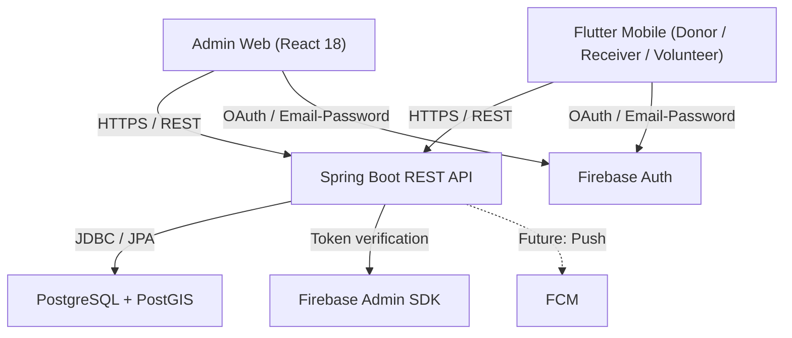

# MealShare — System Architecture Document

| Field       | Value                          |
|-------------|--------------------------------|
| **Version** | 1.0                            |
| **Date**    | September 26, 2026             |
| **Milestone** | CAPSTONE-02                  |
| **Status**  | Current                        |

---

## 1. Platform Overview

MealShare connects surplus-food donors with verified receiver organizations through a secure redistribution platform. The system provides:

- **Admin oversight** via a React-based web dashboard for user verification, donation tracking, and analytics.
- **Volunteer-managed logistics** with OTP-secured pickup handoffs.
- **PostGIS-powered spatial discovery** enabling proximity-based donation matching using real GPS coordinates.

The platform enforces role-based access control across four distinct user roles — Donor, Receiver (Organization + Volunteer), Volunteer, and Admin — with Firebase Authentication as the single identity provider.

---

## 2. Approved Technology Stack

| Layer                | Technology                                   | Version       | Purpose                                              |
|----------------------|----------------------------------------------|---------------|-------------------------------------------------------|
| Frontend (Admin)     | React + Vite + TypeScript                    | 18.3 / 8 / 5.8 | Admin dashboard, user management, analytics          |
| Frontend (Mobile)    | Flutter + Dart                               | 3.44.0 / 3.7  | Donor, Receiver, Volunteer mobile apps               |
| Authentication       | Firebase Authentication                      | —             | Token-based identity verification                    |
| Backend API          | Spring Boot + Java                           | 3.4.3 / 17    | REST API, business logic, security                   |
| Database             | PostgreSQL + PostGIS                         | 16.8 / 3.4.3  | Relational storage with spatial indexing             |
| Schema Migration     | Flyway                                       | 10.x          | Version-controlled database migrations (V1–V7)      |
| Containerization     | Docker Compose                               | —             | PostgreSQL + PostGIS development container           |

---

## 3. System Architecture Diagram

> Reference: `docs/diagrams/system_architecture.mmd`



---

## 4. Backend Architecture

### 4.1 Package Structure

```
com.mealshare
├── config/                  # Spring configuration (Security, CORS, Firebase)
├── security/                # FirebaseAuthenticationFilter, SecurityConfig
├── common/                  # Shared DTOs, exceptions, utilities
├── user/                    # User entity, repository, service, controller
├── donor/                   # Donor profile management
├── donation/                # Donation CRUD and lifecycle
├── receiver/
│   └── request/             # Donation request handling
├── pickup/
│   ├── controller/          # Pickup REST endpoints
│   └── otp/                 # OTP generation, verification, security
├── admin/
│   ├── controller/          # Admin-only REST endpoints
│   └── service/             # Admin business logic
└── notification/
    ├── event/               # Spring Application Event definitions
    └── fcm/                 # Firebase Cloud Messaging integration
```

### 4.2 API Surface

- **18 REST controllers** exposing **47 endpoints**.
- Standard REST conventions: `GET`, `POST`, `PUT`, `PATCH`, `DELETE`.
- Consistent error responses via `@ControllerAdvice` global exception handling.

### 4.3 Service Layer

- Business logic encapsulated in `@Service` classes with `@Transactional` annotations.
- Spring Data JPA repositories with derived queries and **native PostGIS queries** for spatial operations.
- **Spring Application Events** (`ApplicationEventPublisher`) for decoupled notification dispatch — services publish events; listeners handle persistence and delivery independently.

---

## 5. Security Architecture

### 5.1 Authentication Flow

```
Client Request
  │
  ├─ Authorization: Bearer <Firebase ID Token>
  │
  ▼
FirebaseAuthenticationFilter
  │
  ├─ 1. Extract Bearer token from header
  ├─ 2. Firebase Admin SDK → decodeIdToken(token)
  ├─ 3. DB lookup: users.firebase_uid → User entity
  ├─ 4. Map user status → Spring Security GrantedAuthority
  └─ 5. Set SecurityContextHolder authentication
```

### 5.2 Role Mapping

| Firebase UID Status | Spring Security Role     | Access Level              |
|----------------------|--------------------------|---------------------------|
| Active Donor         | `ROLE_DONOR`             | Donation management       |
| Active Receiver Org  | `ROLE_RECEIVER_ORG`      | Request management        |
| Active Receiver Vol  | `ROLE_RECEIVER_VOL`      | Pickup operations         |
| Active Admin         | `ROLE_ADMIN`             | Full platform access      |
| Suspended            | `ROLE_SUSPENDED`         | Read-only / blocked       |
| Unregistered         | `ROLE_UNREGISTERED`      | Registration only         |

### 5.3 Authorization

- **URL-pattern authorization** defined in `SecurityConfig` — public endpoints, role-restricted paths.
- **Method-level security** via `@PreAuthorize` annotations on controller methods for fine-grained access control.

### 5.4 CORS Configuration

- Allowed origins: `http://localhost:5173`, `http://localhost:3000`.
- Configured for development; production origins to be added during deployment.

### 5.5 OTP Security (Pickup Verification)

| Aspect            | Implementation                                      |
|--------------------|-----------------------------------------------------|
| Generation         | `SecureRandom` — 6-digit numeric code               |
| Storage            | BCrypt-hashed in database (plaintext never persisted)|
| Expiry             | 10-minute TTL from generation                       |
| Brute-force guard  | Maximum 5 verification attempts                     |
| Concurrency        | Pessimistic database locking during verification    |

---

## 6. Database Architecture

### 6.1 Schema Overview

- **10 tables** managed across **7 Flyway migrations** (V1 through V7).
- All migrations are version-controlled and applied automatically on application startup.

### 6.2 Table Inventory

| # | Table                  | Purpose                                        |
|---|------------------------|------------------------------------------------|
| 1 | `users`                | Core user identity and role assignment         |
| 2 | `donor_profiles`       | Donor-specific profile data                    |
| 3 | `receiver_organizations` | Verified receiver organization details       |
| 4 | `volunteer_profiles`   | Volunteer profile and assignment data          |
| 5 | `audit_logs`           | Admin action audit trail                       |
| 6 | `donations`            | Donation listings with metadata and status     |
| 7 | `donation_requests`    | Receiver requests against available donations  |
| 8 | `pickups`              | Pickup scheduling, OTP, and completion state   |
| 9 | `notifications`        | In-app notification persistence                |
| 10| `user_device_tokens`   | FCM device token registry                      |

### 6.3 PostGIS Spatial Configuration

| Parameter            | Value                                            |
|----------------------|--------------------------------------------------|
| Column type          | `GEOMETRY(Point, 4326)`                          |
| Spatial index        | GiST index on geometry column                   |
| Coordinate system    | SRID 4326 (WGS 84)                              |
| Proximity queries    | `ST_DWithin(geom, point, radius)` — meters-based|
| Distance calculation | `ST_Distance(geom_a, geom_b)` — Cartesian       |

Spatial queries power the donation discovery feature, enabling receivers to find nearby available donations within a configurable radius.

---

## 7. Frontend Architecture

### 7.1 Admin Web (React 18 SPA)

**Pages (10):**

| Page            | Function                                         |
|-----------------|--------------------------------------------------|
| Dashboard       | Platform-wide statistics and activity overview   |
| Users           | User listing, search, role management            |
| Donations       | Donation monitoring and lifecycle tracking       |
| Requests        | Donation request review and status management    |
| Pickups         | Pickup scheduling and completion tracking        |
| Verification    | Receiver organization document verification     |
| Reports         | Analytics and data export                        |
| Notifications   | Notification management and broadcast            |
| Settings        | Platform configuration                           |
| Login           | Firebase Authentication sign-in                  |

**Key integrations:**

- **Axios HTTP client** with Firebase token interceptor — automatically attaches `Authorization: Bearer <token>` to every API request.
- **Recharts** for analytics visualizations on the Dashboard and Reports pages.
- **Material UI** component library for consistent design.

### 7.2 Mobile (Flutter)

**State management:** Provider pattern.

**Screen inventory by role:**

| Role       | Screens | Description                                      |
|------------|---------|--------------------------------------------------|
| Donor      | 7       | Donation CRUD, history, profile, nearby discovery|
| Receiver   | 7       | Browse donations, request management, pickups    |
| Volunteer  | 1       | Active pickup assignment and OTP verification    |
| Auth       | 2       | Login and registration                           |

**Key features:**

- **Role-based routing** — the app dynamically presents screens based on the authenticated user's role.
- **Mock / live API mode switching** — enables development and testing without a running backend.
- **Firebase Auth integration** — sign-in, token refresh, and automatic session management.

---

## 8. Notification Architecture

### 8.1 Event-Driven Design

Notifications are dispatched through Spring Application Events, decoupling business logic from notification delivery.

```
Service Layer
  │
  ├─ applicationEventPublisher.publishEvent(event)
  │
  ▼
NotificationEventListener
  │
  ├─ @TransactionalEventListener(phase = AFTER_COMMIT, fallbackExecution = true)
  ├─ Persists Notification entity to PostgreSQL
  └─ Invokes FcmService (if configured)
```

- **9 Spring Application Event types** published via `ApplicationEventPublisher`.
- Listener executes **after the publishing transaction commits** to guarantee data consistency.
- `fallbackExecution = true` ensures the listener fires even if no transaction is active.

### 8.2 Notification Types

**11 `NotificationType` enum values** covering the full donation lifecycle:

Donation created, donation updated, donation expired, request submitted, request approved, request rejected, pickup scheduled, pickup completed, OTP generated, organization verified, and general system notifications.

### 8.3 In-App Notifications

- Notifications are **persisted to PostgreSQL** in the `notifications` table.
- Served to clients via **REST API** endpoints with read/unread status tracking.

### 8.4 Push Notifications (FCM)

> [!WARNING]
> **FCM physical device delivery is NOT TESTED.** The `FcmService` is coded but has not been validated with production Firebase credentials or physical devices.

- `FcmService` checks `FirebaseApp.getApps().isEmpty()` at invocation time.
- If no Firebase app is initialized (no production credentials), the service **skips push delivery silently**.
- Device tokens are stored in the `user_device_tokens` table, ready for production activation.

---

## 9. Future / Proposed Enhancements

> [!CAUTION]
> **The items below are NOT IMPLEMENTED.** They represent proposed future directions and are included for planning purposes only. No code exists for these features in the current codebase.

| Enhancement                              | Description                                                             |
|------------------------------------------|-------------------------------------------------------------------------|
| AI/ML Demand Prediction                  | Machine learning models to forecast donation supply and receiver demand |
| AI/ML Dynamic Matching                   | Intelligent donor–receiver matching based on historical patterns        |
| OR-Tools Route Optimization              | Google OR-Tools integration for optimal volunteer pickup routing        |
| Real-Time Event Streaming                | WebSocket or SSE connections for live donation and pickup updates       |
| Production FCM Push Notifications        | Full Firebase Cloud Messaging deployment with production credentials   |
| Horizontal Scaling & Cloud Deployment    | Container orchestration and cloud-native deployment architecture       |

---

*Document generated for CAPSTONE-02 milestone. Reflects the implemented state of the MealShare platform as of September 2026.*
