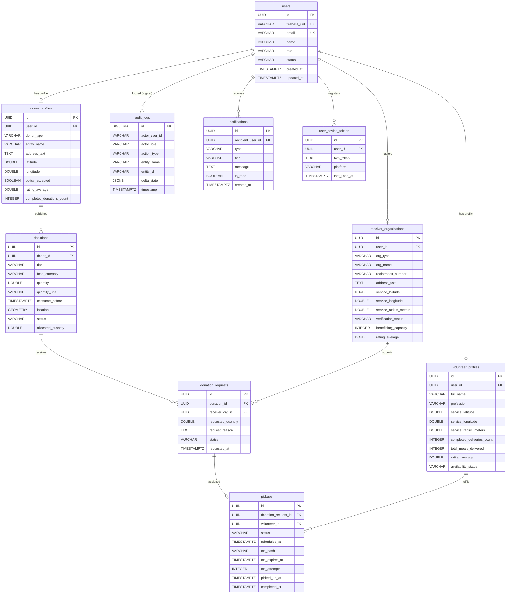

# MealShare — Entity-Relationship Model

| Field     | Value                |
|-----------|----------------------|
| Version   | 1.0                  |
| Date      | September 26, 2026   |
| Milestone | CAPSTONE-02          |

---

## 1  Schema Overview

| Property                | Value                                       |
|-------------------------|---------------------------------------------|
| RDBMS                   | PostgreSQL 16.8                             |
| Spatial Extension       | PostGIS 3.4.3                               |
| Migration Tool          | Flyway                                      |
| Migration Scripts       | V1 – V7 (7 versioned migrations)            |
| Total Tables            | 10                                          |
| Primary Key Strategy    | `UUID` with `DEFAULT gen_random_uuid()`     |
| Temporal Columns        | `TIMESTAMPTZ created_at` / `updated_at` on every table |

> [!NOTE]
> V1 bootstraps the PostGIS extension (`CREATE EXTENSION IF NOT EXISTS postgis`).  
> All subsequent migrations (V2–V7) create tables and add columns incrementally.

---

## 2  Table Definitions

### 2.1  `users`  *(V2)*

Core identity table. Every authenticated person has exactly one row here.

| Column       | Type            | Nullable | Default                  | Constraints / Notes                                                                                         |
|--------------|-----------------|----------|--------------------------|-------------------------------------------------------------------------------------------------------------|
| `id`         | `UUID`          | NO       | `gen_random_uuid()`      | **PK**                                                                                                      |
| `firebase_uid` | `VARCHAR(128)` | NO      |                          | `UNIQUE`                                                                                                    |
| `email`      | `VARCHAR(255)`  | NO       |                          | `UNIQUE`                                                                                                    |
| `phone`      | `VARCHAR(20)`   | YES      |                          |                                                                                                             |
| `name`       | `VARCHAR(255)`  | NO       |                          |                                                                                                             |
| `role`       | `VARCHAR(20)`   | NO       |                          | `CHECK (role IN ('DONOR', 'RECEIVER_ORG', 'RECEIVER_VOL', 'ADMIN'))`                                       |
| `status`     | `VARCHAR(30)`   | NO       | `'PENDING_VERIFICATION'` | `CHECK (status IN ('PENDING_VERIFICATION', 'ACTIVE', 'RESTRICTED', 'SUSPENDED'))`                          |
| `created_at` | `TIMESTAMPTZ`   | NO       | `NOW()`                  |                                                                                                             |
| `updated_at` | `TIMESTAMPTZ`   | NO       | `NOW()`                  |                                                                                                             |

**Indexes**

| Index Name              | Column(s)      | Type  |
|-------------------------|----------------|-------|
| `idx_users_firebase_uid`| `firebase_uid` | B-tree |
| `idx_users_email`       | `email`        | B-tree |
| `idx_users_role`        | `role`         | B-tree |

---

### 2.2  `donor_profiles`  *(V2)*

Extended profile for users whose role is `DONOR`.

| Column                      | Type               | Nullable | Default              | Constraints / Notes              |
|-----------------------------|--------------------|----------|----------------------|----------------------------------|
| `id`                        | `UUID`             | NO       | `gen_random_uuid()`  | **PK**                           |
| `user_id`                   | `UUID`             | NO       |                      | `UNIQUE`, **FK → `users(id)` ON DELETE CASCADE** |
| `donor_type`                | `VARCHAR(30)`      | NO       |                      |                                  |
| `entity_name`               | `VARCHAR(255)`     | NO       |                      |                                  |
| `address_text`              | `TEXT`             | NO       |                      |                                  |
| `latitude`                  | `DOUBLE PRECISION` | NO       |                      |                                  |
| `longitude`                 | `DOUBLE PRECISION` | NO       |                      |                                  |
| `policy_accepted`           | `BOOLEAN`          | NO       | `FALSE`              |                                  |
| `rating_average`            | `DOUBLE PRECISION` | NO       | `5.0`                |                                  |
| `completed_donations_count` | `INTEGER`          | NO       | `0`                  |                                  |
| `created_at`                | `TIMESTAMPTZ`      | NO       | `NOW()`              |                                  |
| `updated_at`                | `TIMESTAMPTZ`      | NO       | `NOW()`              |                                  |

---

### 2.3  `receiver_organizations`  *(V2)*

Extended profile for users whose role is `RECEIVER_ORG`.

| Column                  | Type               | Nullable | Default              | Constraints / Notes              |
|-------------------------|--------------------|----------|----------------------|----------------------------------|
| `id`                    | `UUID`             | NO       | `gen_random_uuid()`  | **PK**                           |
| `user_id`               | `UUID`             | NO       |                      | `UNIQUE`, **FK → `users(id)` ON DELETE CASCADE** |
| `org_type`              | `VARCHAR(30)`      | NO       |                      |                                  |
| `org_name`              | `VARCHAR(255)`     | NO       |                      |                                  |
| `registration_number`   | `VARCHAR(100)`     | NO       |                      |                                  |
| `address_text`          | `TEXT`             | NO       |                      |                                  |
| `service_latitude`      | `DOUBLE PRECISION` | NO       |                      |                                  |
| `service_longitude`     | `DOUBLE PRECISION` | NO       |                      |                                  |
| `service_radius_meters` | `DOUBLE PRECISION` | NO       | `10000.0`            |                                  |
| `verification_status`   | `VARCHAR(20)`      | NO       | `'PENDING'`          |                                  |
| `beneficiary_capacity`  | `INTEGER`          | NO       | `50`                 |                                  |
| `rating_average`        | `DOUBLE PRECISION` | NO       | `5.0`                |                                  |
| `created_at`            | `TIMESTAMPTZ`      | NO       | `NOW()`              |                                  |
| `updated_at`            | `TIMESTAMPTZ`      | NO       | `NOW()`              |                                  |

---

### 2.4  `volunteer_profiles`  *(V2 + V6)*

Extended profile for users whose role is `RECEIVER_VOL`.

| Column                      | Type               | Nullable | Default              | Constraints / Notes                                                        |
|-----------------------------|--------------------|----------|----------------------|----------------------------------------------------------------------------|
| `id`                        | `UUID`             | NO       | `gen_random_uuid()`  | **PK**                                                                     |
| `user_id`                   | `UUID`             | NO       |                      | `UNIQUE`, **FK → `users(id)` ON DELETE CASCADE**                           |
| `full_name`                 | `VARCHAR(255)`     | NO       |                      |                                                                            |
| `profession`                | `VARCHAR(100)`     | YES      |                      |                                                                            |
| `about_bio`                 | `TEXT`             | YES      |                      |                                                                            |
| `service_latitude`          | `DOUBLE PRECISION` | NO       |                      |                                                                            |
| `service_longitude`         | `DOUBLE PRECISION` | NO       |                      |                                                                            |
| `service_radius_meters`     | `DOUBLE PRECISION` | NO       | `10000.0`            |                                                                            |
| `completed_deliveries_count`| `INTEGER`          | NO       | `0`                  |                                                                            |
| `total_meals_delivered`     | `INTEGER`          | NO       | `0`                  |                                                                            |
| `rating_average`            | `DOUBLE PRECISION` | NO       | `5.0`                |                                                                            |
| `availability_status`       | `VARCHAR(20)`      | NO       | `'AVAILABLE'`        | `CHECK (availability_status IN ('AVAILABLE', 'BUSY', 'INACTIVE'))` — *added in V6* |
| `created_at`                | `TIMESTAMPTZ`      | NO       | `NOW()`              |                                                                            |
| `updated_at`                | `TIMESTAMPTZ`      | NO       | `NOW()`              |                                                                            |

---

### 2.5  `audit_logs`  *(V2)*

Append-only log capturing every state-changing action in the system.

| Column          | Type            | Nullable | Default  | Constraints / Notes |
|-----------------|-----------------|----------|----------|---------------------|
| `id`            | `BIGSERIAL`     | NO       | *auto*   | **PK**              |
| `actor_user_id` | `VARCHAR(255)`  | YES      |          | Logical reference to `users`; not FK-enforced |
| `actor_role`    | `VARCHAR(20)`   | NO       |          |                     |
| `action_type`   | `VARCHAR(50)`   | NO       |          |                     |
| `entity_name`   | `VARCHAR(100)`  | NO       |          |                     |
| `entity_id`     | `VARCHAR(255)`  | NO       |          |                     |
| `delta_state`   | `JSONB`         | YES      |          |                     |
| `client_ip`     | `VARCHAR(45)`   | YES      |          |                     |
| `user_agent`    | `TEXT`          | YES      |          |                     |
| `timestamp`     | `TIMESTAMPTZ`   | NO       | `NOW()`  |                     |

**Indexes**

| Index Name                  | Column(s)      | Type   |
|-----------------------------|----------------|--------|
| `idx_audit_logs_actor`      | `actor_user_id`| B-tree |
| `idx_audit_logs_entity`     | `entity_name`, `entity_id` | B-tree |
| `idx_audit_logs_timestamp`  | `timestamp`    | B-tree |

---

### 2.6  `donations`  *(V3 + V5)*

A food donation listing published by a donor.

| Column                         | Type                    | Nullable | Default        | Constraints / Notes                                                                                                  |
|--------------------------------|-------------------------|----------|----------------|----------------------------------------------------------------------------------------------------------------------|
| `id`                           | `UUID`                  | NO       | `gen_random_uuid()` | **PK**                                                                                                          |
| `donor_id`                     | `UUID`                  | NO       |                | **FK → `donor_profiles(id)` ON DELETE CASCADE**                                                                      |
| `title`                        | `VARCHAR(255)`          | NO       |                |                                                                                                                      |
| `description`                  | `TEXT`                  | YES      |                |                                                                                                                      |
| `food_category`                | `VARCHAR(50)`           | NO       |                | `CHECK (food_category IN ('PREPARED_MEALS', 'PACKAGED_FOOD', 'BAKERY', 'FRUITS', 'VEGETABLES', 'GRAINS', 'DAIRY', 'OTHER'))` |
| `quantity`                     | `DOUBLE PRECISION`      | NO       |                | `CHECK (quantity > 0)`                                                                                               |
| `quantity_unit`                | `VARCHAR(50)`           | NO       |                |                                                                                                                      |
| `preparation_datetime`         | `TIMESTAMPTZ`           | NO       |                |                                                                                                                      |
| `consume_before`               | `TIMESTAMPTZ`           | NO       |                |                                                                                                                      |
| `pickup_available_from`        | `TIMESTAMPTZ`           | NO       |                |                                                                                                                      |
| `pickup_available_until`       | `TIMESTAMPTZ`           | NO       |                |                                                                                                                      |
| `pickup_address`               | `TEXT`                  | NO       |                |                                                                                                                      |
| `latitude`                     | `DOUBLE PRECISION`      | NO       |                | `CHECK (latitude BETWEEN -90 AND 90)`                                                                                |
| `longitude`                    | `DOUBLE PRECISION`      | NO       |                | `CHECK (longitude BETWEEN -180 AND 180)`                                                                             |
| `location`                     | `GEOMETRY(Point, 4326)` | NO       |                | PostGIS spatial column                                                                                               |
| `food_safety_declared`         | `BOOLEAN`               | NO       | `FALSE`        |                                                                                                                      |
| `food_safety_declaration_text` | `TEXT`                  | YES      |                |                                                                                                                      |
| `food_safety_declared_at`      | `TIMESTAMPTZ`           | YES      |                |                                                                                                                      |
| `status`                       | `VARCHAR(30)`           | NO       | `'AVAILABLE'`  | `CHECK (status IN ('AVAILABLE', 'REQUESTED', 'APPROVED', 'PICKUP_ASSIGNED', 'PICKED_UP', 'COMPLETED', 'EXPIRED', 'CANCELLED'))` |
| `allocated_quantity`           | `DOUBLE PRECISION`      | NO       | `0.0`          | *Added in V5.* `CHECK (allocated_quantity >= 0 AND allocated_quantity <= quantity)`                                   |
| `created_at`                   | `TIMESTAMPTZ`           | NO       | `NOW()`        |                                                                                                                      |
| `updated_at`                   | `TIMESTAMPTZ`           | NO       | `NOW()`        |                                                                                                                      |

**Indexes**

| Index Name                    | Column(s)    | Type   |
|-------------------------------|--------------|--------|
| `idx_donations_donor_id`      | `donor_id`   | B-tree |
| `idx_donations_status`        | `status`     | B-tree |
| `idx_donations_created_at`    | `created_at DESC` | B-tree |
| `idx_donations_location_gist` | `location`   | GiST   |

---

### 2.7  `donation_requests`  *(V4)*

A request made by a receiver organization against a specific donation.

| Column             | Type               | Nullable | Default   | Constraints / Notes                                                                   |
|--------------------|--------------------|----------|-----------|---------------------------------------------------------------------------------------|
| `id`               | `UUID`             | NO       | `gen_random_uuid()` | **PK**                                                                        |
| `donation_id`      | `UUID`             | NO       |           | **FK → `donations(id)` ON DELETE CASCADE**                                            |
| `receiver_org_id`  | `UUID`             | NO       |           | **FK → `receiver_organizations(id)` ON DELETE CASCADE**                               |
| `requested_quantity` | `DOUBLE PRECISION` | NO     |           | `CHECK (requested_quantity > 0)`                                                      |
| `request_reason`   | `TEXT`             | YES      |           |                                                                                       |
| `status`           | `VARCHAR(30)`      | NO       | `'PENDING'` | `CHECK (status IN ('PENDING', 'APPROVED', 'REJECTED', 'WITHDRAWN', 'COMPLETED'))`   |
| `requested_at`     | `TIMESTAMPTZ`      | NO       | `NOW()`   |                                                                                       |
| `updated_at`       | `TIMESTAMPTZ`      | NO       | `NOW()`   |                                                                                       |

**Indexes**

| Index Name                              | Column(s) / Expression                              | Type            |
|-----------------------------------------|-----------------------------------------------------|-----------------|
| `idx_donation_requests_donation_id`     | `donation_id`                                       | B-tree          |
| `idx_donation_requests_receiver_org_id` | `receiver_org_id`                                   | B-tree          |
| `idx_donation_requests_fcfs`            | `donation_id`, `requested_at`                       | B-tree          |
| `idx_unique_active_donation_request`    | `(donation_id, receiver_org_id) WHERE status IN ('PENDING', 'APPROVED')` | Unique Partial  |

> [!IMPORTANT]
> The partial unique index `idx_unique_active_donation_request` prevents a receiver organization from having more than one active (PENDING or APPROVED) request against the same donation.

---

### 2.8  `pickups`  *(V6)*

Tracks the physical pickup-and-delivery lifecycle for an approved donation request.

| Column                | Type            | Nullable | Default        | Constraints / Notes                                                                  |
|-----------------------|-----------------|----------|----------------|--------------------------------------------------------------------------------------|
| `id`                  | `UUID`          | NO       | `gen_random_uuid()` | **PK**                                                                          |
| `donation_request_id` | `UUID`         | NO       |                | `UNIQUE`, **FK → `donation_requests(id)` ON DELETE CASCADE**                         |
| `volunteer_id`        | `UUID`          | NO       |                | **FK → `volunteer_profiles(id)` ON DELETE CASCADE**                                  |
| `status`              | `VARCHAR(30)`   | NO       | `'ASSIGNED'`   | `CHECK (status IN ('ASSIGNED', 'PICKED_UP', 'COMPLETED', 'CANCELLED'))`              |
| `scheduled_at`        | `TIMESTAMPTZ`   | NO       |                |                                                                                      |
| `assigned_at`         | `TIMESTAMPTZ`   | NO       | `NOW()`        |                                                                                      |
| `otp_hash`            | `VARCHAR(255)`  | NO       |                | Hashed one-time password for pickup verification                                     |
| `otp_expires_at`      | `TIMESTAMPTZ`   | NO       |                |                                                                                      |
| `otp_attempts`        | `INTEGER`       | NO       | `0`            |                                                                                      |
| `otp_verified_at`     | `TIMESTAMPTZ`   | YES      |                |                                                                                      |
| `picked_up_at`        | `TIMESTAMPTZ`   | YES      |                |                                                                                      |
| `completed_at`        | `TIMESTAMPTZ`   | YES      |                |                                                                                      |
| `created_at`          | `TIMESTAMPTZ`   | NO       | `NOW()`        |                                                                                      |
| `updated_at`          | `TIMESTAMPTZ`   | NO       | `NOW()`        |                                                                                      |

**Indexes**

| Index Name                        | Column(s)            | Type   |
|-----------------------------------|----------------------|--------|
| `idx_pickups_volunteer_id`        | `volunteer_id`       | B-tree |
| `idx_pickups_donation_request_id` | `donation_request_id`| B-tree |
| `idx_pickups_status`              | `status`             | B-tree |

---

### 2.9  `notifications`  *(V7)*

In-app notification records delivered to users.

| Column              | Type            | Nullable | Default              | Constraints / Notes                     |
|---------------------|-----------------|----------|----------------------|-----------------------------------------|
| `id`                | `UUID`          | NO       | `gen_random_uuid()`  | **PK**                                  |
| `recipient_user_id` | `UUID`         | NO       |                      | **FK → `users(id)` ON DELETE CASCADE**  |
| `type`              | `VARCHAR(50)`   | NO       |                      |                                         |
| `title`             | `VARCHAR(255)`  | NO       |                      |                                         |
| `message`           | `TEXT`          | NO       |                      |                                         |
| `entity_type`       | `VARCHAR(50)`   | YES      |                      |                                         |
| `entity_id`         | `UUID`          | YES      |                      |                                         |
| `is_read`           | `BOOLEAN`       | NO       | `FALSE`              |                                         |
| `created_at`        | `TIMESTAMPTZ`   | NO       | `NOW()`              |                                         |
| `read_at`           | `TIMESTAMPTZ`   | YES      |                      |                                         |

**Indexes**

| Index Name                          | Column(s)                        | Type   |
|-------------------------------------|----------------------------------|--------|
| `idx_notifications_recipient_user_id` | `recipient_user_id`            | B-tree |
| `idx_notifications_recipient_read`  | `recipient_user_id`, `is_read`   | B-tree |
| `idx_notifications_created_at`      | `created_at`                     | B-tree |

---

### 2.10  `user_device_tokens`  *(V7)*

Stores FCM device tokens for push-notification delivery.

| Column         | Type            | Nullable | Default              | Constraints / Notes                                         |
|----------------|-----------------|----------|----------------------|-------------------------------------------------------------|
| `id`           | `UUID`          | NO       | `gen_random_uuid()`  | **PK**                                                      |
| `user_id`      | `UUID`          | NO       |                      | **FK → `users(id)` ON DELETE CASCADE**                      |
| `fcm_token`    | `TEXT`          | NO       |                      |                                                             |
| `platform`     | `VARCHAR(30)`   | YES      |                      |                                                             |
| `created_at`   | `TIMESTAMPTZ`   | NO       | `NOW()`              |                                                             |
| `updated_at`   | `TIMESTAMPTZ`   | NO       | `NOW()`              |                                                             |
| `last_used_at` | `TIMESTAMPTZ`   | YES      |                      |                                                             |

**Constraints & Indexes**

| Name                            | Definition                      | Type            |
|---------------------------------|---------------------------------|-----------------|
| `uq_user_device_token`          | `(user_id, fcm_token)`          | Unique          |
| `idx_user_device_tokens_user_id`| `user_id`                       | B-tree          |

---

## 3  Foreign-Key Relationships

| FK Source Table          | FK Column(s)          | References Table             | References Column | ON DELETE |
|--------------------------|-----------------------|------------------------------|--------------------|-----------|
| `donor_profiles`         | `user_id`             | `users`                      | `id`               | CASCADE   |
| `receiver_organizations` | `user_id`             | `users`                      | `id`               | CASCADE   |
| `volunteer_profiles`     | `user_id`             | `users`                      | `id`               | CASCADE   |
| `donations`              | `donor_id`            | `donor_profiles`             | `id`               | CASCADE   |
| `donation_requests`      | `donation_id`         | `donations`                  | `id`               | CASCADE   |
| `donation_requests`      | `receiver_org_id`     | `receiver_organizations`     | `id`               | CASCADE   |
| `pickups`                | `donation_request_id` | `donation_requests`          | `id`               | CASCADE   |
| `pickups`                | `volunteer_id`        | `volunteer_profiles`         | `id`               | CASCADE   |
| `notifications`          | `recipient_user_id`   | `users`                      | `id`               | CASCADE   |
| `user_device_tokens`     | `user_id`             | `users`                      | `id`               | CASCADE   |

> [!NOTE]
> `audit_logs.actor_user_id` is typed `VARCHAR(255)` and is **not** FK-enforced.  
> It holds a logical reference to `users.id` for query convenience, but the absence of a
> hard foreign key ensures audit rows are never cascaded away when a user is deleted.

---

## 4  Database Constraints Summary

### 4.1  CHECK Constraints

| Table               | Column / Expression                                    | Rule                                                                                                        |
|---------------------|--------------------------------------------------------|-------------------------------------------------------------------------------------------------------------|
| `users`             | `role`                                                 | `IN ('DONOR', 'RECEIVER_ORG', 'RECEIVER_VOL', 'ADMIN')`                                                    |
| `users`             | `status`                                               | `IN ('PENDING_VERIFICATION', 'ACTIVE', 'RESTRICTED', 'SUSPENDED')`                                         |
| `volunteer_profiles`| `availability_status`                                  | `IN ('AVAILABLE', 'BUSY', 'INACTIVE')`                                                                     |
| `donations`         | `food_category`                                        | `IN ('PREPARED_MEALS', 'PACKAGED_FOOD', 'BAKERY', 'FRUITS', 'VEGETABLES', 'GRAINS', 'DAIRY', 'OTHER')`     |
| `donations`         | `quantity`                                             | `> 0`                                                                                                       |
| `donations`         | `latitude`                                             | `BETWEEN -90 AND 90`                                                                                        |
| `donations`         | `longitude`                                            | `BETWEEN -180 AND 180`                                                                                      |
| `donations`         | `status`                                               | `IN ('AVAILABLE', 'REQUESTED', 'APPROVED', 'PICKUP_ASSIGNED', 'PICKED_UP', 'COMPLETED', 'EXPIRED', 'CANCELLED')` |
| `donations`         | `allocated_quantity`                                   | `>= 0 AND <= quantity`                                                                                      |
| `donation_requests` | `requested_quantity`                                   | `> 0`                                                                                                       |
| `donation_requests` | `status`                                               | `IN ('PENDING', 'APPROVED', 'REJECTED', 'WITHDRAWN', 'COMPLETED')`                                         |
| `pickups`           | `status`                                               | `IN ('ASSIGNED', 'PICKED_UP', 'COMPLETED', 'CANCELLED')`                                                   |

### 4.2  UNIQUE Constraints

| Table                    | Column(s)                  | Constraint Name (if named)    |
|--------------------------|----------------------------|-------------------------------|
| `users`                  | `firebase_uid`             | *(implicit)*                  |
| `users`                  | `email`                    | *(implicit)*                  |
| `donor_profiles`         | `user_id`                  | *(implicit)*                  |
| `receiver_organizations` | `user_id`                  | *(implicit)*                  |
| `volunteer_profiles`     | `user_id`                  | *(implicit)*                  |
| `pickups`                | `donation_request_id`      | *(implicit)*                  |
| `user_device_tokens`     | `(user_id, fcm_token)`     | `uq_user_device_token`        |

### 4.3  Partial Indexes

| Table               | Index Name                          | Expression                                                               |
|---------------------|-------------------------------------|--------------------------------------------------------------------------|
| `donation_requests` | `idx_unique_active_donation_request`| `UNIQUE (donation_id, receiver_org_id) WHERE status IN ('PENDING', 'APPROVED')` |

---

## 5  Spatial Index Architecture

| Property           | Value                                                                |
|--------------------|----------------------------------------------------------------------|
| Extension          | PostGIS 3.4.3 — enabled via V1 migration                            |
| Spatial Column     | `donations.location` — `GEOMETRY(Point, 4326)`                      |
| SRID               | **4326** (WGS 84 — standard GPS coordinate reference system)        |
| Index              | `idx_donations_location_gist` — **GiST** index on `location`        |
| Query Functions    | `ST_DWithin(geography, geography, meters)` and `ST_Distance(geography, geography)` used in native SQL queries |

> [!TIP]
> The `latitude` / `longitude` scalar columns coexist with the PostGIS `location` column.
> Scalar columns simplify DTO mapping in Spring Boot, while the `location` column backs
> spatial queries via the GiST index.

---

## 6  ER Diagram

---

*End of document.*
