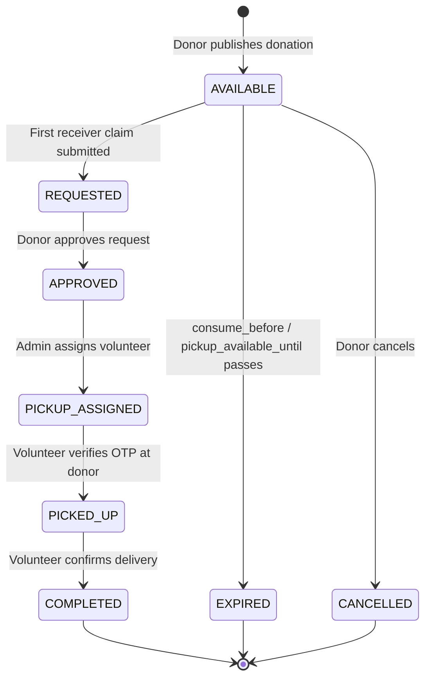
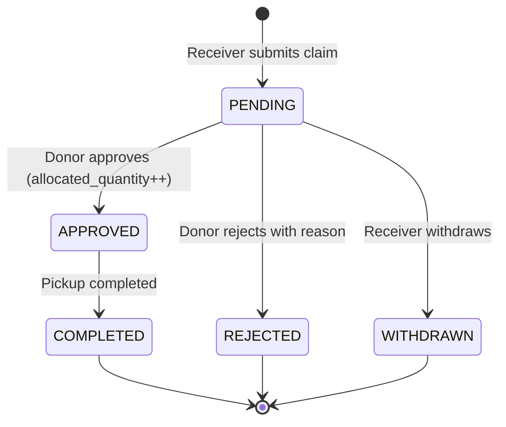
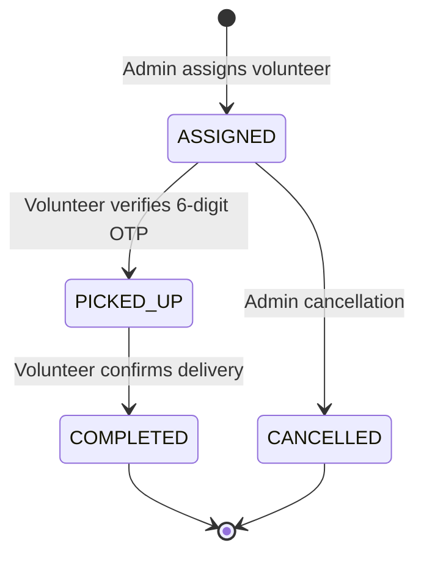
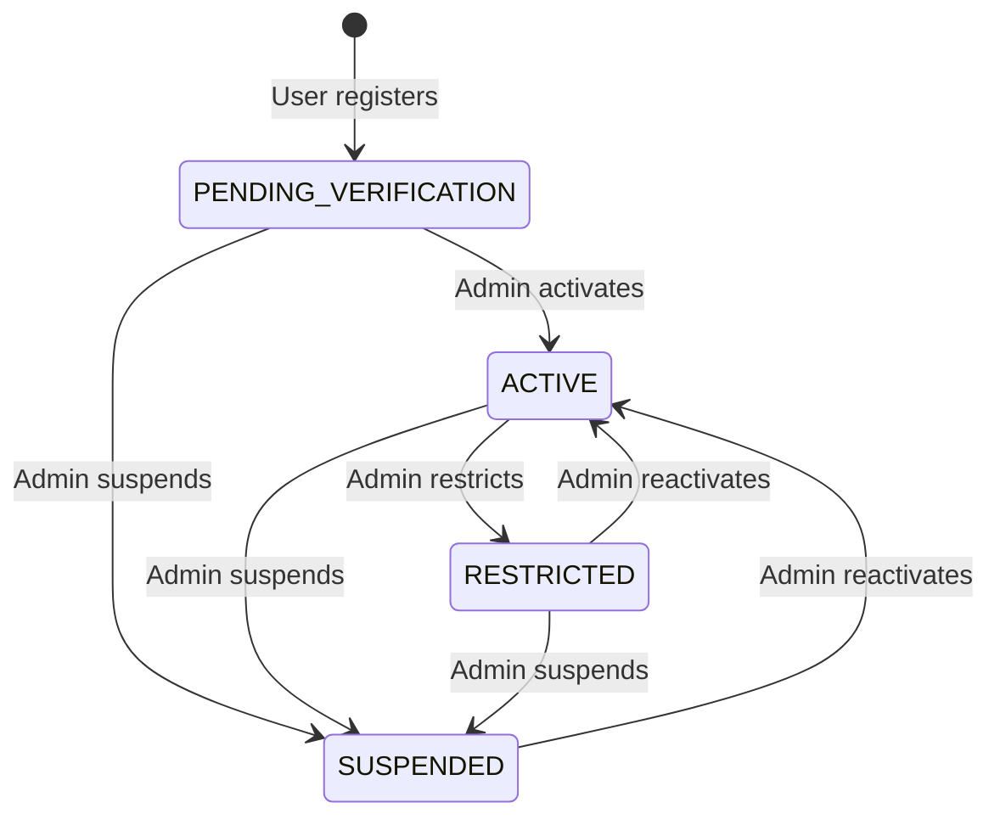
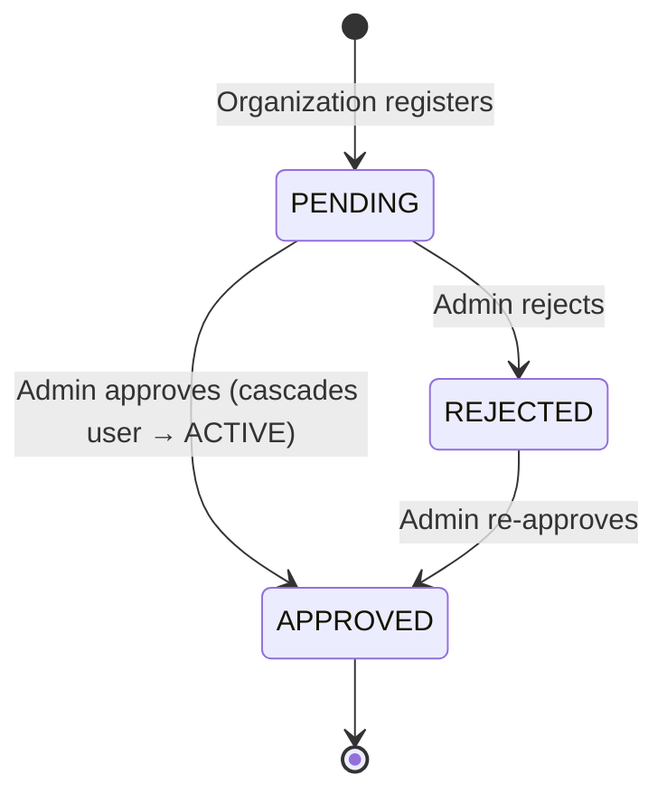
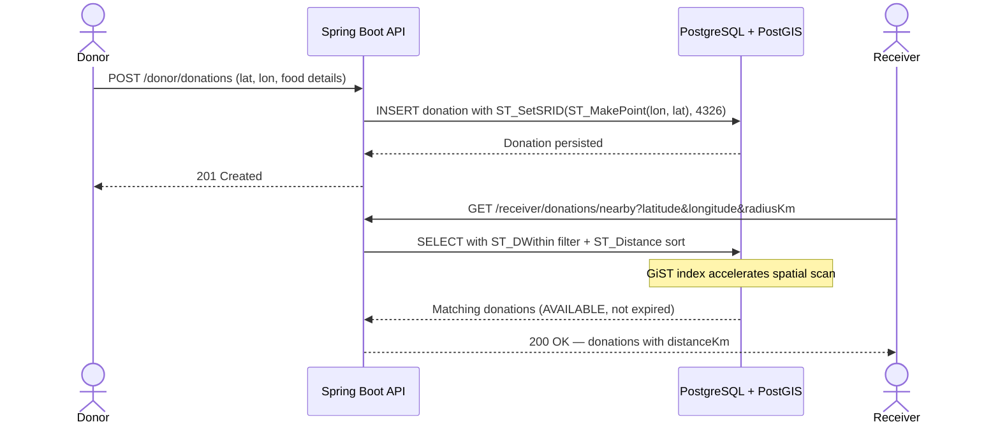
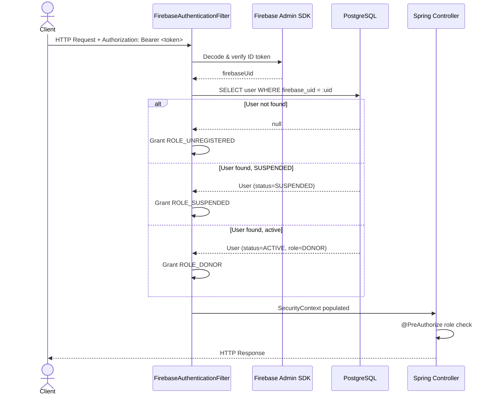
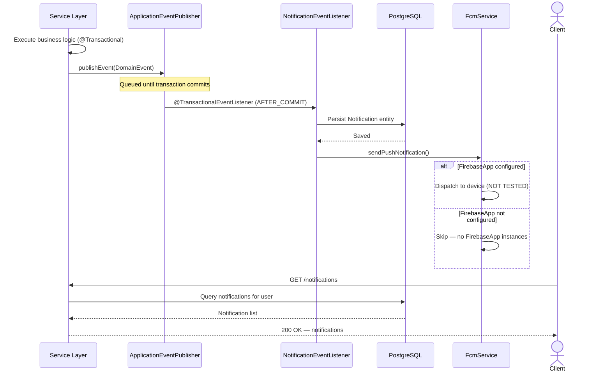
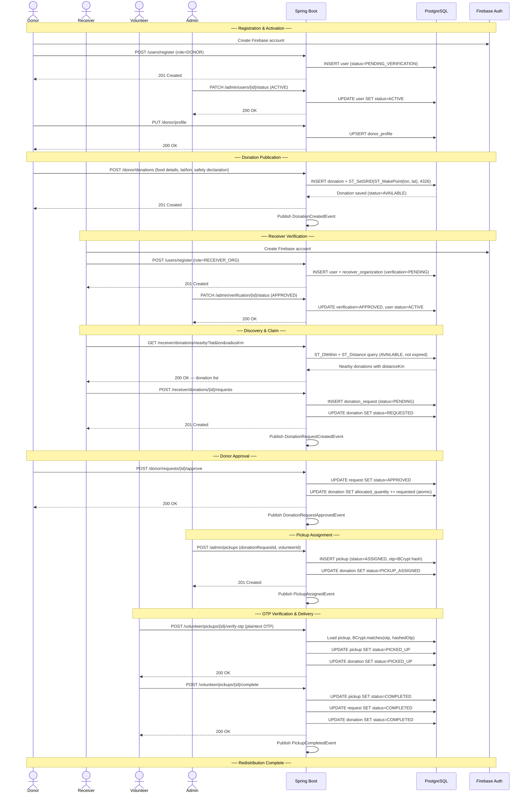

# MealShare — Business Process Flows

| Field     | Value                |
|-----------|----------------------|
| Version   | 1.0                  |
| Date      | September 26, 2026   |
| Milestone | CAPSTONE-02          |

---

## Table of Contents

1. [Donation Lifecycle State Machine](#1-donation-lifecycle-state-machine)
2. [Donation Request State Machine](#2-donation-request-state-machine)
3. [Pickup State Machine](#3-pickup-state-machine)
4. [User Status State Machine](#4-user-status-state-machine)
5. [Receiver Organization Verification Flow](#5-receiver-organization-verification-flow)
6. [PostGIS Spatial Process](#6-postgis-spatial-process)
7. [Security Flow](#7-security-flow)
8. [Notification Flow](#8-notification-flow)
9. [Food Safety Process](#9-food-safety-process)
10. [AI/ML Status](#10-aiml-status)
11. [End-to-End Demo Flow](#11-end-to-end-demo-flow)

---

## 1. Donation Lifecycle State Machine

The `DonationStatus` enum (defined in `DonationStatus.java`) governs the full lifecycle of every donation record. Eight discrete states model the journey from publication through completion, expiry, or cancellation.

### 1.1 Enum Values

| Status            | Description                                              |
|-------------------|----------------------------------------------------------|
| `AVAILABLE`       | Donation published and visible to nearby receivers       |
| `REQUESTED`       | At least one receiver has submitted a claim               |
| `APPROVED`        | Donor has approved a receiver's request                   |
| `PICKUP_ASSIGNED` | Admin has assigned a volunteer for physical pickup         |
| `PICKED_UP`       | Volunteer has verified OTP at donor location              |
| `COMPLETED`       | Volunteer has confirmed delivery to receiver              |
| `EXPIRED`         | `consume_before` or `pickup_available_until` has passed   |
| `CANCELLED`       | Donor has explicitly cancelled the donation               |

### 1.2 State Transitions

| From              | To                | Trigger                                                                 |
|-------------------|-------------------|-------------------------------------------------------------------------|
| `AVAILABLE`       | `REQUESTED`       | First receiver claim submitted (`DonationRequestService`)               |
| `AVAILABLE`       | `CANCELLED`       | Donor cancels via `POST /donor/donations/{id}/cancel`                   |
| `AVAILABLE`       | `EXPIRED`         | Temporal expiry — `consume_before` or `pickup_available_until` passes   |
| `REQUESTED`       | `APPROVED`        | Donor approves a request (`DonorRequestService`)                        |
| `APPROVED`        | `PICKUP_ASSIGNED` | Admin assigns a volunteer pickup (`PickupService.assignVolunteer`)      |
| `PICKUP_ASSIGNED` | `PICKED_UP`       | Volunteer verifies OTP at donor location (`PickupService.verifyOtp`)    |
| `PICKED_UP`       | `COMPLETED`       | Volunteer marks delivery complete (`PickupService.completePickup`)      |

### 1.3 State Diagram



---

## 2. Donation Request State Machine

The `DonationRequestStatus` enum tracks individual receiver claims against a donation. Multiple requests can exist per donation; the donor adjudicates each independently.

### 2.1 Enum Values

| Status      | Description                                            |
|-------------|--------------------------------------------------------|
| `PENDING`   | Request submitted, awaiting donor decision             |
| `APPROVED`  | Donor has approved; `allocated_quantity` incremented    |
| `REJECTED`  | Donor has rejected with a reason                       |
| `WITHDRAWN` | Receiver withdrew the request before adjudication      |
| `COMPLETED` | Pickup completed — request fulfilled                   |

### 2.2 State Transitions

| From       | To          | Trigger                                                                          |
|------------|-------------|----------------------------------------------------------------------------------|
| `PENDING`  | `APPROVED`  | Donor approves — atomically increments `allocated_quantity` on the donation       |
| `PENDING`  | `REJECTED`  | Donor rejects with reason                                                        |
| `PENDING`  | `WITHDRAWN` | Receiver withdraws before adjudication                                           |
| `APPROVED` | `COMPLETED` | Pickup completed — `PickupService.completePickup` cascades request status update |

### 2.3 State Diagram



---

## 3. Pickup State Machine

The `PickupStatus` enum models the physical logistics leg — from volunteer assignment through delivery confirmation.

### 3.1 Enum Values

| Status      | Description                                          |
|-------------|------------------------------------------------------|
| `ASSIGNED`  | Admin has assigned a volunteer to the pickup          |
| `PICKED_UP` | Volunteer has collected food from donor (OTP verified)|
| `COMPLETED` | Volunteer has delivered food to receiver              |
| `CANCELLED` | Admin cancellation                                   |

### 3.2 State Transitions

| From       | To          | Trigger                                               |
|------------|-------------|-------------------------------------------------------|
| `ASSIGNED` | `PICKED_UP` | Volunteer verifies 6-digit OTP at donor location      |
| `PICKED_UP`| `COMPLETED` | Volunteer marks delivery to receiver as complete      |
| `ASSIGNED` | `CANCELLED` | Admin cancellation (if implemented)                   |

### 3.3 State Diagram



---

## 4. User Status State Machine

The `UserStatus` enum controls platform access. Status changes are performed exclusively by admins.

### 4.1 Enum Values

| Status                  | Description                                     |
|-------------------------|-------------------------------------------------|
| `PENDING_VERIFICATION`  | Newly registered, awaiting admin activation     |
| `ACTIVE`                | Fully operational account                       |
| `RESTRICTED`            | Partially restricted by admin                   |
| `SUSPENDED`             | Fully blocked — assigned `ROLE_SUSPENDED`        |

### 4.2 State Transitions

| From                   | To           | Trigger              |
|------------------------|--------------|----------------------|
| `PENDING_VERIFICATION` | `ACTIVE`     | Admin activates user |
| `ACTIVE`               | `RESTRICTED` | Admin restricts      |
| `ACTIVE`               | `SUSPENDED`  | Admin suspends       |
| `RESTRICTED`           | `ACTIVE`     | Admin reactivates    |
| `SUSPENDED`            | `ACTIVE`     | Admin reactivates    |
| Any status             | `SUSPENDED`  | Admin can suspend from any state |

> [!IMPORTANT]
> Suspended users are assigned `ROLE_SUSPENDED` in `FirebaseAuthenticationFilter`, which blocks access to all operational endpoints regardless of the user's original role.

### 4.3 State Diagram



---

## 5. Receiver Organization Verification Flow

Receiver organizations undergo a separate verification workflow before they can operate on the platform. The `verification_status` field is stored as a `String` (not an enum) in the database.

### 5.1 Status Values

| Status     | Description                                    |
|------------|------------------------------------------------|
| `PENDING`  | Organization submitted, awaiting admin review  |
| `APPROVED` | Admin approved — user status cascaded to ACTIVE|
| `REJECTED` | Admin rejected the organization                |

### 5.2 State Transitions

| From       | To         | Trigger                                                                            |
|------------|------------|------------------------------------------------------------------------------------|
| `PENDING`  | `APPROVED` | Admin approves — `AdminVerificationService` cascades user status to `ACTIVE`       |
| `PENDING`  | `REJECTED` | Admin rejects                                                                      |
| `REJECTED` | `APPROVED` | Admin can re-approve a previously rejected organization                            |

### 5.3 State Diagram



---

## 6. PostGIS Spatial Process

Geo-spatial discovery is powered by PostgreSQL with the PostGIS extension. Donor coordinates are stored as `GEOMETRY(Point, 4326)` columns, and receiver searches leverage spatial SQL functions with a GiST index for performance.

### 6.1 Process Steps

| Step | Actor / Component       | Action                                                                                      |
|------|-------------------------|---------------------------------------------------------------------------------------------|
| 1    | Donor                   | Publishes donation with `latitude` and `longitude`                                          |
| 2    | `DonationService`       | Creates PostGIS geometry via `ST_SetSRID(ST_MakePoint(lon, lat), 4326)`                     |
| 3    | Receiver                | Searches nearby donations via `GET /receiver/donations/nearby?latitude=x&longitude=y&radiusKm=z` |
| 4    | `DonationRepository`    | Executes native SQL with `ST_DWithin` for filtering and `ST_Distance` for sorting           |
| 5    | Query filters           | `status = AVAILABLE`, `consume_before > NOW()`, `pickup_available_until > NOW()`            |
| 6    | API Response            | Returns matching donations with computed `distanceKm`                                       |

### 6.2 Native SQL Functions Used

```sql
-- Proximity filter (within radius)
ST_DWithin(
    d.location,
    ST_SetSRID(ST_MakePoint(:longitude, :latitude), 4326),
    :radiusInDegrees
)

-- Distance calculation (for sorting)
ST_Distance(
    d.location,
    ST_SetSRID(ST_MakePoint(:longitude, :latitude), 4326)
)
```

> [!NOTE]
> A **GiST index** on the `location` column enables efficient spatial queries, avoiding full table scans for proximity searches.

### 6.3 Sequence Diagram



---

## 7. Security Flow

All API requests are authenticated via Firebase ID tokens. The `FirebaseAuthenticationFilter` intercepts every request, decodes the token, and maps the Firebase UID to a local user record to determine the granted authority.

### 7.1 Authentication Steps

| Step | Action                                                                                   |
|------|------------------------------------------------------------------------------------------|
| 1    | Client sends HTTP request with `Authorization: Bearer <Firebase_ID_Token>`               |
| 2    | `FirebaseAuthenticationFilter` extracts token from the `Authorization` header            |
| 3    | Firebase Admin SDK decodes and verifies the token → extracts `firebaseUid`               |
| 4    | Filter looks up user in PostgreSQL by `firebaseUid`                                      |
| 5    | If user **not found** → assigns `ROLE_UNREGISTERED`                                      |
| 6    | If user found but status = `SUSPENDED` → assigns `ROLE_SUSPENDED`                        |
| 7    | If user found and active → assigns `ROLE_<user.role>` (e.g., `ROLE_DONOR`, `ROLE_RECEIVER_ORG`, `ROLE_RECEIVER_VOL`, `ROLE_ADMIN`) |
| 8    | `SecurityContext` populated → request proceeds to controller                             |
| 9    | `@PreAuthorize` annotations enforce role-based access at controller method level          |

### 7.2 Granted Authorities

| Condition             | Granted Authority     |
|-----------------------|-----------------------|
| No user record found  | `ROLE_UNREGISTERED`   |
| User is suspended     | `ROLE_SUSPENDED`      |
| User role = DONOR     | `ROLE_DONOR`          |
| User role = RECEIVER_ORG | `ROLE_RECEIVER_ORG` |
| User role = RECEIVER_VOL | `ROLE_RECEIVER_VOL` |
| User role = ADMIN     | `ROLE_ADMIN`          |

### 7.3 Sequence Diagram



---

## 8. Notification Flow

Notifications are driven by Spring Application Events, decoupling business logic from notification delivery. Nine event types are published across the donation lifecycle.

### 8.1 Event Types

| Event Class                       | Published When                       |
|-----------------------------------|--------------------------------------|
| `DonationCreatedEvent`            | Donor publishes a new donation       |
| `DonationCancelledEvent`          | Donor cancels a donation             |
| `DonationRequestCreatedEvent`     | Receiver submits a claim             |
| `DonationRequestApprovedEvent`    | Donor approves a request             |
| `DonationRequestRejectedEvent`    | Donor rejects a request              |
| `DonationRequestWithdrawnEvent`   | Receiver withdraws a request         |
| `PickupAssignedEvent`             | Admin assigns volunteer to pickup    |
| `PickupCompletedEvent`            | Volunteer completes delivery         |
| `UserStatusChangedEvent`          | Admin changes a user's status        |

### 8.2 Processing Flow

| Step | Component                        | Action                                                                    |
|------|----------------------------------|---------------------------------------------------------------------------|
| 1    | Service method                   | Completes business logic within `@Transactional`                          |
| 2    | Service method                   | Publishes event via `applicationEventPublisher.publishEvent()`            |
| 3    | `NotificationEventListener`      | `@TransactionalEventListener(phase = AFTER_COMMIT)` fires after commit   |
| 4    | `NotificationEventListener`      | Creates `Notification` entity and persists to PostgreSQL                  |
| 5    | `FcmService`                     | `sendPushNotification()` called — **skips if `FirebaseApp.getApps().isEmpty()`** |
| 6    | Client                           | Polls `GET /notifications` and `GET /notifications/unread-count`          |

> [!WARNING]
> **FCM physical device delivery is NOT TESTED.** Push notification dispatch requires production Firebase credentials. The `FcmService` gracefully skips sending when no `FirebaseApp` instance is configured. In-app notification persistence (step 4) works independently of FCM.

### 8.3 Sequence Diagram



---

## 9. Food Safety Process

MealShare implements temporal and declarative food safety controls. These are **self-declaration** mechanisms — no physical inspection, temperature logging, or third-party certification is performed by the platform.

### 9.1 Implemented Controls

| Control                          | Type        | Validation Rule                                                  |
|----------------------------------|-------------|------------------------------------------------------------------|
| `food_safety_declared`           | `boolean`   | **Must be `TRUE`** to create a donation                          |
| `food_safety_declaration_text`   | `String`    | Optional — donor's free-text self-declaration                    |
| `food_safety_declared_at`        | `timestamp` | Automatically recorded at donation creation                      |
| `consume_before`                 | `timestamp` | **Must be in the future** at creation time                       |
| `pickup_available_until`         | `timestamp` | **Must be after** `pickup_available_from` **and before** `consume_before` |
| `preparation_datetime`           | `timestamp` | **Must be in the past or present** at creation time              |

### 9.2 Discovery-Time Filters

When receivers search for nearby donations, the query enforces:

```
consume_before > NOW()  AND  pickup_available_until > NOW()
```

Donations that fail either condition are excluded from search results, preventing receivers from discovering expired food.

### 9.3 What Is NOT Implemented

> [!CAUTION]
> The following food safety measures are **NOT implemented** in the current system:
> - Physical food inspection or quality checks
> - Temperature logging or cold-chain monitoring
> - Third-party food safety certification
> - Regulatory compliance verification (FSSAI or equivalent)
>
> **Legal liability for food safety remains with donors and receivers.** The platform provides temporal guardrails and self-declaration only.

---

## 10. AI/ML Status

> [!IMPORTANT]
> **Status: FUTURE / PROPOSED — NOT IMPLEMENTED**

No ML models, training pipelines, inference endpoints, OR-Tools integration, TensorFlow, or PyTorch code exists in the codebase.

### 10.1 Current AI/ML References in Codebase

| Location                            | Content                                            |
|-------------------------------------|----------------------------------------------------|
| `docs/MealShare_Architecture.md`    | Future Integrations section (roadmap text only)    |
| `admin-web/package-lock.json`       | `@firebase/ai` SDK dependency (Firebase SDK, not custom ML) |

### 10.2 Proposed Future Enhancements (Roadmap Only)

These items appear in planning documents but have **zero implementation**:

- **Demand prediction and dynamic matching** — Predict receiver demand patterns to proactively match surplus food
- **Route optimization using OR-Tools** — Optimize volunteer pickup/delivery routes for multi-stop efficiency
- **Predictive analytics for food waste patterns** — Identify trends in donation expiry and waste reduction opportunities

---

## 11. End-to-End Demo Flow

This section traces a complete food redistribution workflow from donor registration through delivery confirmation, covering all actors and system interactions.

### 11.1 Step-by-Step Walkthrough

| Step | Actor     | Action                                                                                   | API Endpoint                                      |
|------|-----------|------------------------------------------------------------------------------------------|---------------------------------------------------|
| 1    | Donor     | Registers on the platform                                                                | `POST /users/register` (role=DONOR)               |
| 2    | System    | User created with `status=PENDING_VERIFICATION`                                         | —                                                 |
| 3    | Admin     | Activates donor account                                                                  | `PATCH /admin/users/{id}/status`                  |
| 4    | Donor     | Creates donor profile                                                                    | `PUT /donor/profile`                              |
| 5    | Donor     | Publishes donation with food safety declaration and coordinates                          | `POST /donor/donations`                           |
| 6    | Receiver  | Registers as organization and gets verified by admin                                     | `POST /users/register` + `PATCH /admin/verification/{id}/status` |
| 7    | Receiver  | Discovers nearby available donations                                                     | `GET /receiver/donations/nearby` (PostGIS query)  |
| 8    | Receiver  | Claims a donation                                                                        | `POST /receiver/donations/{id}/requests`          |
| 9    | Donor     | Approves the claim (atomic `allocated_quantity` update)                                  | `POST /donor/requests/{id}/approve`               |
| 10   | Admin     | Assigns volunteer for pickup (generates OTP, notifies volunteer)                         | `POST /admin/pickups`                             |
| 11   | Volunteer | Verifies 6-digit OTP at donor location (BCrypt comparison)                               | `POST /volunteer/pickups/{id}/verify-otp`         |
| 12   | Volunteer | Completes delivery to receiver                                                           | `POST /volunteer/pickups/{id}/complete`            |
| 13   | System    | Cascading status updates: `pickup=COMPLETED`, `request=COMPLETED`, `donation=COMPLETED` | —                                                 |
| 14   | System    | Notifications generated at each step via Spring Application Events                       | —                                                 |

### 11.2 Comprehensive Sequence Diagram



---

*Document generated for MealShare Capstone Project — CAPSTONE-02 Milestone*
