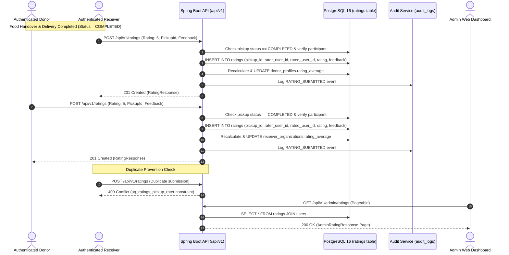

# CAPSTONE-11 — LIVE RATINGS & FEEDBACK SYSTEM

**Document Version:** 1.0  
**Date:** October 7, 2026  
**Milestone:** CAPSTONE-11  
**Project:** MealShare (Redistribution Platform)  
**Roles:** DONOR, RECEIVER, ADMIN (Strict 3-Role Model — Zero Volunteers)  

---

## 1. Executive Summary

Milestone **CAPSTONE-11** implements the complete, production-grade **Ratings & Feedback System** for MealShare. 

The feature establishes mutual accountability and trust between food redistribution participants. Following successful delivery of surplus food, both the Donor and the Receiver can independently submit a 1-to-5 star rating accompanied by qualitative feedback. All data is persisted directly in PostgreSQL via Flyway versioned migrations, audited in real-time, aggregated into user profiles, and surfaced across both mobile (Flutter) and desktop (React Admin) clients without mocks or sample data.

---

## 2. System Architecture & Lifecycle Integration



### Key Architectural Tenets
1. **Strict Post-Completion Trigger:** Ratings can only be created once a pickup transaction reaches `COMPLETED`. Pre-completion attempts return `HTTP 400 Bad Request`.
2. **Mutual Counterpart Resolution:** The backend automatically identifies who the counterpart is based on the pickup's `donation_request` relationships:
   - When a `DONOR` rates, the target is the `receiver_organizations.user_id`.
   - When a `RECEIVER` rates, the target is the `donor_profiles.user_id`.
3. **Immutability & Singularity:** Each participant is permitted exactly one rating per completed pickup. Submissions are immutable.
4. **No Self-Rating:** Enforced at both the service layer and database CHECK constraint (`chk_ratings_different_users`).
5. **No Third-Party Ratings:** Unrelated users or administrators attempting to rate a pickup are blocked with `HTTP 403 Forbidden`.

---

## 3. Database Architecture (Flyway V10)

The persistence tier was implemented via Flyway migration [`V10__create_ratings_table.sql`](file:///k:/MCA%20-%20PES/Sem%203/MealShare/backend/src/main/resources/db/migration/V10__create_ratings_table.sql).

### Table Schema: `ratings`

| Column | Type | Nullable | Default | Description |
| :--- | :--- | :--- | :--- | :--- |
| `id` | `UUID` | `NOT NULL` | `gen_random_uuid()` | Primary Key |
| `pickup_id` | `UUID` | `NOT NULL` | — | Foreign Key $\to$ `pickups(id)` ON DELETE CASCADE |
| `rater_user_id` | `UUID` | `NOT NULL` | — | Foreign Key $\to$ `users(id)` ON DELETE CASCADE |
| `rated_user_id` | `UUID` | `NOT NULL` | — | Foreign Key $\to$ `users(id)` ON DELETE CASCADE |
| `rating` | `INTEGER` | `NOT NULL` | — | Star score (1 to 5) |
| `feedback` | `TEXT` | `NULL` | — | Optional written feedback (trimmed, max 1000 chars) |
| `created_at` | `TIMESTAMPTZ` | `NOT NULL` | `NOW()` | Submission timestamp |

### Database Constraints & Indexes

```sql
-- 1. Uniqueness: exactly one rating per pickup per user
CONSTRAINT uq_ratings_pickup_rater UNIQUE (pickup_id, rater_user_id);

-- 2. Range validation: 1 to 5 stars
CONSTRAINT ratings_rating_check CHECK (rating >= 1 AND rating <= 5);

-- 3. Self-rating prevention
CONSTRAINT chk_ratings_different_users CHECK (rater_user_id <> rated_user_id);

-- Performance Indexes
CREATE INDEX idx_ratings_pickup_id ON ratings(pickup_id);
CREATE INDEX idx_ratings_rater_user_id ON ratings(rater_user_id);
CREATE INDEX idx_ratings_rated_user_id ON ratings(rated_user_id);
CREATE INDEX idx_ratings_created_at ON ratings(created_at DESC);
```

### Direct PostgreSQL Verification Output

Execution against running Docker container `mealshare-postgres`:

```
                  id                  |              pickup_id               |            rater_user_id             |            rated_user_id             | rating |                                       feedback                                        |          created_at           
--------------------------------------+--------------------------------------+--------------------------------------+--------------------------------------+--------+---------------------------------------------------------------------------------------+-------------------------------
 98507d46-574a-4223-a111-b7e788b9e27d | 82cab6a8-d775-447b-9f1d-abb6050fd13f | 11111111-1111-1111-1111-111111111111 | 22222222-2222-2222-2222-222222222221 |      5 | Receiver arrived on time with proper food carriers and completed pickup courteously.  | 2026-10-07 05:19:29.482069+00
 1713c8b7-6387-4905-9658-6b2ac2f99c6a | 82cab6a8-d775-447b-9f1d-abb6050fd13f | 22222222-2222-2222-2222-222222222221 | 11111111-1111-1111-1111-111111111111 |      5 | Outstanding food condition, warm insulated packing, and prompt coordination by donor! | 2026-10-07 05:19:29.37335+00
(2 rows)
```

SQL Constraint checks verified:
- Attempting `rating = 6` $\to$ `ERROR: new row for relation "ratings" violates check constraint "ratings_rating_check"`
- Attempting `rater_user_id == rated_user_id` $\to$ `ERROR: new row for relation "ratings" violates check constraint "chk_ratings_different_users"`
- Attempting duplicate rating $\to$ `ERROR: duplicate key value violates unique constraint "uq_ratings_pickup_rater"`

---

## 4. REST API Endpoints

### 4.1. Submit Rating
- **Method:** `POST`
- **Path:** `/api/v1/ratings`
- **Security:** `@PreAuthorize("hasAnyRole('DONOR', 'RECEIVER')")`
- **Request Body:**
  ```json
  {
    "pickupId": "82cab6a8-d775-447b-9f1d-abb6050fd13f",
    "rating": 5,
    "feedback": "Prompt collection and courteous handling."
  }
  ```
- **Responses:**
  - `201 Created`: Returns `RatingResponse` with resolved participant names and roles.
  - `400 Bad Request`: Pickup not in `COMPLETED` status or invalid rating value (e.g. 0 or 6).
  - `403 Forbidden`: User was not a participant in this pickup, or caller is an Admin.
  - `409 Conflict`: User has already rated this pickup.

### 4.2. Pickup Rating Status
- **Method:** `GET`
- **Path:** `/api/v1/ratings/pickup/{pickupId}`
- **Security:** `@PreAuthorize("hasAnyRole('DONOR', 'RECEIVER')")`
- **Responses:**
  - `200 OK`: Returns `PickupRatingStatusResponse`:
    ```json
    {
      "pickupId": "82cab6a8-d775-447b-9f1d-abb6050fd13f",
      "canRate": false,
      "alreadyRated": true,
      "myRating": { "id": "...", "rating": 5, "feedback": "..." },
      "counterpartRating": { "id": "...", "rating": 5, "feedback": "..." },
      "allRatings": [ ... ]
    }
    ```
  - `403 Forbidden`: Requesting user is not a participant in this pickup.

### 4.3. Admin Ratings Moderation Listing
- **Method:** `GET`
- **Path:** `/api/v1/admin/ratings`
- **Security:** `@PreAuthorize("hasRole('ADMIN')")`
- **Query Parameters:** `page`, `size`, `sort`
- **Responses:**
  - `200 OK`: Returns Spring `Page<AdminRatingResponse>` containing detailed metadata, donor donation title, rater/rated roles and emails, timestamps, and feedback for compliance oversight.

---

## 5. Client Implementations

### 5.1. Mobile Client (Flutter)
- **`mobile/lib/shared/widgets/rating_dialog.dart`**: Reusable modal dialog with interactive 5-star selection, review feedback input with character counter, loading progress indicator, and double-submission protection.
- **`mobile/lib/donor/donation_details_screen.dart`**: Evaluates completed pickup states and fetches rating status from `/api/v1/ratings/pickup/{id}`. Renders a prominent `"Rate Receiver"` button or a `"Rated 5 ★ (✓ Rating submitted)"` badge.
- **`mobile/lib/receiver/receiver_pickups_screen.dart`**: On completed food collections, renders a `"Rate Donor"` button or status badge displaying their submitted score.

### 5.2. Web Client (React Admin)
- **`admin-web/src/pages/RatingsPage.tsx`**: Administrative moderation interface with:
  - Metric cards: Total Reviews, Average Platform Rating, 5-Star Reviews count.
  - Filterable and searchable data table: Stars, feedback snippet, rater badge, rated user badge, donation title, and created date.
  - Detailed modal drawer for reviewing comprehensive feedback details.
- **`admin-web/src/App.tsx` & `Sidebar.tsx`**: Mounted under `/admin/ratings` within the **Trust & Safety** navigation section.

---

## 6. Verification and Test Results

### 6.1. Unit & Integration Tests (16/16 Passed)
```
[INFO] Running com.mealshare.rating.RatingSecurityAndApiTest
[INFO] Tests run: 8, Failures: 0, Errors: 0, Skipped: 0 -- in RatingSecurityAndApiTest
[INFO] Running com.mealshare.rating.RatingServiceTest
[INFO] Tests run: 8, Failures: 0, Errors: 0, Skipped: 0 -- in RatingServiceTest
[INFO] BUILD SUCCESS
```

| Test Class | Test Case | Description | Result |
| :--- | :--- | :--- | :--- |
| `RatingServiceTest` | `testDonorCanRateReceiverOnCompletedPickup` | Validates donor can rate receiver and average is updated | **PASS** |
| `RatingServiceTest` | `testReceiverCanRateDonorOnCompletedPickup` | Validates receiver can rate donor and average is updated | **PASS** |
| `RatingServiceTest` | `testCannotRateNonCompletedPickup` | Validates exception thrown when pickup is ASSIGNED/PICKED_UP | **PASS** |
| `RatingServiceTest` | `testCannotRateTwice` | Validates duplicate submission exception | **PASS** |
| `RatingServiceTest` | `testCannotRateUnrelatedPickup` | Validates IDOR prevention for non-participants | **PASS** |
| `RatingServiceTest` | `testAdminCannotSubmitRating` | Validates role rejection for ADMIN callers | **PASS** |
| `RatingServiceTest` | `testInvalidRatingScores` | Validates bounds enforcement for 0 and 6 stars | **PASS** |
| `RatingServiceTest` | `testGetPickupRatingStatus` | Validates status evaluation and counterpart rating discovery | **PASS** |
| `RatingSecurityAndApiTest` | `donorCanSubmitRatingSuccessfully` | HTTP 201 Created on POST /api/v1/ratings | **PASS** |
| `RatingSecurityAndApiTest` | `receiverCanSubmitRatingSuccessfully` | HTTP 201 Created on POST /api/v1/ratings | **PASS** |
| `RatingSecurityAndApiTest` | `unauthenticatedUserCannotSubmitRating` | HTTP 401 Unauthorized | **PASS** |
| `RatingSecurityAndApiTest` | `adminCannotSubmitRating` | HTTP 403 Forbidden | **PASS** |
| `RatingSecurityAndApiTest` | `invalidRatingScoresReturnBadRequest` | HTTP 400 Bad Request on out-of-bounds ratings | **PASS** |
| `RatingSecurityAndApiTest` | `canGetPickupRatingStatus` | HTTP 200 OK on GET /api/v1/ratings/pickup/{id} | **PASS** |
| `RatingSecurityAndApiTest` | `adminCanGetAllRatings` | HTTP 200 OK on GET /api/v1/admin/ratings | **PASS** |
| `RatingSecurityAndApiTest` | `donorCannotAccessAdminRatings` | HTTP 403 Forbidden on GET /api/v1/admin/ratings | **PASS** |

### 6.2. Live End-to-End Workflow (`execute_live_workflow.py`)
All 20 live workflow phases passed with zero failures:
1. `[1]` Authenticated tokens acquired for Donor, Receiver, Admin, and third-party Receiver.
2. `[2]` Fresh surplus donation created (40 meals).
3. `[3]` Spatial discovery by Receiver via PostGIS (0.61 km away).
4. `[4]` Receiver claims 15 meals.
5. `[5]` Donor approves claim (15 allocated, 25 remaining surplus).
6. `[6]` Admin schedules pickup directly for claiming receiver (confidential response).
7. `[7]` Donor securely retrieves 6-digit handover OTP (`578887`).
8. `[8]` Receiver inspects scheduled pickups dashboard.
9. `[9]` IDOR protection verified: third-party receiver blocked (403 Forbidden).
10. `[10]` Wrong OTP (`000000`) rejected with HTTP 409.
11. `[11]` Correct OTP (`578887`) verified $\to$ Status becomes `PICKED_UP`.
12. `[12]` Replay prevention verified $\to$ OTP single-use cache invalidated.
13. `[13]` Receiver completes delivery $\to$ Status becomes `COMPLETED`.
14. `[14]` **Receiver rates Donor:** 5 stars + feedback submitted (HTTP 201 Created).
15. `[15]` **Donor rates Receiver:** 5 stars + feedback submitted (HTTP 201 Created).
16. `[16]` **Duplicate Prevention:** Both duplicate attempts rejected with HTTP 409 Conflict.
17. `[17]` **Authorization & Validation:** Admin blocked (403), Unrelated user blocked (403), Unauthenticated blocked (401), invalid ratings (400).
18. `[18]` **Status Endpoint:** Both parties verify `alreadyRated=True` and view counterpart review.
19. `[19]` **Admin Verification:** Admin moderation listing confirms both persisted ratings.
20. `[20]` **Negative Security Checks:** Role boundary enforcement verified.

---

## 7. Operational Limitations & Roadmap

1. **Rating Editing:** Ratings are currently immutable once submitted. Future revisions could introduce a time-bounded edit window (e.g., within 24 hours of submission) if business requirements dictate.
2. **Review Reporting/Flagging:** Admin moderation currently enables viewing all reviews. Future enhancements may add explicit "Flag Review for Abuse" workflows for participants.
3. **Sentiment Analysis:** While rating scores are aggregated mathematically, automated sentiment classification or keyword alerting for food safety keywords is not yet implemented.
