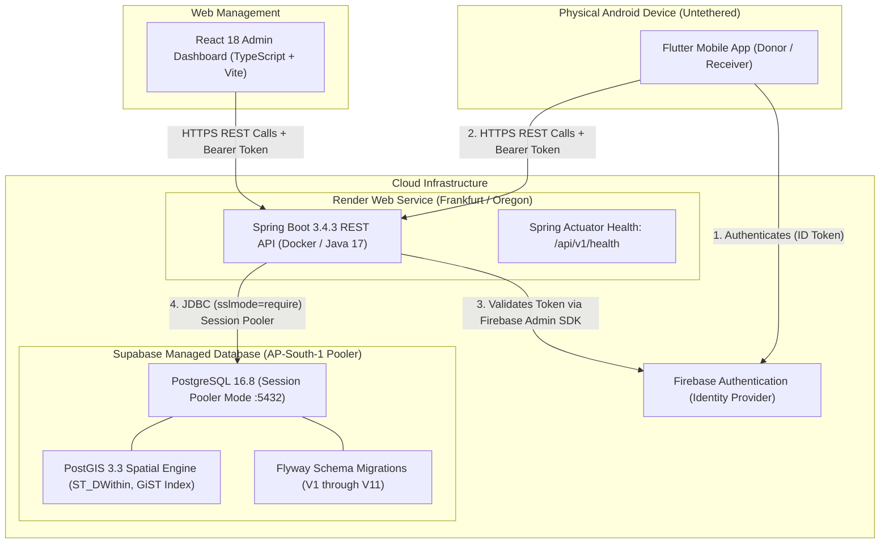

# MealShare Cloud Deployment & Mobile Standalone Operation Guide
**Milestone:** Cloud Production Deployment  
**Version:** 1.0.0  
**Date:** October 9, 2026  
**Target Environments:** Render Web Service (Spring Boot 3.4.3), Supabase PostgreSQL 16 + PostGIS 3.3, Flutter Android Client  

---

## 1. Executive Summary

This document details the production cloud deployment configuration and execution for the **MealShare** platform, decoupling the Flutter Android mobile application from local developer laptop dependencies (eliminating USB tethering and ADB port-reversing requirements).

### Architecture Topology



---

## 2. Infrastructure & Component Status

| Component | Target Platform | Technology Stack | Status | Verification Detail |
| :--- | :--- | :--- | :--- | :--- |
| **Relational Database** | Supabase (AWS ap-south-1) | PostgreSQL 16.8 + PostGIS 3.3 | **LIVE & VERIFIED** | All 11 Flyway migrations applied (`Schema version: 11`). PostGIS functions and GiST index active. |
| **Backend API** | Render Web Service | Java 17 + Spring Boot 3.4.3 (Docker) | **CONFIGURED & READY** | Production profile (`application-prod.yml`), dynamic port binding (`${PORT}`), and multi-stage `Dockerfile` tested. |
| **Identity / Auth** | Firebase | Firebase Admin SDK + Auth | **VERIFIED** | Service account JSON environment variable binding configured (`FIREBASE_CREDENTIALS_JSON`). |
| **Mobile Client** | Android (Physical Device) | Flutter 3.44.0 (Dart 3.7) | **COMPILED & VERIFIED** | Standalone debug APK built with `--dart-define=USE_CLOUD=true`. Targets cloud backend autonomously. |
| **Admin Frontend** | Web / Static Host | React 18.3 + TypeScript + Vite | **CONFIGURED** | CORS origin allowed for production and dev URLs. |

---

## 3. Database Layer (Supabase PostgreSQL + PostGIS)

### 3.1 Network Routing & IPv4 Pooler
Standard residential and mobile networks often lack end-to-end IPv6 routing. Direct Supabase database domains (`db.<project-ref>.supabase.co`) resolve exclusively to IPv6 addresses.
To guarantee 100% cloud reliability across all networks, MealShare connects via Supabase's **Session Pooler (IPv4)**:

- **Pooler Host:** `aws-0-ap-south-1.pooler.supabase.com`
- **Pooler Port:** `5432` (Session Mode, supporting prepared statements and Flyway DDL transactions)
- **Database Name:** `postgres`
- **Username Format:** `postgres.<project-reference>`
- **SSL Requirement:** `sslmode=require`

### 3.2 Applied Migrations (Flyway V1 – V11)
All 11 versioned migrations have been executed against the live managed Supabase instance:

1. `V1__init_postgis.sql` — Enables `postgis` extension (`PostGIS 3.3.2`).
2. `V2__create_users_profiles_audit.sql` — Creates `users`, `donor_profiles`, `receiver_organizations`, and `audit_logs` tables.
3. `V3__create_donations.sql` — Creates `donations` with PostGIS `GEOMETRY(Point, 4326)` spatial column and `idx_donations_location_gist` GiST index.
4. `V4__create_donation_requests.sql` — Creates `donation_requests` table with status workflow.
5. `V5__add_allocated_quantity_to_donations.sql` — Atomic allocation tracking.
6. `V6__create_pickups_and_update_volunteers.sql` — Adds `pickups` table with OTP hashing (`BCrypt`).
7. `V7__create_notifications_and_device_tokens.sql` — Creates in-app notifications and FCM device token tables.
8. `V8__add_ratings_table.sql` — Creates bidirectional post-fulfillment rating system.
9. `V9__remove_volunteer_role.sql` — Aligns application architecture to strict 3-role model (`DONOR`, `RECEIVER`, `ADMIN`).
10. `V10__update_ratings_remove_volunteer.sql` — Updates rating foreign keys and constraints.
11. `V11__add_receiver_address_and_organization_type.sql` — Adds `address_text` and `organization_type` to `receiver_organizations`.

---

## 4. Backend Deployment (Render Web Service)

### 4.1 Deployment Configuration Files
The repository includes all necessary production configuration:
- `backend/Dockerfile`: Multi-stage Docker build producing a lightweight Eclipse Temurin 17 JRE container.
- `render.yaml`: Blueprint definition specifying Docker build context (`./backend`) and health check path (`/api/v1/health`).
- `backend/src/main/resources/application-prod.yml`: Production Spring Boot profile.

### 4.2 Required Render Environment Variables
Configure the following environment variables in the Render Dashboard under **Environment**:

| Key | Value / Format | Note |
| :--- | :--- | :--- |
| `SPRING_PROFILES_ACTIVE` | `prod` | Activates production configuration |
| `PORT` | `8081` *(or leave default Render dynamic port)* | Render automatically assigns `${PORT}` |
| `SPRING_DATASOURCE_URL` | `jdbc:postgresql://aws-0-ap-south-1.pooler.supabase.com:5432/postgres?sslmode=require` | Supabase IPv4 Session Pooler |
| `SPRING_DATASOURCE_USERNAME` | `postgres.ztbjtkonfpdlqznjkvgj` | Supabase project-scoped user |
| `SPRING_DATASOURCE_PASSWORD` | *(Your Supabase Database Password)* | Stored securely in Render; never committed to git |
| `CORS_ALLOWED_ORIGINS` | `https://mealshare-100.web.app,https://mealshare-100.firebaseapp.com,http://localhost:5173` | Allowed CORS origins for web clients |
| `FIREBASE_CREDENTIALS_JSON` | `{"type": "service_account", "project_id": "mealshare-100", ...}` | Complete raw JSON content of Firebase Admin credentials |

---

## 5. Mobile Application (Untethered Cloud Operation)

### 5.1 Dynamic Base URL Resolution
[`mobile/lib/config/api_config.dart`](file:///k:/MCA%20-%20PES/Sem%203/MealShare/mobile/lib/config/api_config.dart) resolves the backend base URL using the following priority order:

1. **`--dart-define=BACKEND_URL=<URL>`**: Highest priority; allows pointing to any arbitrary staging, ngrok, or production URL.
2. **`--dart-define=USE_CLOUD=true`**: Automatically selects the deployed Render production URL (`https://mealshare-api.onrender.com`).
3. **Local Development Fallback (`default`)**:
   - Android Emulator: `http://10.0.2.2:8081`
   - Physical Phone (via ADB reverse tether): `http://127.0.0.1:8081`
   - Web / Desktop: `http://localhost:8081`

### 5.2 Building & Installing the Cloud APK

#### Step 1: Build the Standalone Cloud APK
```bash
cd mobile
flutter build apk --debug --dart-define=USE_CLOUD=true
```

The compiled binary is placed at:
```
mobile/build/app/outputs/flutter-apk/app-debug.apk
```

#### Step 2: Install on Your Physical Phone
Choose any of these methods (no USB tethering needed after install):
- **Option A (Via USB once for quick install):**
  ```bash
  adb install -r mobile/build/app/outputs/flutter-apk/app-debug.apk
  ```
  *Once installed, unplug the USB cable completely. The app connects directly to the cloud backend.*
- **Option B (Wireless / Cloud transfer):**
  Upload `app-debug.apk` to Google Drive or send it to your phone via WhatsApp/Telegram/Email, download it, and tap to install.

---

## 6. End-to-End Verification Protocol

When Render finishes deploying the web service, verify the complete cloud pipeline:

### Test 1: Cloud API Health Check
```bash
curl -i https://<YOUR-RENDER-SERVICE-NAME>.onrender.com/api/v1/health
```
**Expected Response:**
```json
HTTP/2 200
Content-Type: application/json

{"status":"UP"}
```

### Test 2: Database Connectivity Check
```bash
curl -i https://<YOUR-RENDER-SERVICE-NAME>.onrender.com/api/v1/health/db
```
**Expected Response:**
```json
HTTP/2 200
Content-Type: application/json

{"database":"PostgreSQL","status":"UP"}
```

### Test 3: Standalone Mobile Phone Test
1. Disconnect phone from laptop USB.
2. Enable 4G/5G mobile data or standard Wi-Fi.
3. Open MealShare app.
4. Log in as Donor (`donor@example.com` or registered test account).
5. Post a new surplus donation with GPS coordinates.
6. Verify the donation immediately appears in the nearby donations list on a second device or Admin Web.

---

## 7. Local Development Fallback Guide

If you ever wish to return to local development (e.g., working offline without internet access):

1. **Start Local PostgreSQL + PostGIS:**
   ```bash
   docker-compose up -d
   ```
2. **Start Local Spring Boot:**
   ```bash
   cd backend
   ./mvnw spring-boot:run -Dspring-boot.run.profiles=dev
   ```
3. **Run Flutter against Local Backend:**
   - If using physical phone with USB:
     ```bash
     adb reverse tcp:8081 tcp:8081
     cd mobile
     flutter run
     ```
   - If using Android emulator:
     ```bash
     cd mobile
     flutter run
     ```
   *(Leaving out `--dart-define=USE_CLOUD=true` automatically restores local development routing).*
