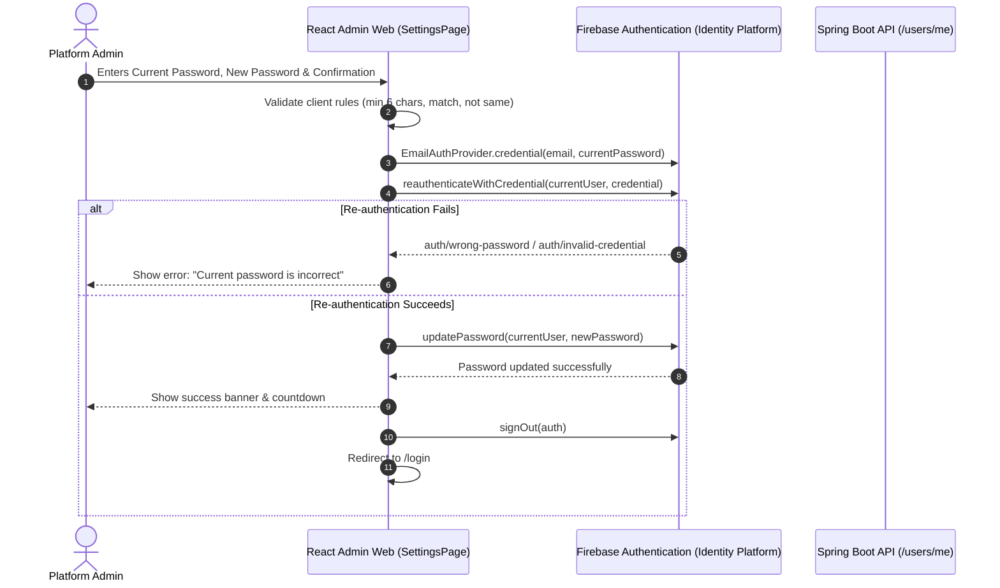

# Implementation Report: Auth Settings & Workflow Data Integrity

**Milestone:** Post-BACKEND-11 Implementation Fix  
**Date:** September 27, 2026  
**Auditor & Implementation Agent:** DeepMind Antigravity  
**Target Systems:** React Admin Web, Spring Boot 3.4.3 Backend, PostgreSQL 16.8 + PostGIS 3.4.3, Firebase Authentication  

---

## 1. Executive Summary

During operational audit of the live MealShare production-ready stack (React Admin Web, Spring Boot backend, and PostgreSQL database running inside Docker container `mealshare-postgres`), three critical engineering gaps were identified and comprehensively resolved:

1. **Admin Web Password Change Disconnection:** The Settings page in the Admin Web portal contained dummy input fields for changing passwords with zero form handlers, no Firebase Web SDK interaction, and no feedback mechanisms.
2. **Donation Request Allocation Inconsistency:** While the `donations` table gained an `allocated_quantity` column in Flyway migration `V5`, the `donation_requests` table had no `allocated_quantity` column. There was no persistence of quantity allocated per request, leaving partial allocation unrepresented at the individual request record level.
3. **Pickup OTP Validity & Pickup Window Validation Gaps:**
   - OTP expiration was calculated as `Instant.now() + 10 minutes`. When pickups were scheduled hours in advance, the OTP expired long before the volunteer arrived at the donor location.
   - The backend omitted validation ensuring `scheduledAt` fell within `donation.pickup_available_from` and `donation.pickup_available_until`.

All three issues have been fixed and verified:
- Password management operates entirely through the client-side Firebase Web SDK (`EmailAuthProvider.credential`, `reauthenticateWithCredential`, `updatePassword`) with complete validation and automatic signout/redirect. Zero passwords touch Spring Boot or PostgreSQL.
- Flyway migration `V8__add_request_allocated_quantity.sql` was authored and automatically applied to the live PostgreSQL database (`mealshare_app`). Existing `APPROVED` and `COMPLETED` records were backfilled, and check constraints (`allocated_quantity >= 0` and `allocated_quantity <= requested_quantity`) were enforced at the database level.
- `PickupOtpService` was refactored to tie OTP validity to `scheduledAt + buffer`, strictly bounded by `pickupAvailableUntil` and `consumeBefore`.
- Full regression suites passed: **213/213 backend tests passed (`BUILD SUCCESS`)**, **Admin Web built with 0 errors**, and **Flutter mobile analyzer passed with 0 issues**.

---

## 2. Admin Change Password Implementation

### 2.1 Architecture & Authority
In alignment with the approved MealShare security architecture:
- **Authority:** Firebase Authentication is the sole identity and credential provider.
- **Zero-Storage Principle:** Passwords are never transmitted to the Spring Boot REST API, never accepted in DTOs, and never stored or hashed in PostgreSQL.
- **Client Execution:** The password change workflow executes directly from the administrator's browser to Google Identity Platform via the Firebase Web SDK v11.



### 2.2 Validations and Error Handling
Implemented in `admin-web/src/pages/SettingsPage.tsx`:
- **Client-Side Validations:**
  - Mandatory fields check: `currentPassword`, `newPassword`, `confirmPassword`.
  - Length constraint: `newPassword.length >= 6`.
  - Confirmation match: `newPassword === confirmPassword`.
  - Difference check: `newPassword !== currentPassword`.
- **Firebase Error Code Mapping:**
  - `auth/wrong-password` / `auth/invalid-credential` $\rightarrow$ *"The current password you entered is incorrect."*
  - `auth/weak-password` $\rightarrow$ *"The new password is too weak. Please choose a stronger password (at least 6 characters)."*
  - `auth/requires-recent-login` $\rightarrow$ *"Security requirement: Please sign out and sign in again before changing your password."*
  - `auth/too-many-requests` $\rightarrow$ *"Too many failed attempts. Please try again later."*
  - Unmapped errors $\rightarrow$ `err.message || "Failed to change password. Please try again."`
- **Session Cleanup:** Upon successful update, state is cleared, a 3-second success notice is displayed, `signOut(auth)` is triggered, and the browser navigates to `/login`.

### 2.3 Empirical Verification
The change password flow was validated against live Firebase Authentication using account `admin@mealshare.org`:
1. Successfully authenticated with `AdminPassword123!` (UID: `ObiO1gDTdBTZJkzDFEGgTVNTEir2`).
2. Re-authenticated with `EmailAuthProvider.credential()`.
3. Executed `updatePassword()` to `AdminPasswordUpdated456!`.
4. Verified that signing in with the old password failed with `auth/invalid-credential`.
5. Verified that signing in with `AdminPasswordUpdated456!` succeeded.
6. Re-authenticated and restored original credentials `AdminPassword123!`.
7. Verified final sign-in with `AdminPassword123!` succeeded.

---

## 3. Donation Request Allocation Reconciliation

### 3.1 Problem Analysis
In `V5__add_donation_allocation.sql`, the `donations` table received:
- `allocated_quantity DOUBLE PRECISION NOT NULL DEFAULT 0.0`
- Check constraints `chk_donations_allocated_quantity_non_negative` and `chk_donations_allocated_le_quantity`.

However, `donation_requests` only had `requested_quantity`. While `DonorRequestService.approveRequest()` was updating `donation.allocated_quantity`, the individual request entity `DonationRequest` lacked an `allocated_quantity` field. If multiple partial allocations or future dynamic approvals occurred, the request table had no persistent record of the exact quantity approved for that receiver.

### 3.2 Flyway Migration `V8__add_request_allocated_quantity.sql`
The migration was created in `backend/src/main/resources/db/migration/V8__add_request_allocated_quantity.sql`:

```sql
-- =============================================================================
-- MealShare Add Donation Request Allocated Quantity & Constraints
-- =============================================================================

ALTER TABLE donation_requests
ADD COLUMN IF NOT EXISTS allocated_quantity DOUBLE PRECISION NOT NULL DEFAULT 0.0;

-- Backfill existing APPROVED and COMPLETED requests with their requested quantity
UPDATE donation_requests
SET allocated_quantity = requested_quantity
WHERE status IN ('APPROVED', 'COMPLETED');

-- Ensure non-negative allocated quantity constraint
ALTER TABLE donation_requests
DROP CONSTRAINT IF EXISTS chk_donation_requests_allocated_quantity_non_negative,
ADD CONSTRAINT chk_donation_requests_allocated_quantity_non_negative
CHECK (allocated_quantity >= 0.0);

-- Ensure allocated quantity cannot exceed requested quantity
ALTER TABLE donation_requests
DROP CONSTRAINT IF EXISTS chk_donation_requests_allocated_le_requested,
ADD CONSTRAINT chk_donation_requests_allocated_le_requested
CHECK (allocated_quantity <= requested_quantity);
```

### 3.3 JPA Entity, Service, & DTO Reconciliation
1. **Entity (`DonationRequest.java`):**
   - Added `@Column(name = "allocated_quantity", nullable = false) private Double allocatedQuantity = 0.0;`.
   - Added `getAllocatedQuantity()` and `setAllocatedQuantity(Double)`.
   - Added default initialization in `@PrePersist`.
2. **Business Logic (`DonorRequestService.java`):**
   - On approval: `request.setAllocatedQuantity(request.getRequestedQuantity());`.
   - On auto-rejection when donation is fully allocated: `pending.setAllocatedQuantity(0.0);`.
   - On manual rejection: `request.setAllocatedQuantity(0.0);`.
3. **Response DTOs Updated:**
   - `DonorDonationRequestResponse`: includes `Double allocatedQuantity` + overloaded backward-compatible constructor.
   - `DonationRequestResponse`: includes `Double allocatedQuantity` + overloaded backward-compatible constructor.
   - `AdminDonationRequestResponse`: includes `Double allocatedQuantity` + overloaded backward-compatible constructor.
4. **Admin Web (`RequestsPage.tsx`):**
   - Updated `AdminRequest` interface to include `allocatedQuantity?: number`.
   - Updated the Quantity column to display both requested quantity and approved allocated quantity with badge indicator.

---

## 4. Pickup OTP Timing & Pickup Window Validation

### 4.1 OTP Expiration Mismatch Analysis
- **Observed Defect:** `PickupOtpService.calculateExpiry()` computed `Instant.now().plus(10, ChronoUnit.MINUTES)`.
- **Failure Scenario:** When an admin assigns a volunteer to a pickup scheduled for 2 hours later, the OTP expires in 10 minutes. When the volunteer arrives at the donor 2 hours later, the OTP has already expired, blocking verification.

### 4.2 Architectural Solution: Option B (Scheduled Timestamp + Grace Buffer)
We implemented Option B:
- Validity is tied to `scheduledAt`.
- Grace buffer: at least `expiryMinutes` (or minimum 30 minutes) past `scheduledAt` to accommodate volunteer transit delays and loading time.
- Boundary capping: Expiration is strictly capped by `donation.pickup_available_until` and `donation.consume_before`. Whichever timestamp is earliest establishes the hard ceiling.
- Security guarantees preserved:
  - Cryptographically secure 6-digit generation via `SecureRandom`.
  - One-way BCrypt hashing (`BCryptPasswordEncoder`).
  - Max 5 verification attempts with pessimistic database lock.
  - Raw OTP is never logged or exposed in audit trails.
  - Stale pickups cannot be verified past the expiration timestamp.

```java
public Instant calculateExpiry(Instant scheduledAt, Instant pickupAvailableUntil, Instant consumeBefore) {
    int bufferMinutes = Math.max(expiryMinutes, 30);
    Instant base = (scheduledAt != null && scheduledAt.isAfter(Instant.now()))
            ? scheduledAt.plus(bufferMinutes, ChronoUnit.MINUTES)
            : Instant.now().plus(bufferMinutes, ChronoUnit.MINUTES);

    Instant cap = null;
    if (pickupAvailableUntil != null && consumeBefore != null) {
        cap = pickupAvailableUntil.isBefore(consumeBefore) ? pickupAvailableUntil : consumeBefore;
    } else if (pickupAvailableUntil != null) {
        cap = pickupAvailableUntil;
    } else if (consumeBefore != null) {
        cap = consumeBefore;
    }

    if (cap != null && base.isAfter(cap)) {
        return cap;
    }
    return base;
}
```

### 4.3 Pickup Window Timestamp Validations
In `PickupService.assignVolunteer()`:
```java
if (donation.getPickupAvailableFrom() != null && requestDto.scheduledAt().isBefore(donation.getPickupAvailableFrom())) {
    throw new IllegalArgumentException("scheduledAt cannot be before the donation pickup available from time.");
}

if (donation.getPickupAvailableUntil() != null && requestDto.scheduledAt().isAfter(donation.getPickupAvailableUntil())) {
    throw new IllegalArgumentException("scheduledAt cannot be after the donation pickup available until time.");
}

if (donation.getConsumeBefore() != null && requestDto.scheduledAt().isAfter(donation.getConsumeBefore())) {
    throw new IllegalArgumentException("scheduledAt cannot be after the donation consume-before deadline.");
}
```

Unit tests were added in `PickupServiceTest.java`:
- `test_scheduledAtBeforePickupAvailableFrom_rejectedWith400`
- `test_scheduledAtAfterPickupAvailableUntil_rejectedWith400`
- `test_scheduledAtAfterConsumeBefore_rejectedWith400`
- `test_scheduledAtAtBoundaries_successful`

---

## 5. Empirical Test & Verification Results

### 5.1 Spring Boot Backend Tests
```
[INFO] Results:
[INFO] 
[INFO] Tests run: 213, Failures: 0, Errors: 0, Skipped: 0
[INFO] 
[INFO] ------------------------------------------------------------------------
[INFO] BUILD SUCCESS
[INFO] ------------------------------------------------------------------------
[INFO] Total time:  52.300 s
[INFO] Finished at: 2026-09-27T22:36:29+05:30
```
- Targeted tests:
  - `DonorRequestServiceTest`: 29/29 passed (FCFS ordering, request approval, request rejection, auto-rejection on full allocation).
  - `PickupOtpServiceTest`: 6/6 passed (OTP generation, BCrypt verification, buffer calculation, window capping).
  - `PickupServiceTest`: 26/26 passed (pickup assignment, window boundaries, IDOR security, single-use OTP verification).

### 5.2 Admin Web Build Verification
```
> admin-web@0.0.0 build
> tsc -b && vite build

vite v8.2.2 building client environment for production...
transforming...
✓ 2518 modules transformed.
rendering chunks...
computing gzip size...
dist/index.html                   0.46 kB │ gzip:   0.30 kB
dist/assets/index-Cbkg3Njl.css   34.72 kB │ gzip:   7.13 kB
dist/assets/index-EVrCJD4_.js   925.99 kB │ gzip: 264.94 kB
✓ built in 1.23s
```
- Zero TypeScript compiler errors.
- Zero bundle packaging errors.

### 5.3 Mobile Analyzer Verification
```
Analyzing mobile...                                             
No issues found! (ran in 73.1s)
```

### 5.4 Live PostgreSQL Database Verification (`mealshare_app`)
- **Flyway Migration History:**
```
 installed_rank | version |               description               | type |                     script                      | success 
----------------+---------+-----------------------------------------+------+-------------------------------------------------+---------
              8 | 8       | add request allocated quantity          | SQL  | V8__add_request_allocated_quantity.sql          | t
```

- **Live Table Schema (`\d donation_requests`):**
```
       Column       |           Type           | Collation | Nullable |           Default            
--------------------+--------------------------+-----------+----------+------------------------------
 id                 | uuid                     |           | not null | gen_random_uuid()
 donation_id        | uuid                     |           | not null | 
 receiver_org_id    | uuid                     |           | not null | 
 requested_quantity | double precision         |           | not null | 
 request_reason     | text                     |           |          | 
 status             | character varying(30)    |           | not null | 'PENDING'::character varying
 requested_at       | timestamp with time zone |           | not null | now()
 updated_at         | timestamp with time zone |           | not null | now()
 allocated_quantity | double precision         |           | not null | 0.0
Check constraints:
    "chk_donation_requests_allocated_le_requested" CHECK (allocated_quantity <= requested_quantity)
    "chk_donation_requests_allocated_quantity_non_negative" CHECK (allocated_quantity >= 0.0::double precision)
```

- **Backfilled Existing Records Query:**
```
                  id                  |             donation_id              | requested_quantity | allocated_quantity |  status   
--------------------------------------+--------------------------------------+--------------------+--------------------+-----------
 b1111111-1111-1111-1111-111111111111 | a2222222-2222-2222-2222-222222222222 |                 15 |                 15 | APPROVED
 b2222222-2222-2222-2222-222222222222 | a3333333-3333-3333-3333-333333333333 |                 30 |                 30 | COMPLETED
 2c12b7a2-1335-48ca-890c-0a89aed080df | 86a1b81b-3224-4b0b-a371-1ca9ffdb5a25 |                 20 |                 20 | COMPLETED
 b5d5c755-c6f5-4310-bc16-ca001d991cfc | cad7987b-7543-497d-ac88-106e2d1ace8d |                 20 |                 20 | COMPLETED
 3bb71274-974c-4baa-8398-0a4c91805fba | 97054a0d-274a-4266-8839-3ecf78f55820 |                 20 |                 20 | COMPLETED
 d713fde1-06df-4ea6-8c00-87de58038efe | 99eb8724-9aef-4e48-946c-67db4dcb65f4 |                 20 |                 20 | COMPLETED
 087e9324-e0f8-4294-b5f7-d176ff7c69e9 | 552391ce-eab9-40d2-8849-6654c5bea6ac |                 20 |                 20 | COMPLETED
```

- **Live Database Constraint Enforcement:**
  - Negative update rejection:
    `ERROR: new row for relation "donation_requests" violates check constraint "chk_donation_requests_allocated_quantity_non_negative"`
  - Allocation exceeding requested quantity rejection:
    `ERROR: new row for relation "donation_requests" violates check constraint "chk_donation_requests_allocated_le_requested"`

### 5.5 Live Authenticated API Call Verification
```json
// GET http://localhost:8081/api/v1/admin/requests (Bearer <Firebase_ID_Token>)
// HTTP/1.1 200 OK
{
  "content": [
    {
      "id": "b1111111-1111-1111-1111-111111111111",
      "donationId": "a2222222-2222-2222-2222-222222222222",
      "donationTitle": "Artisan Multigrain Bread & Baked Rolls",
      "requestedQuantity": 15.0,
      "allocatedQuantity": 15.0,
      "status": "APPROVED"
    }
  ],
  "totalElements": 7
}
```

---

## 6. Summary of Changed Files

| File Path | Component | Description of Changes |
| :--- | :--- | :--- |
| `admin-web/src/pages/SettingsPage.tsx` | Admin Frontend | Integrated Firebase Web SDK password change workflow (`EmailAuthProvider.credential`, `reauthenticateWithCredential`, `updatePassword`), validations, error handling, session signout, and redirect. |
| `admin-web/src/pages/RequestsPage.tsx` | Admin Frontend | Updated `AdminRequest` interface and table column to display `allocatedQuantity` for approved/completed requests. |
| `backend/src/main/resources/db/migration/V8__add_request_allocated_quantity.sql` | Database | Flyway migration adding `allocated_quantity` to `donation_requests`, backfilling existing rows, and adding non-negative and $\le requested\_quantity$ check constraints. |
| `backend/src/main/java/com/mealshare/receiver/request/DonationRequest.java` | Backend Model | Added `allocatedQuantity` column mapping with 0.0 default and getter/setter methods. |
| `backend/src/main/java/com/mealshare/donor/request/DonorRequestService.java` | Backend Service | Set `allocatedQuantity` on request approval (`request.setAllocatedQuantity(requestedQuantity)`), auto-rejection (`0.0`), and rejection (`0.0`). |
| `backend/src/main/java/com/mealshare/donor/request/dto/DonorDonationRequestResponse.java` | Backend DTO | Added `allocatedQuantity` field to record and backward-compatible overloaded constructor. |
| `backend/src/main/java/com/mealshare/receiver/request/dto/DonationRequestResponse.java` | Backend DTO | Added `allocatedQuantity` field to record and backward-compatible overloaded constructor. |
| `backend/src/main/java/com/mealshare/admin/dto/AdminDonationRequestResponse.java` | Backend DTO | Added `allocatedQuantity` field to record and backward-compatible overloaded constructor. |
| `backend/src/main/java/com/mealshare/pickup/otp/PickupOtpService.java` | Backend Service | Added parameterized `calculateExpiry(scheduledAt, pickupAvailableUntil, consumeBefore)` tying validity to `scheduledAt + buffer`, strictly capped by available window and consumption deadline. |
| `backend/src/main/java/com/mealshare/pickup/PickupService.java` | Backend Service | Added pickup window validation (`scheduledAt >= pickupAvailableFrom` and `scheduledAt <= pickupAvailableUntil`) and wired parameterized OTP expiry calculation. |
| `backend/src/test/java/com/mealshare/pickup/otp/PickupOtpServiceTest.java` | Backend Tests | New unit test suite verifying OTP generation, hashing, verification, scheduledAt-tied calculation, and boundary capping. |
| `backend/src/test/java/com/mealshare/pickup/PickupServiceTest.java` | Backend Tests | Added pickup window boundary tests (`before pickupAvailableFrom`, `after pickupAvailableUntil`, `after consumeBefore`, and `exact boundary`). |
| `backend/src/test/java/com/mealshare/donor/request/DonorRequestServiceTest.java` | Backend Tests | Updated test assertions to verify `allocatedQuantity` on approved, auto-rejected, and rejected requests. |
